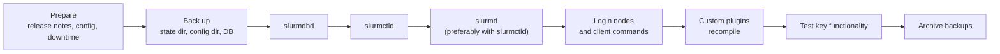

# Upgrading Slurm: The Order, the Window, and the Parts That Bite

<!-- related-block -->
<div class="reading-time">12 min read</div>
<!-- related-block -->
<div class="related-strip">

**See also:** [Dying Politely: Preemption, Requeue and the Signals Your Training Job Ignores](/fields/schedulers/slurm-preemption-requeue-signals.md), [pam_slurm_adopt: Closing the Slurm SSH Backdoor](/fields/schedulers/slurm-pam-adopt-ssh-access.md), [Rebooting a Slurm Cluster Without Losing Your Job (Or Anyone Else's)](/fields/schedulers/slurm-reboot-order.md), [Slurm Multi-Tenancy: Who Stores the Rules, Who Enforces Them](/fields/schedulers/slurm-accounting-multi-tenancy.md)

</div>


> **Part of the [schedulers](https://github.com/AhmedYousriSobhi/aCupOfTea/blob/main/fields/schedulers/slurm-intro.md) directory.** The [reboot-order page](https://github.com/AhmedYousriSobhi/aCupOfTea/blob/main/fields/schedulers/slurm-reboot-order.md) covers patching the OS underneath Slurm and says plainly that it assumes you are *not* upgrading Slurm itself. This is the other half. Everything here comes from SchedMD's Upgrade Guide and is not tested on a live cluster; read the guide for your exact target version before a real maintenance window.

## Table of Contents

- [Upgrading Slurm: The Order, the Window, and the Parts That Bite](#upgrading-slurm-the-order-the-window-and-the-parts-that-bite)
  - [Table of Contents](#table-of-contents)
  - [The upgrade that fails on startup](#the-upgrade-that-fails-on-startup)
  - [The compatibility window](#the-compatibility-window)
  - [The order, and why it is the order](#the-order-and-why-it-is-the-order)
  - [Backups: three things, not one](#backups-three-things-not-one)
  - [Stage 1: slurmdbd, the slow one](#stage-1-slurmdbd-the-slow-one)
  - [Stage 2: slurmctld, with the timeouts raised](#stage-2-slurmctld-with-the-timeouts-raised)
  - [Stage 3: slurmd, and the old stepds](#stage-3-slurmd-and-the-old-stepds)
  - [Stage 4: everything that links against Slurm](#stage-4-everything-that-links-against-slurm)
  - [Packaging traps](#packaging-traps)
  - [There is no undo](#there-is-no-undo)
  - [Pre-flight checklist](#pre-flight-checklist)
  - [References](#references)

* * *

## The upgrade that fails on startup

Imagine a cluster that has run happily on Slurm 22.05 for years. Someone decides to jump straight to 25.05 over a long weekend, installs the new packages everywhere and starts the daemons.

The daemons refuse. SchedMD's guide is blunt about this: upgrades from incompatible versions fail immediately on startup. It adds a harsher sentence for the careless case. The compatibility requirements apply to running jobs too, so going outside the window kills them and loses their accounting.

That is the good outcome, the one where the software stops you. The rest of this page is about the ways to get hurt even inside the rules.

* * *

## The compatibility window

Slurm releases twice a year now. The version number is the release month: 25.05 is May 2025 and 25.11 is November 2025. Releases moved to this six-month cycle with 24.05, and each one gets roughly 18 months of support.

How far back an upgrade may reach has changed, and plenty of older write-ups still carry the old rule:

- **Up to 24.05:** you could upgrade from the previous **two** major releases.
- **From 24.11 on:** you can upgrade from the previous **three**, to keep a similar support duration with the faster cycle.

The guide's table of compatible prior versions:

| Release | Can be upgraded from |
|---|---|
| 23.02 | 22.05, 21.08 |
| 23.11 | 23.02, 22.05 |
| 24.05 | 23.11, 23.02 |
| 24.11 | 24.05, 23.11, 23.02 |
| 25.05 | 24.11, 24.05, 23.11 |
| 25.11 | 25.05, 24.11, 24.05 |

The copy of the guide I read stops at 25.11. The rest of this repo cites the 26.05 docs, so check the live table for your target before planning.

When your starting point is outside the window, you go in steps, and each step must land on a version compatible with where you are. A worked example using the table above, from 22.05 to 25.05:

```
22.05  ->  23.11   (23.11 accepts 23.02 and 22.05: allowed)
23.11  ->  25.05   (25.05 accepts 24.11, 24.05, 23.11: allowed)
```

Two hops, with a real validation between them. SchedMD recommends exactly this: upgrade everything to the intermediate version, verify it works, then continue. Skipping the verification defeats the purpose, since each hop is only supported if it starts from a healthy cluster.

* * *

## The order, and why it is the order



The rule underneath it: **`slurmdbd` must be at the same or a higher major release than `slurmctld`**, and close enough to be within the window. That forces the database daemon to go first. If you run a backup `slurmdbd` host, upgrade it at the same time as the primary.

Everything below the database follows the same dependency logic as the [reboot order](https://github.com/AhmedYousriSobhi/aCupOfTea/blob/main/fields/schedulers/slurm-reboot-order.md): the thing others talk to goes first, the things that talk to it follow.

* * *

## Backups: three things, not one

The reboot page backs up the SQL database, and that is the right instinct for a reboot. An upgrade needs more, because the daemons rewrite their own state files on first start. SchedMD's minimum:

| What | How to find it | Why |
|---|---|---|
| `StateSaveLocation` | `scontrol show config \| grep StateSaveLocation` | Controller state: jobs, nodes, reservations |
| The Slurm config directory | Usually `/etc/slurm/` | Every `.conf` file, including `gres.conf` and `cgroup.conf` |
| The accounting database | `mysqldump --databases slurm_acct_db > backup.sql` | Associations, limits, QOS, job history |

A note on the dump. The guide prefers taking it after `slurmdbd` is shut down, when nothing is writing. You can use `--single-transaction` to dump a live database, but the guide lists the catches: it can slow the database, the restore only has the state from when the dump began, and the dump may be incorrect or fail if certain operations overlap, such as upgrading the database, adding or removing a cluster, or archiving and purging accounting data.

> [!TIP]
> If you are about to upgrade, purge accounting records you no longer need first. SchedMD notes that a large database means a longer dump and a long, unresponsive schema update, so trimming it before the window can shorten the outage noticeably.

* * *

## Stage 1: slurmdbd, the slow one

`slurmdbd` is the stage most likely to turn a short window into a long one. On a big accounting database, the upgraded daemon can be unresponsive for tens of minutes while it converts the schema.

The guide's procedure, condensed:

1. Stop `slurmdbd` gracefully (`sacctmgr shutdown` or `systemctl stop slurmdbd`) and **wait until it is fully down**. Stopping too early risks losing data that was not yet saved.
2. Back up the database.
3. Check that `innodb_buffer_pool_size` in `my.cnf` is larger than the default (the accounting page in the Slurm docs has the recommendation).
4. Upgrade the packages **on the slurmdbd host only**.
5. Start it, and here is the part that surprises people: **the first start after an upgrade should be run by hand as the Slurm user**, not through systemd.

```bash
sudo -u slurm slurmdbd -D     # foreground; Ctrl+C when it finishes converting
```

The reason is a timeout. If you start the daemon with systemd and the conversion outlasts the unit's start timeout, systemd kills the daemon halfway through a database update, which can cause data loss. After the foreground run completes, exit and start it normally.

6. Start the backup `slurmdbd` if you have one.
7. Check that `sacct` and `sacctmgr` return data.

**What the rest of the cluster does meanwhile.** Scheduling continues. `slurmctld` queues accounting messages in its DBD Agent queue. While `slurmdbd` is down, `sacct`, `sacctmgr` and any `slurmrestd` paths containing `slurmdb` fail. Watch `slurmctld` memory and the agent queue size in `sdiag`, because the guide says the queue must not exceed the configured `MaxDBDMsgs`, and a long outage puts accounting records at risk. This is the same cache-while-down behavior described in the [multi-tenancy page](https://github.com/AhmedYousriSobhi/aCupOfTea/blob/main/fields/schedulers/slurm-accounting-multi-tenancy.md#when-slurmdbd-goes-down), now with a deadline attached.

> [!NOTE]
> If you are also moving the accounting database to MariaDB 10.2.1 or later from an older MariaDB or from MySQL, the guide says to be on `slurmdbd` 22.05.7 or newer first, because those versions handle the changed MariaDB defaults.

* * *

## Stage 2: slurmctld, with the timeouts raised

The controller goes down briefly. Job submissions are refused, queued jobs are not scheduled, and information about completing jobs waits. All of it resumes when the new controller starts.

SchedMD prefers upgrading `slurmctld`, `slurmd` and the client commands together, because the effects of downtime on controller and node daemons are largely the same, so doing them together minimizes the total duration. Rolling upgrades are possible if the controller goes first.

The step that people skip is the first one:

1. **Raise `SlurmdTimeout` and `SlurmctldTimeout`**, then run `scontrol reconfig`. Make the new values long enough to cover your whole upgrade method. If the timeout is reached while daemons are down, nodes may be marked DOWN and their jobs killed.
2. Stop `slurmctld` (all of them, if you run more than one).
3. Optionally stop `slurmd` on the compute nodes too.
4. **Back up `StateSaveLocation`.**
5. Upgrade the packages.
6. Start `slurmd` again if you stopped it, then start `slurmctld`.
7. Check node communication and that a job can start and finish.
8. **Put the timeouts back** and run `scontrol reconfig` again.

Step 8 is the one that gets forgotten. A cluster left with a very long `SlurmdTimeout` will take far longer than intended to notice a node that has genuinely died.

* * *

## Stage 3: slurmd, and the old stepds

Running jobs survive a `slurmd` upgrade as long as `SlurmdTimeout` is not reached. While a node's `slurmd` is down, new jobs do not start on it, and finishing jobs wait to report back until it returns. SchedMD recommends upgrading all nodes with the controller, but a rolling upgrade in groups is allowed, and the guidance is to keep the time spent running mixed versions short.

The point most guides skip is easy to state: **a job started before a node was upgraded keeps running with the old `slurmstepd`.** The upgrade guide says to wait for all jobs that were already running to finish before you consider the upgrade complete, because starting another upgrade, or relying on a new feature, while old stepds are still alive may cause problems.

On a cluster with multi-day training jobs, that means "upgraded" is a state that arrives gradually. The practical consequences:

- Do not schedule the *next* hop of a multi-step upgrade until the old jobs have drained.
- Do not announce a new feature to users the moment the daemons restart.
- This is one more reason to use the [`MAINT` reservation approach](https://github.com/AhmedYousriSobhi/aCupOfTea/blob/main/fields/schedulers/slurm-reboot-order.md#phase-0--scheduling) from the reboot page: an empty cluster has no old stepds.

* * *

## Stage 4: everything that links against Slurm

**Client commands and login nodes** need no special handling except where the release notes say so. Upgrade them after the core daemons.

**JSON and YAML output.** If you or your tools use `--json` or `--yaml` with Slurm commands, or run `slurmrestd`, the output format is produced by versioned `data_parser` plugins, and the default is the newest one, which may not match the previous format. Old plugins are removed on a schedule (the guide lists each release and the one that drops it). Pin the version in anything that parses the output:

```bash
sinfo --json=v0.0.41 | my_site_script       # explicit data_parser
sinfo --json=v0.0.41+spec_only > /tmp/v41.json   # compare formats before upgrading
```

`slurmrestd` clients show the plugin in the URL path, for example `/slurm/v0.0.40/jobs`, and that path keeps working until the plugin is removed. Regenerate and retest any generated OpenAPI clients before the upgrade.

**Locally built plugins and applications.** `libslurm.so` gets a new version number with every major release, so anything linked against it must be recompiled, and locally written plugins usually need code changes as well. A quick check:

```bash
ldd /path/to/binary | grep slurm     # a versioned libslurm.so.x.y.z means: recompile
```

MPI stacks are mostly spared, because OpenMPI and MVAPICH2 link against Slurm's PMI-1 and PMI-2 libraries, which are meant to stay fixed. The documented exception is MPICH built with Slurm support and the Hydra process manager, which uses the Slurm API and needs a rebuild.

* * *

## Packaging traps

Three that have nothing to do with Slurm itself:

- **EPEL.** A Slurm package exists in EPEL that SchedMD does not provide or support, and a routine system update can pull it in and change your version outside a maintenance window. The guide recommends adding `exclude=slurm*` to the `[epel]` section of the repo file.
- **Daemons sharing a host.** Slurm daemons on one machine may have to be upgraded together because of their dependencies on the common `slurm` package. Start them in the usual order afterwards. SchedMD says outright that this layout is not recommended for production and advises one core daemon per system.
- **Distribution packages.** Some distro packaging couples `slurmdbd` and `slurmctld` so tightly that you cannot upgrade them one at a time the way the guide describes. If that is your situation, plan around it before the window opens, not during it.

For sites that build their own Slurm, the guide describes "seamless upgrades": install each version into its own directory and point a symlink in `PATH` at the active one. That lets you stage the new version ahead of the window and switch back with one command, and it avoids library conflicts from mixing versions in one directory.

* * *

## There is no undo

Reverting an upgrade is **not supported** once any Slurm daemon has been started. On first start the daemons rewrite their state files and databases into the new format. An older daemon will not recognize them, which can mean lost or corrupted state and accounting, and the old daemon will likely refuse to start.

The only way back is restoring from backups: `StateSaveLocation` and the accounting database, plus the config directory. That brings back the old state and also erases everything that happened after the backup was taken, including jobs submitted and finished in between.

Two softer notes from the guide:

- **Minor releases** (the `.4` in 23.11.4) follow the same procedure, but it is faster and more forgiving of mixed versions and in-place downgrades. Keep current backups anyway.
- **Pre-release versions** (release candidates, the master branch) can crash, change behavior and lose state. Run them on test machines, not production.

* * *

## Pre-flight checklist

- [ ] Read `RELEASE_NOTES` for the target and every release in between; look for removed or changed options.
- [ ] Prepare and test config changes on a test system first.
- [ ] Confirm the hop is inside the compatibility window, or plan the intermediate step.
- [ ] Check `--json`/`--yaml` users and `slurmrestd` clients; pin `data_parser` versions.
- [ ] Plan for recompiling `libslurm`-linked software and any custom plugins.
- [ ] Purge old accounting records if the database is large.
- [ ] Back up `StateSaveLocation`, the config directory and the database.
- [ ] Verify `innodb_buffer_pool_size` is above the default.
- [ ] Raise `SlurmdTimeout` and `SlurmctldTimeout` and plan to restore them.
- [ ] Tell users the expected downtime; avoid scheduling it outside vendor support hours.
- [ ] Have a hidden test partition and a small test job ready, as in the reboot checklist.
- [ ] Upgrade in order: `slurmdbd` (hand-started first run), `slurmctld`, `slurmd`, clients, plugins.
- [ ] Do not call it finished until pre-upgrade jobs have drained.

* * *

## References

- [Slurm: Upgrade Guide](https://slurm.schedmd.com/upgrades.html)
- [Slurm: Accounting and Resource Limits](https://slurm.schedmd.com/accounting.html) (the `innodb_buffer_pool_size` recommendation)
- [slurm-users: upgrading slurmdbd and daemon packaging, March 2025](https://lists.schedmd.com/mailman3/hyperkitty/list/slurm-users@lists.schedmd.com/message/OIAK6PNQHSQJRVLIBTUSVYVUDWTYPLC5/)