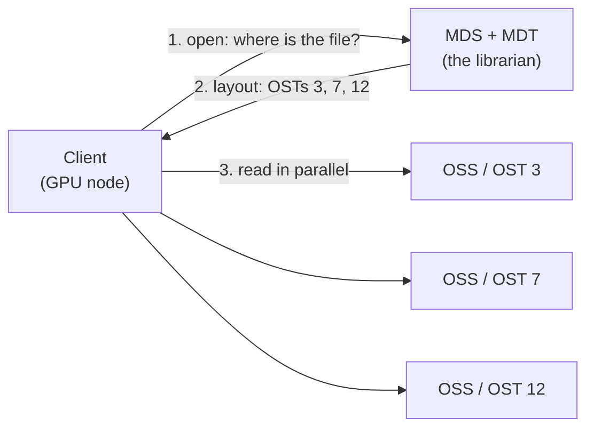

# Parallel Filesystems: Why 10,000 GPUs Can Starve on a Full Disk

> **Part 1 of the [Storage and Fabric for AI Clusters series](/fields/system-administration/ai-storage-and-fabric/README.md).** A GPU that's waiting for data is the most expensive idle hardware in your building. This page explains how parallel filesystems like Lustre keep thousands of GPUs fed, the two workloads that break them (small files and checkpoints), and what to do about each. By the end you'll be able to diagnose a data-starved training job and explain the fix.

## Table of Contents
- [Parallel Filesystems: Why 10,000 GPUs Can Starve on a Full Disk](#parallel-filesystems-why-10000-gpus-can-starve-on-a-full-disk)
  - [Table of Contents](#table-of-contents)
  - [The training run with a heartbeat](#the-training-run-with-a-heartbeat)
  - [Why a normal file server can't do this](#why-a-normal-file-server-cant-do-this)
  - [Lustre in one picture: the librarian and the shelves](#lustre-in-one-picture-the-librarian-and-the-shelves)
  - [Striping: one file, many servers](#striping-one-file-many-servers)
  - [Try it before you scroll](#try-it-before-you-scroll)
  - [The small-file trap](#the-small-file-trap)
  - [The checkpoint storm](#the-checkpoint-storm)
  - [Lustre, GPFS, or something else?](#lustre-gpfs-or-something-else)
  - [Symptom, cause, fix](#symptom-cause-fix)
    - [References](#references)

---

## The training run with a heartbeat

A team trains an image model on 512 GPUs. The GPU utilization graph has a heartbeat: long stretches near 100%, then a sharp dip to 30% at the start of every epoch, and smaller dips every few minutes in between.

The model is fine. The GPUs are fine. The network is fine. The dataset is 40 million JPEG files in one directory tree, and every epoch begins with 512 GPUs' worth of data loaders asking the filesystem to open millions of tiny files at once.

The storage system has petabytes free and hundreds of gigabytes per second of bandwidth. It's starving the GPUs anyway, because the bottleneck isn't **bytes**. It's **opens**.

To see why, you need to know how a parallel filesystem is built.

---

## Why a normal file server can't do this

A single NFS server is one machine with one set of disks and one network link. Every client goes through it. Ten clients are fine. Ten thousand GPUs reading training data are not: the server's network port and CPU become the ceiling for the whole cluster.

A **parallel filesystem** spreads one shared namespace (one `/data`, visible identically everywhere) across many servers, so clients read from many servers at once. Total bandwidth grows as you add servers. The two classic examples in HPC are **Lustre** and **IBM Storage Scale** (formerly Spectrum Scale, originally GPFS).

---

## Lustre in one picture: the librarian and the shelves

Lustre's design splits the filesystem in two, and the split explains almost everything about its behavior.

| Component | Role | Stores |
|-----------|------|--------|
| **MGS** (management server) | Holds configuration for one or more filesystems | Its config, on an MGT |
| **MDS** (metadata server) | Manages the namespace: names, directories, permissions, where each file's data lives | Metadata, on **MDTs** |
| **OSS** (object storage server) | Serves file contents | Data objects, on **OSTs** |
| **Clients** | Mount the filesystem with a normal POSIX interface | Nothing |

The key behavior, from the Lustre project's architecture guide: **metadata operations go to the MDS, data operations go directly to the OSSs. The MDS is never in the data path for reads and writes.** That's what makes Lustre scale.

Think of a library. The **MDS is the librarian** with the catalog: "where is `train/000123.jpg`, and may I read it?" The **OSSs are the shelves**. Once the librarian tells you which shelves hold your book, you walk to the shelves yourself, and thousands of readers can do that in parallel without queuing at the desk.



Two operational facts from the same guide worth knowing: Lustre supports up to 256 MDTs, and if the MGS is down, running filesystems keep working, but new mounts and configuration changes fail.

Hold onto the library picture. It tells you which workloads Lustre loves (big files: one trip to the librarian, then lots of shelf reading) and which it hates (tiny files: a trip to the librarian for every few kilobytes).

---

## Striping: one file, many servers

Lustre can split one file across several OSTs. That's **striping**, controlled by two settings:

| Setting | Meaning | Default (per the Lustre architecture guide) |
|---------|---------|---------------------------------------------|
| `stripe_count` | How many OSTs the file is spread across | 1 (the whole file on one OST) |
| `stripe_size` | How big each chunk is before moving to the next OST | 4 MiB |

With `stripe_count=1`, a file lives on one OST, so one OSS's bandwidth caps how fast anyone can read it. With a wider stripe, many clients reading different parts of one big file hit different servers at once.

The rule of thumb: **stripe big shared files wide; leave small files at 1.** A 2 TB dataset shard read by hundreds of nodes wants many OSTs. A 100 KB file gains nothing from striping, and every extra stripe is extra bookkeeping.

You set striping per directory, so new files inherit it:

```bash
lfs setstripe -c 8 -S 4M /lustre/project/shards   # new files: 8 OSTs, 4 MiB chunks
lfs getstripe /lustre/project/shards/shard-0001.tar
```

(Standard `lfs` commands from the Lustre documentation; not run for this page.)

---

## Try it before you scroll

☕ Two datasets, the same 10 TB of images:

- **A:** 50 million individual JPEG files of about 200 KB.
- **B:** 5,000 archive files ("shards") of about 2 GB, each containing 10,000 images.

Same bytes. Which one starves 512 GPUs, and why?

**A.** Every image is a separate open, permission check and layout lookup at the MDS: 50 million trips to the librarian per epoch. **B** needs 5,000 trips, then long sequential reads straight from the OSSs, which is exactly what Lustre is built for.

---

## The small-file trap

That puzzle is the most common cause of data-starved GPUs. The bandwidth number on the storage system's spec sheet is about **bytes**; small files are limited by **metadata operations**, a completely different resource, and usually the scarcer one.

Fixes, roughly from most to least effective:

| Fix | How it helps |
|-----|-------------|
| **Pack samples into large shards** (tar-based or record formats, a few hundred MB to a few GB each) | Turns millions of metadata operations into thousands, and random reads into sequential ones |
| **Stage data to local NVMe** on each node before or during training | Each epoch after the first reads from local disk, not the shared filesystem |
| **Spread metadata load** (multiple MDTs, directories distributed across them) | More librarians; helps but doesn't remove the per-file cost |
| **Raise data-loader parallelism and prefetching** | Hides latency, but multiplies the load on a struggling MDS if files are tiny |

The opinionated default: **shard first.** It's a one-time data preparation step that fixes the problem at its source, and it works on every filesystem, not just Lustre.

---

## The checkpoint storm

Reading data is a steady stream. **Writing checkpoints** is a flash flood.

Every so often, a training job saves its full state so a failure doesn't cost days. For a large run, every GPU writes its share at the same moment. Meta's Llama 3 paper describes exactly this: its storage system offered 240 PB across 7,500 SSD servers, with 2 TB/s of sustainable throughput and 7 TB/s peak, and **a major challenge was highly bursty checkpoint writes that saturated the storage fabric for short durations.** Each GPU's saved state ranged from 1 MB to 4 GB.

Why checkpoints matter so much: while a synchronous job checkpoints, training typically pauses. And at scale, failures are frequent: the same paper reports 419 unexpected interruptions in 54 days ([see the GPU failure series](/fields/system-administration/gpu-failure-prediction/what-fails-and-what-warns.md#why-one-gpu-stops-a-thousand)). Checkpoint too rarely and each failure costs hours. Checkpoint too often and the storms eat your training time.

So the **peak** your storage must survive is usually set by checkpoints, not by dataset reads. Size for the storm, not the stream. Common mitigations: write checkpoints asynchronously (copy to host memory, keep training, flush in the background), stagger writes, and write to a fast tier first.

---

## Lustre, GPFS, or something else?

The common advice is "use Lustre or GPFS." Those are proven choices for HPC-style AI clusters, especially with InfiniBand. But it's worth knowing the real options:

| Option | Strengths | Watch out for |
|--------|-----------|---------------|
| **Lustre** | Open source, very high aggregate bandwidth, widely used in large HPC systems | Metadata limits with small files; needs expertise to run |
| **IBM Storage Scale (GPFS)** | Mature, enterprise support, flexible metadata handling | Commercial licensing |
| **Other distributed or object storage** with caching | Scales capacity cheaply; cloud-native | Not POSIX by default; needs a fast cache tier for training reads |

Meta's Llama 3 training didn't use either of the classic two: the paper describes **Tectonic**, Meta's own distributed filesystem. The underlying principle is the same everywhere: **separate metadata from data, spread data across many servers, and connect it over a fast fabric.** That fabric is [part 2](/fields/system-administration/ai-storage-and-fabric/rdma-infiniband-gpudirect.md).

---

## Symptom, cause, fix

| Symptom | Likely cause | Fix |
|---------|--------------|-----|
| GPU utilization dips at each epoch start | Data loaders opening millions of small files | Shard the dataset; stage to local NVMe |
| Steady low GPU utilization, storage bandwidth far from its limit | Metadata-bound (opens and stats), or too few loader workers | Shard; check MDS load before adding workers |
| Throughput capped near one server's bandwidth | Big files with `stripe_count=1` | Stripe large shared files across more OSTs |
| Training stalls for minutes at regular intervals | Synchronous checkpoint writes saturating storage | Asynchronous checkpoints, staggered writes, a fast tier |
| One slow node drags the whole job | That node's storage path is degraded (link errors, a bad mount) | Health-check storage mounts and links per node ([NHC series](/fields/system-administration/node-health-check/README.md)) |

**Takeaway:** a parallel filesystem scales by keeping the metadata librarian out of the data path, so feed it few large files instead of millions of small ones, stripe what's big, and size the storage for checkpoint storms, not steady reads.

Next: [part 2, RDMA, InfiniBand and GPUDirect](/fields/system-administration/ai-storage-and-fabric/rdma-infiniband-gpudirect.md).

### References
- [Lustre wiki: Lustre Architecture for Admins (MGS, MDS, OSS, data path, striping defaults)](https://wiki.lustre.org/Lustre_Architecture_for_Admins)
- [Lustre wiki: Understanding Lustre Internals](https://wiki.lustre.org/Understanding_Lustre_Internals)
- [Grattafiori et al., "The Llama 3 Herd of Models", arXiv:2407.21783 (section 3.3.1, storage and network)](https://arxiv.org/abs/2407.21783)
- [IBM Storage Scale documentation](https://www.ibm.com/docs/en/storage-scale)