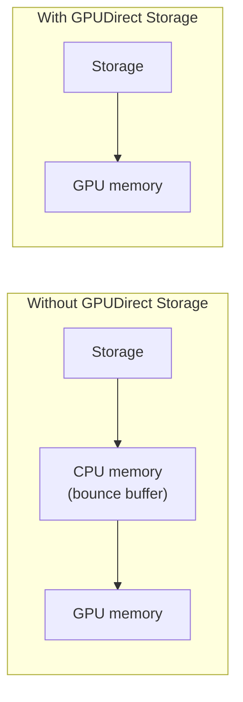

# RDMA, InfiniBand and GPUDirect: Taking the CPU Out of the Way

> **Part 2 of the [Storage and Fabric for AI Clusters series](/fields/system-administration/ai-storage-and-fabric/README.md).** [Part 1](/fields/system-administration/ai-storage-and-fabric/parallel-filesystems-for-ai.md) built the storage. This page is the road between storage, GPUs and other GPUs. By the end you'll know why AI clusters use RDMA instead of ordinary networking, what InfiniBand and RoCE are, and how GPUDirect lets data skip the CPU entirely.

## Table of Contents
- [RDMA, InfiniBand and GPUDirect: Taking the CPU Out of the Way](#rdma-infiniband-and-gpudirect-taking-the-cpu-out-of-the-way)
  - [Table of Contents](#table-of-contents)
  - [The fast network with a slow middleman](#the-fast-network-with-a-slow-middleman)
  - [Two fabrics, two jobs](#two-fabrics-two-jobs)
  - [RDMA: three things the CPU stops doing](#rdma-three-things-the-cpu-stops-doing)
  - [InfiniBand or RoCE?](#infiniband-or-roce)
  - [GPUDirect: skipping one more stop](#gpudirect-skipping-one-more-stop)
  - [Try it before you scroll](#try-it-before-you-scroll)
  - [How to know if the fabric is starving your GPUs](#how-to-know-if-the-fabric-is-starving-your-gpus)
    - [References](#references)

---

## The fast network with a slow middleman

A team upgrades to 400 Gb/s network cards. Their data loading barely improves. Profiling shows the network links half idle and the CPUs on each node busy at 80%.

The network wasn't the bottleneck. **The CPU was the middleman.** With ordinary TCP networking, every packet is handled by the operating system kernel: copied from the network card into kernel memory, processed, copied again into the application's memory, and, for a GPU workload, copied once more into GPU memory. At hundreds of gigabits per second, all that copying and interrupt handling eats the CPU alive, and the CPU becomes the speed limit of a network that could go much faster.

AI clusters fix this by taking the CPU out of the data path. Twice.

---

## Two fabrics, two jobs

A large GPU cluster usually has at least two kinds of network traffic, often on separate physical networks:

| Fabric | Carries | Traffic shape | What breaks if it's slow |
|--------|---------|---------------|--------------------------|
| **Compute fabric** (east-west) | GPU-to-GPU traffic between nodes: gradient all-reduces, tensor and pipeline parallel exchanges | Huge, synchronized bursts; everyone waits for the slowest link | Every training step ([the rowing boat rule](/fields/schedulers/slurm-mixed-gpus/why-mixed-training-disappoints.md#the-rowing-boat-rule)) |
| **Storage fabric** | Dataset reads, checkpoint writes | Steady streams, plus checkpoint storms | Data loading and checkpoints ([part 1](/fields/system-administration/ai-storage-and-fabric/parallel-filesystems-for-ai.md#the-checkpoint-storm)) |

Keeping them separate means a checkpoint storm can't slow down the all-reduces, and vice versa. Many clusters also have a third, ordinary Ethernet network for management, logins and monitoring.

---

## RDMA: three things the CPU stops doing

**RDMA** (Remote Direct Memory Access) lets one machine's network card read or write another machine's memory directly. Three things change:

| Without RDMA | With RDMA |
|--------------|-----------|
| The kernel handles every send and receive | **Kernel bypass**: the application hands work straight to the network card |
| Data is copied between kernel and application buffers | **Zero-copy**: the card moves data directly to and from application memory |
| The CPU runs the network protocol | **Offload**: the network card runs the transport itself |

The result is lower latency, higher bandwidth, and CPUs left free for actual work, like decoding the images part 1's data loaders just read.

The analogy: ordinary networking is sending a package through a mailroom, where a clerk opens it, logs it and repackages it at each end. RDMA is a courier with a key to the recipient's office who puts the package straight on their desk.

---

## InfiniBand or RoCE?

RDMA runs on two main families of network:

| | InfiniBand | RoCE (RDMA over Converged Ethernet) |
|---|---|---|
| What it is | A network designed around RDMA from the start | RDMA carried over Ethernet |
| Strengths | Built-in lossless behavior and congestion handling; long HPC track record | Uses Ethernet switches and skills many organizations already have |
| Watch out for | A separate technology and toolset to run | Needs careful configuration to stay lossless and avoid congestion problems |

Both work at the largest scales. Meta's Llama 3 paper is a nice proof: the 405B model trained on a **RoCE** fabric, while smaller Llama 3 models trained on **NVIDIA Quantum-2 InfiniBand**, both with 400 Gb/s links between GPUs.

So the opinionated answer isn't "InfiniBand always." It's: **InfiniBand if you want the most mature path with the least tuning; RoCE if your team is strong on Ethernet and wants one network technology everywhere.** Either way, it must be RDMA.

---

## GPUDirect: skipping one more stop

RDMA took the kernel out. But on a GPU node there's one more stop: the data still usually lands in **CPU memory** first, then gets copied to GPU memory. NVIDIA's **GPUDirect** technologies remove that stop too.

**GPUDirect RDMA** lets the network card read and write **GPU memory** directly. When NCCL sends gradients from a GPU on one node to a GPU on another, the bytes can go GPU memory → network card → network → network card → GPU memory, without a detour through either node's CPU memory.

**GPUDirect Storage (GDS)** does the same for storage. NVIDIA's overview describes it as a direct DMA data path between storage and GPU memory that **avoids a bounce buffer through the CPU**. Without it, a read goes storage → CPU memory → GPU memory, two trips. With it, one.

What GDS needs and gives, per NVIDIA's overview guide:

- **It's explicit.** Applications use the **cuFile** API, whose reads and writes work with GPU memory buffers, closely mimicking POSIX `pread` and `pwrite`.
- **It needs `O_DIRECT`**, which bypasses the filesystem page cache, for direct transfers (newer releases can take the direct path for aligned buffers even without it).
- **It needs GDS-enabled filesystem drivers.** The direct path depends on the filesystem's driver supporting it, which is why "does our parallel filesystem support GDS?" is a real procurement question.
- **It suits big streaming transfers** better than fine-grained random access.
- **The gain can be large on the right hardware.** NVIDIA notes that on some systems, a direct path through a PCIe switch offers at least twice the peak bandwidth of a path through the CPU.

Notice the pattern across this whole page: **every layer removes a middleman.** RDMA removes the kernel. GPUDirect removes the CPU memory hop. The goal is the same each time: let the data go where the GPUs are, as directly as the hardware allows.

---

## Try it before you scroll

☕ A training job loads large dataset shards from a parallel filesystem over RDMA, but GPU utilization is still low, and each node's CPUs are busy. Which of these would you check first?

1. Upgrade the network to faster links.
2. Check whether data takes a CPU-memory detour and whether the CPU is busy decoding or copying.
3. Add more storage servers.

**2.** Busy CPUs plus underused links point at the middleman, not the road. Check whether GPUDirect Storage is available and used, and whether data preprocessing (like image decoding) is running on the CPU when it could move to the GPU. Options 1 and 3 add capacity to resources that aren't the bottleneck, the [roofline lesson](/fields/generative-ai/llm-inference-performance/compute-bound-vs-memory-bound.md) all over again.

---

## How to know if the fabric is starving your GPUs

| Symptom | Likely cause | First check |
|---------|--------------|-------------|
| All-reduce time grows with node count far more than expected | Compute fabric congestion or a bad link | Run NCCL tests across nodes ([NCCL benchmark guide](/fields/benchmarks/nccl.md)) |
| One node makes every step slower | A degraded link or misconfigured port on that node | Point-to-point bandwidth tests ([OSU benchmarks](/fields/benchmarks/osu.md)); link error counters |
| High CPU, low network and GPU use during data loading | CPU copying and processing data | GPUDirect Storage support; move preprocessing to the GPU |
| Checkpoint stalls also slow other jobs' communication | Storage and compute traffic sharing one fabric | Separate fabrics, or traffic classes on a shared one |
| Good bandwidth in tests, poor in training | Small messages, latency-bound collectives, or topology-unaware placement | Rank placement and affinity ([affinity guide](/fields/benchmarks/parallel-execution-affinity-master-guide.md)) |

**Takeaway:** at AI scale the CPU is the slowest thing between your data and your GPUs, so use RDMA (InfiniBand or RoCE) to remove the kernel, GPUDirect to remove the CPU memory hop, and separate fabrics so checkpoints don't trample gradients.

Back to the [series overview](/fields/system-administration/ai-storage-and-fabric/README.md).

### References
- [NVIDIA Magnum IO GPUDirect Storage Overview Guide](https://docs.nvidia.com/gpudirect-storage/overview-guide/index.html)
- [NVIDIA GPUDirect RDMA documentation](https://docs.nvidia.com/cuda/gpudirect-rdma/index.html)
- [Grattafiori et al., "The Llama 3 Herd of Models", arXiv:2407.21783 (section 3.3.1, network)](https://arxiv.org/abs/2407.21783)
- [NVIDIA AI Enterprise: GPUDirect Storage overview](https://docs.nvidia.com/ai-enterprise/deployment/bare-metal/latest/gds-overview.html)