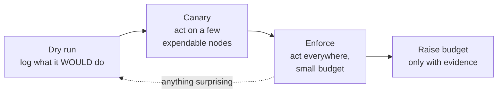

# Acting Without Making It Worse

> **Part 4 of the [Predicting GPU Node Failures series](/fields/system-administration/gpu-failure-prediction/README.md).** A prediction nobody acts on at 23:10 on a Friday is a log line. But automation that acts on predictions can do more damage than any single GPU. This page is about the principles that keep automated response safe. By the end you'll be able to say which actions to automate, how to limit the harm a bad rule can do, and how to roll it out without betting the cluster.

## Table of Contents
- [Acting Without Making It Worse](#acting-without-making-it-worse)
  - [Table of Contents](#table-of-contents)
  - [The real risk is your own automation](#the-real-risk-is-your-own-automation)
  - [Principle 1: automate the reversible, hand off the irreversible](#principle-1-automate-the-reversible-hand-off-the-irreversible)
  - [Principle 2: lead time must beat drain time](#principle-2-lead-time-must-beat-drain-time)
  - [Principle 3: correlated alerts are rarely correlated hardware](#principle-3-correlated-alerts-are-rarely-correlated-hardware)
  - [Principle 4: earn trust in stages](#principle-4-earn-trust-in-stages)
  - [Principle 5: every action must be findable and undoable](#principle-5-every-action-must-be-findable-and-undoable)
  - [Principle 6: humans hear about everything](#principle-6-humans-hear-about-everything)
  - [After the drain: reset, reboot or RMA](#after-the-drain-reset-reboot-or-rma)
    - [References](#references)

---

## The real risk is your own automation

One failing GPU costs one job's worth of restart. One bad deploy of a monitoring config, a driver update that misreports a flag, or a renamed metric can make *every* GPU look sick at once. If your automation drains on every alert, it turns a monitoring bug into a cluster-wide outage, at machine speed.

So the design question isn't "how do I act fast on predictions?" It's: **"what's the worst my automation can do on its worst day, and is that acceptable?"** Everything below answers that.

---

## Principle 1: automate the reversible, hand off the irreversible

Sort the possible responses by how easy they are to undo:

| Action | Reversible? | Who should do it |
|--------|-------------|------------------|
| Drain the node (stop new jobs, let running ones finish) | Yes: resume it | Automation |
| Reset the GPU | Mostly, but it kills anything still running on it | Automation *after* the node is empty, or a human |
| Reboot the node | Mostly, same caveat | Human or a guarded remediation loop |
| Open an RMA, pull the GPU | No | Human, after NVIDIA's field diagnostic |

A scheduler **drain** is the ideal automated response. It doesn't kill anything; it just stops feeding the node. Running jobs finish or reach their next checkpoint, which is exactly what NVIDIA's guidance asks for before a reset.

The rule of thumb: **automation may take capacity away; only humans give hardware back.** Resuming a node whose GPU had a remap failure is a decision, not a cleanup step.

One trade-off to accept up front: schedulers like Slurm drain *nodes*, not GPUs. On an 8-GPU node, draining for one bad GPU also idles seven healthy ones until the reset. Removing just the one GPU from the scheduler is more efficient and much easier to get wrong. Start with whole-node drains.

---

## Principle 2: lead time must beat drain time

A drain is only useful if it finishes before the failure. That gives a simple test for whether a prediction is worth acting on:

> **prediction lead time > time for running jobs to finish or checkpoint**

If your long jobs checkpoint every six hours, a warning that arrives two hours before failure can't save the job that's running; it can only stop the *next* job from landing there. That's still worth a lot, but it's a different promise. Measure lead time ([part 5](/fields/system-administration/gpu-failure-prediction/scoring-and-backtesting.md)), and be honest about which of the two you're buying.

This is also why the action tiers from [part 3](/fields/system-administration/gpu-failure-prediction/rules-that-predict.md) differ. Tier 1 (already broken) can't benefit from lead time; draining just stops the bleeding. Tier 2 (pending remap) has time on its side, because NVIDIA says unaffected work keeps running. Tier 3 (wear) has the most lead time and the least certainty, so it plans instead of draining.

---

## Principle 3: correlated alerts are rarely correlated hardware

Real GPU failures are mostly independent: one weak HBM cell doesn't make the GPU in the next rack weaker. So when many GPUs alert at once, the likely cause is upstream: a driver change, an exporter upgrade, a metric rename, a firmware bug.

That suggests a **drain budget**: a cap on how many nodes your automation may hold drained at any moment. When the budget is full, the automation stops and asks a human. This is a **circuit breaker**: it trips when behavior looks abnormal, so a fault can't spread.

How to size it:

- Size it to **what you can lose without anyone noticing**, not to how many GPUs you expect to fail.
- Count only drains made **by the automation**, so a human's maintenance drains don't use it up.
- Treat "budget full" as a **page**, never a log line. Either several GPUs really are failing together, which is rare and worth a human, or something upstream is lying.

> [!CAUTION]
> Never let a "resolved" alert un-drain a node. Alerts resolve for many reasons, including the exporter dying. A predictive system that drains on one signal and resumes on its absence will flap nodes in and out of service.

---

## Principle 4: earn trust in stages

New automation has to earn the right to act. A standard ladder:



| Stage | What happens | Move on when |
|-------|--------------|--------------|
| **Dry run** | The automation logs "would drain X because Y" and touches nothing. You compare the log with what actually failed | Every "would drain" points at a GPU you'd have drained by hand, for at least a week or two |
| **Canary** | Real drains, but only on a short list of nodes you're happy to lose | Drains look right, running jobs finished normally |
| **Enforce** | Real drains everywhere, with a small budget | A normal week passes without hitting the budget |
| **Raise the budget** | Only when the backtest in part 5 says the rules earn it | - |

The dry-run stage has a second benefit: its log is the start of your **label set**. Part 5 needs a history of "we predicted X" next to "X actually failed," and the dry-run log is exactly that.

---

## Principle 5: every action must be findable and undoable

Give every automated drain a **recognizable signature**, for example a reason that always starts with the same prefix. Then three things become one-liners:

- **Find** everything the automation did: list drained nodes whose reason has the prefix.
- **Count** it, which is how the drain budget works.
- **Undo** it in bulk if the automation was wrong.

In Slurm, the drain reason is that signature:

```bash
scontrol update NodeName=cn042 State=DRAIN Reason="GPUPRED: GpuFatalXid gpu3 drain_now"
```

Bulk rollback is "find every node drained with the prefix, resume it." But the rollback is for *wrong* drains. A node whose GPU had a remap failure or fell off the bus shouldn't be resumed just because undoing is easy.

> [!TIP]
> A good reason string answers "why is this node out?" without opening a dashboard: who drained it (the prefix), which rule, which GPU, and which action tier.

---

## Principle 6: humans hear about everything

Automation should never act in silence. Every automated drain should also notify the team, through the same channel as everything else. The alert router has to send drain-tier alerts to *both* the automation and the people.

This is easy to get wrong. With Prometheus Alertmanager, a route that sends drain alerts to the automation, marked to "continue" matching, does not automatically also reach the default human receiver: the default only catches alerts that matched *no* route. When we checked a config built that way with Alertmanager's own route tester, drain alerts went to the automation only. The fix is an explicit catch-all route for humans after the automation route.

The general lesson: **test your alert routing like you test your rules.** "Who gets this alert?" should be a question with a checked answer.

---

## After the drain: reset, reboot or RMA

The drain buys time. This is what the time is for, condensed from NVIDIA's triage guidance:

| What fired | Once the node is empty | Then |
|------------|------------------------|------|
| Remap pending, uncorrectable error (Xid 48, 94) | Reset the GPU | Confirm the remap is no longer pending, run a short diagnostic, resume |
| Xid 64, or Xid 95 with MIG off | Reboot the node | If it repeats: collect a bug report, run field diagnostics, report |
| Xid 79 | Collect evidence, reboot | Expect it to recur; report to the vendor |
| Remap failure | Keep it drained | NVIDIA's field diagnostic validates the flag for RMA |

Reset limits depend on the platform. On Hopper and later systems with NVSwitch, GPUs can be reset individually; older NVSwitch systems may need the Fabric Manager running, or all connected GPUs reset together. Check NVIDIA's reset-capabilities table before automating resets. For the fix-and-verify loop itself, see [NHC auto-remediation](/fields/system-administration/node-health-check/auto-remediation.md).

**Takeaway:** automate only the reversible step (drain), cap your automation's blast radius with a budget, earn trust through dry run → canary → enforce, make every action findable and undoable, and make sure humans hear about all of it.

Next: [part 5, is the prediction any good?](/fields/system-administration/gpu-failure-prediction/scoring-and-backtesting.md)

### References
- [NVIDIA GPU Debug Guidelines: GPU Node Triage (actions, reset capabilities)](https://docs.nvidia.com/deploy/gpu-debug-guidelines/gpu-node-triage.html)
- [NVIDIA GPU Memory Error Management: Error Recovery and Response Flags (drain and reset)](https://docs.nvidia.com/deploy/a100-gpu-mem-error-mgmt/error-recovery-and-response-flags.html)
- [Slurm `scontrol` man page (DRAIN, RESUME, Reason)](https://slurm.schedmd.com/scontrol.html)
- [Alertmanager configuration (routes, `continue`)](https://prometheus.io/docs/alerting/latest/configuration/)
- [Grattafiori et al., "The Llama 3 Herd of Models", arXiv:2407.21783](https://arxiv.org/abs/2407.21783)