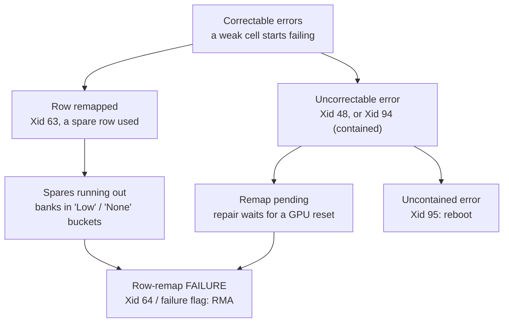

# How GPU Memory Fails, and Why You Can See It Coming

> **Part 1 of the [Predicting GPU Node Failures series](/fields/system-administration/gpu-failure-prediction/README.md).** Prediction only works if failure leaves footprints before it happens. This page explains the hardware that leaves them: ECC, spare rows, error containment, and the field evidence that errors repeat. By the end you'll be able to draw the error ladder from memory and say which rungs are predictions and which are already failures.

## Table of Contents
- [How GPU Memory Fails, and Why You Can See It Coming](#how-gpu-memory-fails-and-why-you-can-see-it-coming)
  - [Table of Contents](#table-of-contents)
  - [A Friday night on cn042](#a-friday-night-on-cn042)
  - [Why one GPU stops a thousand](#why-one-gpu-stops-a-thousand)
  - [Concept 1: ECC, the first line of defense](#concept-1-ecc-the-first-line-of-defense)
  - [Concept 2: soft errors versus hard errors](#concept-2-soft-errors-versus-hard-errors)
  - [Concept 3: banks, rows and spare rows](#concept-3-banks-rows-and-spare-rows)
  - [Concept 4: containing the damage](#concept-4-containing-the-damage)
  - [The error ladder](#the-error-ladder)
  - [What the field studies say](#what-the-field-studies-say)
  - [What's predictable and what isn't](#whats-predictable-and-what-isnt)
  - [What this is not for](#what-this-is-not-for)
    - [References](#references)

---

## A Friday night on cn042

Here's a story every GPU cluster admin has lived in some form. The host is invented; the events follow NVIDIA's documentation.

On Tuesday, GPU 3 in `cn042` logged an **Xid 94**, a contained memory error. One user's job died; they resubmitted. Right behind it came an **Xid 63**: the GPU had recorded a repair that would only take effect after a GPU reset. Nobody reset it. The node kept taking jobs.

On Friday at 23:10 the same GPU logged **Xid 79**, *"GPU has fallen off the bus,"* and took a 512-GPU training run down with it. The run restarted from a checkpoint six hours old.

Nothing about Friday was a surprise. The GPU had been talking since Tuesday. The point of this series is to understand what it was saying.

---

## Why one GPU stops a thousand

Large training jobs are **synchronous**: every step waits for every GPU to finish its share. If one GPU disappears, the step never completes, and the whole job usually restarts from its last checkpoint.

So the real cost of a failure is roughly:

> **cost ≈ GPUs in the job × time since the last checkpoint**

Meta's Llama 3 paper shows how often this happens at scale. In a 54-day snapshot of pre-training on 16,384 H100 GPUs there were 466 job interruptions, 419 of them unexpected. Faulty GPUs caused 30.1% of the unexpected ones and GPU HBM3 memory another 17.2%. The paper notes that because training is synchronous, a single GPU failure may require restarting the entire job.

That equation is also why prediction pays. Draining a suspect node on Tuesday afternoon costs one node's worth of idle time. The same failure on Friday night costs every GPU in the job, times six hours.

---

## Concept 1: ECC, the first line of defense

Memory bits occasionally read back wrong. **ECC** (error-correcting code) stores a few extra check bits next to each memory word, so the hardware can notice and often repair a bad bit.

The common scheme in servers is **SECDED**: *single error correct, double error detect*. Google's DRAM study describes it plainly: it can reliably detect and correct any single-bit error, but can only detect, not correct, multi-bit errors. That gives two kinds of event:

| Event | Also called | What happens | Does the job notice? |
|-------|-------------|--------------|----------------------|
| **Correctable error (CE)** | Single-bit error, SBE | Hardware fixes the bit and counts it | No |
| **Uncorrectable error (UE)** | Double-bit error, DBE | Hardware knows the data is wrong but can't fix it | Usually yes: the process or node is hit |

The key insight for prediction: **a correctable error is free today, but it's information.** It says a bit in this memory went wrong once. Whether that matters depends on the next concept.

Two more ideas from the same study are worth knowing:

- **Scrubbing.** Some memory systems scan memory in the background and rewrite corrected words, so single-bit errors don't pile up into double-bit ones. Without scrubbing, errors are only found when memory is read.
- **Detection depends on use.** The study found correctable error rates 2 to 3 times higher under high utilization, even at the same temperature. A GPU that sat idle all month and reported no errors hasn't proven much.

---

## Concept 2: soft errors versus hard errors

Not all bit flips are equal.

- A **soft error** is a random flip, from a particle strike for example. The cell is fine; rewrite it and the problem is gone. Soft errors are random in time, so they don't predict anything.
- A **hard error** comes from a physical defect: a weak or stuck cell. It will go wrong again, in the same place.

Older thinking assumed most memory errors were soft. Google's large field study (2.5 years of its server fleet) found strong evidence for the opposite: **errors are dominated by hard errors.** The fingerprints:

- Errors repeat. In more than 85% of cases a correctable error was followed by another in the same month.
- Errors concentrate. For every platform, the top 20% of DIMMs with errors produced over 94% of all observed errors.
- Errors persist. The month-to-month correlation of error counts stayed significant for up to about 7 months.

This is the single most important idea in the series:

> **Memory errors are not lightning strikes. They're mostly weak cells that keep failing. That's why the past predicts the future.**

The study was on host DIMMs, not GPU HBM, so treat the exact numbers as an illustration. The shape, a few bad parts producing most of the errors and repeating, is what the rest of this series builds on.

---

## Concept 3: banks, rows and spare rows

GPU memory is organized in **banks**, and each bank in **rows** of cells. NVIDIA's documentation for Ampere and later GPUs describes a hardware repair built on that structure: **row remapping.**

- **Every bank has spare rows.** When a row degrades, the GPU marks it to be replaced by a spare. Unlike older "page retirement," the swap happens in hardware and doesn't leave holes in the address space.
- **The swap waits for a reset.** A remap is recorded immediately (that's Xid 63) but only takes effect at the next **GPU reset**. Until then it's **pending**. NVIDIA says that while a remap is pending, unaffected applications can keep running and new work can still launch.
- **Repairs are permanent.** Once applied, a remap lasts for the life of the GPU.
- **The budget is finite.** The frame buffer supports up to 512 remappings. Remaps caused by correctable errors can be replaced by remaps for uncorrectable errors when a bank's reserved rows run out.
- **Dynamic page offlining** fills the gap: the page holding the bad memory is excluded from new allocations until the remap is applied.

NVIDIA also exposes how full each bank is, as **bucketized counts**: how many banks still have their maximum number of spares, how many are "High," "Partial," "Low" (one spare left) or "None" (no spares). A healthy GPU has every bank in the top bucket. NVIDIA's own example shows 640 banks there.

When the budget runs out, the GPU sets the **row-remap failure flag**, NVIDIA's RMA criterion. Per the RMA policy, the flag is set when a remap for an uncorrectable error hits a bank that already has eight uncorrectable rows remapped, hits a row that was already remapped, or when 512 uncorrectable remaps have happened in total.

Think of spare rows like spare tires in a fleet of trucks. Using one isn't a failure. Running a truck with no spare left is a failure waiting for a pothole.

---

## Concept 4: containing the damage

An uncorrectable error used to mean "the GPU is in an unknown state, reset everything." Ampere-generation GPUs add **error containment**: if the hardware can tell which process touched the bad memory, it kills only that process.

| Xid | Name | What it means |
|-----|------|---------------|
| 94 | Contained ECC error | Only the application that hit the error is affected; restart it |
| 95 | Uncontained ECC error | Containment failed; NVIDIA says reboot immediately when MIG is off |

Containment is good news and bad news. Good, because one bad row no longer kills everything on the GPU. Bad, because the GPU looks fine afterwards. The neighbors keep running, the dashboards stay green, and the pending remap waits for a reset nobody schedules. That's Tuesday on `cn042`.

---

## The error ladder

Put the four concepts together and a failing GPU tends to climb a ladder. Every rung is visible.

Read it as three zones:

- **Wear** (correctable errors, remaps, shrinking spares): nothing is broken, but the trend is visible. This is where *prediction* lives.
- **Damage** (uncorrectable errors, pending remap): something is already wrong, but there's time to act gracefully. This is where *planned* action lives.
- **Failure** (remap failure, uncontained errors): act now.

> [!NOTE]
> **Xid 79 isn't on the ladder.** "Fallen off the bus" has several possible causes in NVIDIA's Xid catalog, spanning hardware, driver, bus and thermal problems. Sometimes a memory story ends there, often it doesn't. Treat it as an event to react to, not something memory counters will reliably predict.

The rule of thumb for the whole series: **predict wear, react to breaks.**

---

## What the field studies say

Two studies frame what to expect.

**Google, "DRAM Errors in the Wild" (Schroeder, Pinheiro, Weber, SIGMETRICS 2009).** Host memory, millions of DIMM-days.

- Correctable errors predict uncorrectable ones: 70-80% of uncorrectable errors were preceded by a correctable error in the same or previous month, and a correctable error raised the uncorrectable-error probability by factors between 9 and 400.
- But the *absolute* risk stayed small: 0.1 to 2.3% per month. The authors concluded that replacing memory just because of correctable errors only pays off where downtime is very expensive. (AI training clusters are such a place. [Part 5](/fields/system-administration/gpu-failure-prediction/scoring-and-backtesting.md) explains why "9-400× more likely" and "probably still fine" are both true.)
- A more sophisticated model (CART trees) did not predict significantly better than the simple correctable-error signal.

**NCSA Delta (Cui et al., "Characterizing GPU Resilience and Impact on AI/HPC Systems").** 2.5 years and 11.7 million GPU hours on A100 and H100.

- H100 had 3.2× lower per-GPU mean time between errors than A100 for uncorrectable ECC memory errors, and memory errors were the main cause of job failures on H100.
- Row remapping and error containment mitigated 92% of uncorrectable ECC memory errors on H100.
- In one case an uncontained memory error persisted for 17 days because monitoring didn't trigger a timely GPU reset.

The lesson from that last finding: **the hardware did its job; the operations around it didn't.**

---

## What's predictable and what isn't

| Signal | Zone | Predictable? | Why |
|--------|------|-------------|-----|
| Rising correctable error rate | Wear | Weakly | Hard faults repeat, but most never become fatal |
| Spare rows nearly gone in a bank | Wear | Strongly | The next uncorrectable error in that bank can't be repaired |
| Remap pending | Damage | Not a prediction: a known-bad state with time to act | Needs a reset, which needs an empty GPU |
| Remap failure, Xid 64 | Failure | Already happened | Spares exhausted or repair not recorded |
| Xid 79, Xid 95 | Failure | Mostly no | Sudden, several causes |
| Xid 13 | Usually not hardware | No | NVIDIA lists it as a graphics engine exception, often the application |

---

## What this is not for

- **Not a replacement for health checks.** Something still has to refuse a node that's broken *right now*. Prediction works on a longer horizon, alongside it.
- **Not for silent data corruption.** A GPU that computes wrong answers without raising errors leaves nothing in these counters.
- **Not for software failures.** Out-of-memory crashes, NCCL hangs and bad kernels aren't hardware wear.
- **Not for GPUs you aren't watching.** No telemetry means no prediction.

**Takeaway:** GPU memory errors are mostly weak cells that keep failing, and the hardware's repairs (ECC, spare rows, containment) leave a visible ladder, so prediction is really about reading how far up the ladder each GPU has climbed.

Next: [part 2, reading the GPU's vital signs](/fields/system-administration/gpu-failure-prediction/collecting-the-signals.md).

### References
- [NVIDIA GPU Memory Error Management: Row Remapping](https://docs.nvidia.com/deploy/a100-gpu-mem-error-mgmt/row-remapping.html)
- [NVIDIA GPU Memory Error Management: Error Recovery and Response Flags](https://docs.nvidia.com/deploy/a100-gpu-mem-error-mgmt/error-recovery-and-response-flags.html)
- [NVIDIA GPU Memory Error Management: User Visible Statistics](https://docs.nvidia.com/deploy/a100-gpu-mem-error-mgmt/user-visible-statistics.html)
- [NVIDIA GPU Memory Error Management: RMA Policy](https://docs.nvidia.com/deploy/a100-gpu-mem-error-mgmt/rma-policy-thresholds-for-row-remapping.html)
- [NVIDIA GPU Debug Guidelines: GPU Node Triage](https://docs.nvidia.com/deploy/gpu-debug-guidelines/gpu-node-triage.html)
- [NVIDIA Xid Errors catalog](https://docs.nvidia.com/deploy/xid-errors/index.html)
- [Grattafiori et al., "The Llama 3 Herd of Models", arXiv:2407.21783](https://arxiv.org/abs/2407.21783)
- [Schroeder, Pinheiro, Weber, "DRAM Errors in the Wild: A Large-Scale Field Study", SIGMETRICS 2009](https://www.cs.toronto.edu/~bianca/papers/sigmetrics09.pdf)
- [Cui et al., "Characterizing GPU Resilience and Impact on AI/HPC Systems", arXiv:2503.11901 (figures from v2 and v3)](https://arxiv.org/abs/2503.11901)