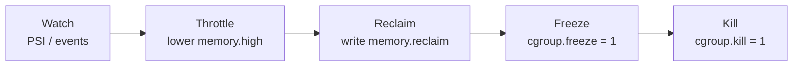

# cgroup v2 Memory Control: The Levers Between Doing Nothing and Killing

> **Part 4 of the [Linux Memory Pressure series](/fields/system-administration/linux-memory-pressure/README.md).** Detection ([part 2](/fields/system-administration/linux-memory-pressure/memory-pressure-psi.md)) is only half a rescuer. The other half is a set of levers it can pull, and cgroups have a surprisingly fine one for every stage, from "slow this group down" to "remove it". By the end you'll know what each memory file does, in which order you'd pull them, and which ones an ordinary user can't touch.

## Table of Contents
- [cgroup v2 Memory Control: The Levers Between Doing Nothing and Killing](#cgroup-v2-memory-control-the-levers-between-doing-nothing-and-killing)
  - [Table of Contents](#table-of-contents)
  - [The hotel with a group booking](#the-hotel-with-a-group-booking)
  - [What a cgroup is, in one paragraph](#what-a-cgroup-is-in-one-paragraph)
  - [The four limit files](#the-four-limit-files)
  - [Try it before you scroll](#try-it-before-you-scroll)
  - [The active levers: reclaim, freeze, kill](#the-active-levers-reclaim-freeze-kill)
  - [The escalation ladder](#the-escalation-ladder)
  - [Who may pull the levers](#who-may-pull-the-levers)
  - [Look at your own groups](#look-at-your-own-groups)
  - [References](#references)

---

## The hotel with a group booking

A conference books a block of rooms in a busy hotel. The manager has a set of controls for that one group, and they escalate:

1. **Guaranteed rooms**: "these 20 are theirs; nobody else may be given them."
2. **Preferred rooms**: "we'll try to keep these 30 free for them, but in an emergency we may need them back."
3. **Slow check-in**: past 50 rooms, each extra guest is made to wait at the desk.
4. **No more rooms**: past 60, the desk turns people away, and if the group insists, someone is asked to leave.

Beyond the booking, the manager can also act directly: ask the group to give some rooms back, send everyone to their rooms and shut the doors (nobody leaves or arrives), or clear the whole block.

That list is the memory controller of cgroup v2, almost one for one.

| Hotel | cgroup v2 file |
|-------|----------------|
| Guaranteed rooms | `memory.min` |
| Preferred rooms | `memory.low` |
| Slow check-in | `memory.high` |
| No more rooms | `memory.max` |
| Ask them to give rooms back | `memory.reclaim` |
| Shut the doors | `cgroup.freeze` |
| Clear the block | `cgroup.kill` |

---

## What a cgroup is, in one paragraph

A **control group** is a set of processes that the kernel accounts for and limits together. On modern systems with cgroup v2 there's a single tree under `/sys/fs/cgroup`. Each systemd service, user session and container is a directory in it, and the files in that directory are both the measurements (`memory.current`, `memory.pressure`) and the controls. You change a limit by writing a number to a file. There is no special API.

---

## The four limit files

All values are in bytes (or the word `max` for "no limit"). Think of them as four lines on a ruler, from protection to hard stop.

| File | Name | What the kernel does | Never OOM-kills? |
|------|------|----------------------|------------------|
| `memory.min` | Hard protection | Memory below this is **not reclaimed**, even under pressure | n/a |
| `memory.low` | Soft protection | Memory below this is reclaimed **only if nothing unprotected is left** | n/a |
| `memory.high` | Throttle | Above this, the group is put under heavy reclaim pressure and its tasks are **slowed down** | **Yes: it never kills** |
| `memory.max` | Hard limit | Above this, the group runs OOM handling and a process in it is **killed** | No, this is the kill |

Two limits on that table. `memory.min` is not absolute: the kernel docs say that if there is no unprotected reclaimable memory left, the OOM killer is invoked anyway. And `memory.low` is capped by the `memory.low` of the group's **ancestors**, so protecting one service while its parent slice has none protects little.

The distinction people trip on is **`high` versus `max`**:

- `memory.high` is a speed limit. The group can go over it, but every allocation past the line turns into forced reclaim and sleeping, so it runs slower and slower. It cannot kill anything.
- `memory.max` is a wall. There the OOM killer ([part 3](/fields/system-administration/linux-memory-pressure/the-oom-killer.md)) is invoked inside the group.

Setting `memory.high` a bit below `memory.max` gives a working group a warning zone: it slows down *before* it dies, and the cgroup's `memory.pressure` ([part 2](/fields/system-administration/linux-memory-pressure/memory-pressure-psi.md)) rises as a signal that you could see.

A catch worth knowing. `memory.high` works by making the group reclaim memory. If **nothing in the group can be reclaimed** (all anonymous pages and no swap), it can't get under the line, and the throttling just gets heavier. When I tried this by putting a small program in a scope with a 100 MiB `memory.high` and swap disabled for it, allocating 130 MiB, it had not finished after 40 seconds (Ubuntu 26.04, Linux 7.0). I repeated it in clean VMs with a 60-second cap. On Ubuntu 22.04 (Linux 5.15, systemd 249), touching 130 MiB did not finish, and neither did 105 MiB, only 5 MiB over the line. On Ubuntu 26.04 (Linux 7.0) 130 MiB still did not finish, but 105 MiB finished in 9 seconds, so a small overshoot is throttled hard on the old kernel and survivable on the new one. After 8 seconds the group sat at about 106 MiB, `memory.events` showed `high` at 997, and its `memory.pressure` read `some avg10=43.67`. The throttle is real and can look like a hang. To reproduce it, use the throwaway-scope command at the end of this page with `MemoryHigh=100M` and `MemorySwapMax=0`, and allocate and touch more than 100 MiB inside it.

> [!WARNING]
> A group throttled by `memory.high` that has nothing to reclaim looks hung, not dead, and it never gets OOM-killed for it. Watch `memory.events` (`high` counting up) and the group's `memory.pressure`, or you'll wait on a job that can't finish.

Writing `memory.high` is itself an action with a cost: the kernel docs say a normal write triggers synchronous reclaim, and that **opening the file with `O_NONBLOCK` bypasses it**. A rescuer that lowers `memory.high` under pressure should open the file that way.

Two companions: `memory.swap.max` caps how much of the group can go to swap (0 means none), and `memory.events` counts what has happened: times `high` and `max` were reached, `oom` and `oom_kill` events.

---

## Try it before you scroll

☕ Grab a pen. A container has `memory.high` = 4 GiB and `memory.max` = 6 GiB. It's growing steadily, and nothing in it can be swapped.

1. At 3 GiB, what happens?
2. At 5 GiB?
3. At 6 GiB?

Got your answers? Scroll on.

Answers: at 3 GiB, **nothing**: it is below every line. At 5 GiB it is **throttled**: it is still alive but slowed, with its pressure rising and `memory.events` `high` counting up. At 6 GiB it **runs out of room** and the kernel's OOM handling kills a process in it. And if it throttles so hard it can't grow, it may never reach 6 GiB.

---

## The active levers: reclaim, freeze, kill

The limit files are *standing rules*. Three more files are **actions** a rescuer can take on demand.

**`memory.reclaim`.** Writing an amount, such as `echo 512M > memory.reclaim`, asks the kernel to reclaim that much from the group *now*, pushing its cold pages to swap or dropping its cache. It does **not** change any limit. It is a polite request that returns an error (`EAGAIN`) if the group couldn't give back the full amount. Since it is proactive, it is the gentlest way to free memory from a specific group. It needs **Linux 5.19 or newer**: on Ubuntu 22.04 (5.15) the file does not exist in a new cgroup, while `cgroup.kill`, `cgroup.freeze`, `memory.high`, `memory.low` and `memory.min` do. The docs don't say whether the write waits for the reclaim. On Linux 7.0 a request against a group holding 200 MiB of anonymous memory with no swap returned `EAGAIN` immediately (under a millisecond), so it did not block when nothing could be reclaimed; I did not time one where pages could be reclaimed, so time it on your kernel before you put it in a rescuer's hot path. On Linux 7.0 it also accepts a `swappiness=` argument that overrides `vm.swappiness` for that one request (0, 60 and `max` were accepted and 201 was refused; it is not available on 5.15, where the whole file is missing).

**`cgroup.freeze`.** Writing `1` freezes every process in the group: they stop being scheduled, like a paused video. It does **not** release their memory; it only stops it growing. Writing `0` thaws them. This is how `docker pause` works. It is a good emergency brake: it buys time without destroying anyone's work. Frozen processes can still be killed.

**`cgroup.kill`.** Writing `1` kills **every process in the group and its child groups**. No sequence of signals, no waiting for children. It is the clean "remove this entire container" action, and it frees the memory. It needs Linux 5.14 or newer (`cgroup.freeze` needs 5.2).

> [!CAUTION]
> `cgroup.kill` is not reversible and takes down the whole subtree. Never point it at a group you picked by a name pattern without a dry run: log which group the rescuer *would* kill for a few days before you let it write `1`.

| Lever | Frees memory? | Loses work? | Reversible? |
|-------|---------------|-------------|-------------|
| `memory.high` lowered | Gradually, by throttling | No | Yes |
| `memory.reclaim` | Some (cold pages) | No | Yes (pages come back on use) |
| `cgroup.freeze` | **No**: stops growth | No | Yes |
| `cgroup.kill` | **Yes**, all of it | **Yes** | No |

---

## The escalation ladder

Put them in order of how much damage each does, and you have the plan of a graduated rescuer. Lowest rung first, moving up only while pressure stays high:



Two design points make this practical:

- **Choose the victim by priority.** Because every service and container is a cgroup, a rescuer can act on the *lowest-priority* group first and leave the important ones alone, which the kernel's blunt per-process OOM killer cannot do.
- **Each rung is a single `write`.** That is what makes it fit with the memory-locking page: open the files for the groups you might act on **ahead of time**, keep the handles, and the action under pressure becomes one `pwrite` on a handle you already hold, with nothing to open or allocate in your own program. The kernel may still do work inside that write: a normal `memory.high` write reclaims synchronously (open it with `O_NONBLOCK` to skip that), and `memory.reclaim` may take time. See [part 5](/fields/system-administration/linux-memory-pressure/memory-locking-mlockall.md).

---

## Who may pull the levers

Writing these files requires **ownership of the cgroup**. A normal user typically owns only a *delegated* subtree, such as their own user session's slice, and only the controllers that systemd has enabled for it (`cat /sys/fs/cgroup/user.slice/user-1000.slice/user@1000.service/cgroup.controllers` shows them; on my machine it lists `cpu memory pids`).

| | Ordinary user | Root |
|-|---------------|------|
| Groups it can control | Only a delegated user subtree | Every group, including other services and containers |
| Container actions | Through the Docker API, if in the `docker` group (`pause`, `stop`) | Directly: freeze, throttle, reclaim and kill any container's cgroup |
| Typical rescue ability | Pause or stop the containers it can reach | The full ladder above |

> [!WARNING]
> Membership of the `docker` group is effectively root on that host: anyone in it can start a privileged container. Treat "an unprivileged rescuer that talks to Docker" as a root-equivalent service when you decide who may run it.

This is the same split as in the [memory-locking page](/fields/system-administration/linux-memory-pressure/memory-locking-mlockall.md): a rescuer without root is **best effort** and uses the few tools it can reach, while a root service has the whole ladder and the lock.

---

## Look at your own groups

```bash
cat /proc/self/cgroup                              # which group is this shell in?
cd /sys/fs/cgroup/user.slice                       # one of your parent groups
cat memory.current memory.high memory.max          # how much it uses, and its limits
cat memory.events memory.pressure                  # what has happened, and the PSI for just this group
systemd-cgtop -m                                   # live memory per group, like top for cgroups
```

To set a limit safely, let systemd do it on a throwaway group, which cleans up after itself:

```bash
systemd-run --user --scope -p MemoryHigh=200M -p MemoryMax=300M -p MemorySwapMax=0 <command>
```

Success: it prints `Running scope as unit: run-<id>.scope` and then your command's output. Tested as an ordinary user on Ubuntu 22.04, where the user's `cgroup.controllers` was `memory pids`. Check that `memory` is in that listing first: a user session without a delegated `memory` controller can't apply these limits. To watch `memory.events` while it runs, find the scope's directory with `cat /proc/<pid>/cgroup` for the command's PID.

Do not point experiments at your login session's group. Create a new scope as above and watch it from a second terminal.

**Takeaway:** cgroup v2 gives a rescuer a graduated ladder (`memory.high` to slow a group, `memory.reclaim` to ask for pages back, `cgroup.freeze` to stop it growing, `cgroup.kill` to remove it), so it can take the gentlest step that works and choose the victim by priority; most of the ladder needs ownership of the group, which in practice means root.

You now have pressure to *see* and levers to *pull*. What keeps the program that holds the levers alive and fast when the machine is at its worst? That's the memory-locking page, next, and [part 6](/fields/system-administration/linux-memory-pressure/rescuer-checklist.md) ties everything into one checklist.

## References
- [Linux kernel docs: Control Group v2, Memory](https://www.kernel.org/doc/html/latest/admin-guide/cgroup-v2.html#memory)
- [Linux kernel docs: Control Group v2, cgroup.freeze and cgroup.kill](https://www.kernel.org/doc/html/latest/admin-guide/cgroup-v2.html#core-interface-files)
- [systemd.resource-control(5): MemoryHigh, MemoryMax, MemorySwapMax](https://www.freedesktop.org/software/systemd/man/latest/systemd.resource-control.html)
- [Docker: pause and the freezer cgroup](https://docs.docker.com/reference/cli/docker/container/pause/)
