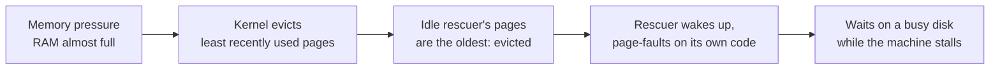

# Memory Locking: Keeping a Rescuer in RAM with mlockall

> **Part 5 of the [Linux Memory Pressure series](/fields/system-administration/linux-memory-pressure/README.md).** Some programs exist to act when the machine is out of memory: a watchdog that kills a runaway job, a daemon that pauses containers. Those programs have a trap waiting for them, and `mlockall` is the fix. By the end you'll know what the trap is, what the fix pins, what it costs, and why an ordinary user can only get half of it.

## Table of Contents
- [Memory Locking: Keeping a Rescuer in RAM with mlockall](#memory-locking-keeping-a-rescuer-in-ram-with-mlockall)
  - [Table of Contents](#table-of-contents)
  - [The tow truck that got towed](#the-tow-truck-that-got-towed)
  - [Step 1: what swapping really is](#step-1-what-swapping-really-is)
  - [Step 2: the trap](#step-2-the-trap)
  - [Try it before you scroll](#try-it-before-you-scroll)
  - [Step 3: the fix, mlockall](#step-3-the-fix-mlockall)
  - [Step 4: the second half of the fix, pre-allocation](#step-4-the-second-half-of-the-fix-pre-allocation)
  - [Step 5: the cost, and where 8 MiB comes from](#step-5-the-cost-and-where-8-mib-comes-from)
  - [Root versus ordinary user](#root-versus-ordinary-user)
  - [Check it on your own machine](#check-it-on-your-own-machine)
  - [What locking does not do](#what-locking-does-not-do)
  - [References](#references)

---

## The tow truck that got towed

A city's parking lot is full. The council employs a tow truck whose whole job is to clear the lot when it gets too crowded. To make room, the rule is simple: the least recently used cars get towed to a faraway yard, and fetched back when their owner shows up.

One busy afternoon the lot overflows. The tow truck driver walks out to start the clearing, and finds that **her own car has been towed**. It was parked there all day doing nothing, so it was the least recently used car in the lot. Now she has to wait for it to come back from the far yard, and the yard is busy hauling everyone else's cars. The lot stays jammed. The one person who could fix the jam is stuck waiting for transport.

The fix is not a faster tow truck. The fix is a **reserved parking spot** that the towing rule is forbidden to touch, plus keys that are **already in her hand**.

| City | Linux machine |
|------|---------------|
| The parking lot | RAM |
| The far yard | Swap (a disk, or compressed RAM like zram) |
| The towing rule | The kernel's page reclaim, least recently used first |
| The tow truck | Your rescuer program (watchdog, governor, OOM helper) |
| The reserved spot | `mlockall` |
| Keys already in hand | Resources opened and allocated before trouble |

The rest of this page is that table, one row at a time.

---

## Step 1: what swapping really is

Programs don't touch RAM directly. They see **virtual memory**: the kernel hands each process a big imaginary address space and chops it into **pages** (usually 4 KiB). Each page is either in RAM right now, or it isn't.

When RAM gets short, the kernel needs free pages. It looks for pages nobody has used lately and **evicts** them:

- A page backed by a file (a library, the program's own code) can simply be dropped, because it can be read from the file again.
- A page that only exists in memory (heap, stack) has nowhere to go, so it is written to **swap**.

Later, if the program touches an evicted page, the CPU raises a **page fault**, the kernel reads the page back in, and the program continues. The program never notices, except that the access took far longer.

How much longer? A RAM access is around a hundred nanoseconds. Reading a page back from an SSD is around a hundred microseconds, a thousand times slower. From a spinning disk it is milliseconds. And when the machine is thrashing, the disk queue is full of everybody else's evictions, so your page waits in line.

This is a fine trade for a text editor you left open overnight. It is a terrible one for the program whose job is to act *right now*.

---

## Step 2: the trap

Put the two facts together:

1. Memory pressure is exactly when the kernel evicts pages.
2. A rescuer is exactly the program that sits idle until memory pressure arrives.

An idle program is a perfect eviction candidate: its pages haven't been touched in hours. So by the time pressure hits, the rescuer's code and data have probably been pushed out to swap. The moment it wakes up to act, it page-faults on its **own instructions**, and each fault waits on a disk that is busy with the crisis it was supposed to stop.



Nothing is broken here. The kernel is doing exactly what it should. The design is what's wrong: the program that handles emergencies is treated as just another idle program.

---

## Try it before you scroll

☕ Grab a pen. Which of these should pin its memory in RAM?

1. A text editor with ten open files.
2. A watchdog that pauses containers when free memory drops below 5%.
3. A database buffer pool of 200 GiB.

Got your answer? Scroll on.

Answer: **2**. The editor can afford a slow page fault. The 200 GiB pool is far too big to pin (and the database has its own tools). The watchdog is tiny, idle most of the time, and needed at the worst possible moment: the textbook candidate.

---

## Step 3: the fix, mlockall

Linux lets a program say "never evict these pages". The call is `mlockall`:

```python
import ctypes, os

MCL_CURRENT, MCL_FUTURE = 1, 2           # values from <sys/mman.h>
libc = ctypes.CDLL(None, use_errno=True)

if libc.mlockall(MCL_CURRENT | MCL_FUTURE) != 0:
    err = ctypes.get_errno()
    raise OSError(err, os.strerror(err))
```

The two flags are the whole trick:

| Flag | Pins | Why you need it |
|------|------|-----------------|
| `MCL_CURRENT` | Every page the process has mapped **right now**: its code, libraries, heap, stack | The rescuer's existing instructions and data can no longer be swapped out |
| `MCL_FUTURE` | Every page the process maps **from now on** | Memory it grows into later is born locked, not evictable |

After the call, the process is the tow truck with the reserved spot. The kernel's reclaim loop skips its pages, no matter how long they sit idle.

A sibling call, `mlock(addr, len)`, pins just one range. `mlockall` is the blunt tool: "everything I have, and everything I'll get". For a small daemon that's what you want.

---

## Step 4: the second half of the fix, pre-allocation

A locked car is no use if the driver has to hunt for her keys. The same holds here, and it is the subtler half.

When the rescuer finally acts, it has to *do* something: open a file, write to a control file, start a helper. Each of those can need **new memory**: a fresh buffer, a new file handle, a new kernel structure. And asking for new memory under pressure means asking the kernel for a free page when there are none. The kernel has to reclaim one first (this is *direct reclaim*), and the caller waits while it happens.

Locking doesn't help with that. It protects pages you already have, not pages you're about to ask for.

So the second half is: **do all the asking before the crisis.**

- Open the files and sockets the rescue will write to, and keep the handles.
- Allocate the buffers it will need, and **touch** them (write to them once) so the kernel really backs them with RAM instead of promising it for later.
- Do this *before* calling `mlockall`, so those pages are included in the lock.

```python
buf = bytearray(64 * 1024)
buf[:] = b"\0" * len(buf)        # touch every page now
fd = os.open("/sys/fs/cgroup/job/cgroup.freeze", os.O_WRONLY)   # open now
# ... later, during the crisis, only: os.pwrite(fd, b"1", 0)
```

When the crisis comes, the rescuer's work is a single `write` to a handle it already holds, using memory it already owns. No allocation, no waiting on reclaim.

| Without pre-allocation | With pre-allocation |
|------------------------|---------------------|
| Opens the control file at the moment of need | Handle was opened at startup |
| Allocates a buffer under pressure | Buffer was allocated and touched at startup |
| May stall in reclaim | Nothing left to wait for |

Two honest limits. If the rescue involves **starting a new process** (for example running a `docker stop` command), the kernel has to allocate for that process, and no pre-allocation inside your program can prevent it. Only plain writes to already-open handles avoid new allocations in your own code.

And the examples on this page are Python, which allocates small objects on almost every call, even `os.pwrite`. A Python rescuer can shrink that (build the bytes to write once at startup and reuse them) but can't get to zero. If the rescuer has to be strict about it, write it in C, Go or Rust, and treat the Python here as the readable version of the idea.

---

## Step 5: the cost, and where 8 MiB comes from

A locked page is a page the kernel can **never** reclaim. If every program did it, the kernel would run out of pages it's allowed to take back, and the whole machine would fall over. Locking is a privilege that has to be rationed.

Linux rations it with a per-process limit, `RLIMIT_MEMLOCK`:

- It caps how many bytes one **unprivileged** process may lock.
- Since Linux 5.16 the default is **8 MiB**. (Before that it was 64 KiB.)
- It has a **soft** limit (the one enforced) and a **hard** limit (the ceiling the soft one can be raised to).
- An ordinary user can raise the soft limit up to the hard limit, but **cannot raise the hard limit**.

Now the catch. `mlockall(MCL_CURRENT | MCL_FUTURE)` locks *everything mapped*, not just the program's own few kilobytes. A Python interpreter with its libraries is easily tens of MiB. So against an 8 MiB limit, the call fails with `ENOMEM`, even though the program is tiny by any other measure.

---

## Root versus ordinary user

This is why a rescuer often comes in two modes.

| | Ordinary user | Root service |
|-|---------------|--------------|
| Memory-lock limit | 8 MiB default, hard limit can't be raised | Not limited (`CAP_IPC_LOCK`), or `LimitMEMLOCK=infinity` in the service file |
| `mlockall` | Often fails with `ENOMEM` | Succeeds |
| Result | **Best effort**: it still runs, but its pages may be swapped out | The **real guarantee** |
| Other powers | Only what the user can do, e.g. talking to Docker | Can also write cgroup control files: throttle a group, force reclaim |

So the lock isn't just a flag you switch on. It is tied to privilege: the same program gives a weaker guarantee when started as a normal user. That's a design tradeoff, not a bug. The unprivileged mode is easy to start and useful, and the privileged service is the upgrade you install when you need the full promise.

A good program in the unprivileged mode **tries the lock, logs that it failed, and carries on**, rather than refusing to start. It also pairs well with `OOMScoreAdjust=-900` in a systemd unit, which tells the kernel's OOM killer to prefer almost any other victim first (more on that below).

---

## Check it on your own machine

```bash
ulimit -l                          # soft memlock limit in KiB (8192 = 8 MiB)
prlimit --memlock                  # soft and hard, for the current shell
grep VmLck /proc/<pid>/status      # how much that process has locked, in kB
grep Mlocked /proc/meminfo         # total locked across the machine
```

For a systemd service, the limit comes from the unit file, not your shell:

```ini
[Service]
LimitMEMLOCK=infinity
OOMScoreAdjust=-900
```

To see the failure for yourself, run the Python snippet from Step 3 as a normal user with an 8 MiB limit (`ulimit -l 8192` first). Expect `OSError: [Errno 12] Cannot allocate memory`. I confirmed that on Ubuntu 22.04 (Linux 5.15). The limit varies by distribution and systemd version: on that same VM `ulimit -l` was 251360 KiB out of the box, and the call **succeeded** for an ordinary user (`VmLck: 17564 kB`). On a clean Ubuntu 26.04 VM (Linux 7.0) `ulimit -l` was `8192` and the same call failed for an ordinary user with `ENOMEM`, so that is the default to expect on newer systems. Check `ulimit -l` before you assume you're limited to 8 MiB. Run it as root and it returns normally, and `VmLck` in `/proc/self/status` jumps from `0 kB` to the size of the process.

---

## What locking does not do

Pinning pages fixes one stall. It is not armor.

- **It doesn't stop the OOM killer.** A locked process can still be chosen and killed when the machine truly runs out of memory. That's what `OOMScoreAdjust` is for, and it's a separate setting.
- **It doesn't give you CPU.** If the machine is so loaded that your process isn't scheduled, being in RAM doesn't help. Real-time scheduling priority is another tool.
- **It doesn't make allocation free.** Only memory you got *before* the lock is guaranteed. That's why Step 4 exists.
- **It isn't free for the machine.** Locked pages are lost to everyone else. Keep the rescuer small, and never lock a big cache "just in case".
- **It counts inside cgroup limits.** In a container with a memory cap, locked pages count against it and can't be reclaimed to get back under it.

Slurm does this for its own node daemon: `slurmd -M` locks it into memory, as described in [slurmstepd](/fields/schedulers/slurm-slurmstepd.md).

The same call has a second, unrelated use: programs that hold secrets (keys, passwords) lock that memory so it never reaches a swap file on disk.

**Takeaway:** a program meant to act under memory pressure is the first thing the kernel would evict, so it pins its own pages with `mlockall` and does its allocating before trouble starts; Linux rations that power, which is why the full guarantee needs root and an unprivileged run is best effort.

The lock is one piece of survival. CPU priority, the OOM shield and a watchdog complete it in [part 6](/fields/system-administration/linux-memory-pressure/rescuer-checklist.md).

## References
- [mlock(2), mlockall(2): Linux manual pages](https://man7.org/linux/man-pages/man2/mlock.2.html)
- [getrlimit(2): RLIMIT_MEMLOCK](https://man7.org/linux/man-pages/man2/getrlimit.2.html)
- [systemd.exec: LimitMEMLOCK, OOMScoreAdjust](https://www.freedesktop.org/software/systemd/man/latest/systemd.exec.html)
- [Linux kernel docs: Concepts overview (virtual memory, swapping)](https://www.kernel.org/doc/html/latest/admin-guide/mm/concepts.html)
