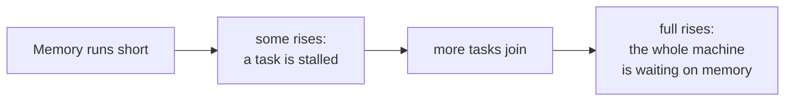

# Pressure Stall Information: Measuring Time Lost, Not Bytes Left

> **Part 2 of the [Linux Memory Pressure series](/fields/system-administration/linux-memory-pressure/README.md).** "How much memory is left?" is the wrong question, because Linux keeps it nearly all in use on purpose. The right question is "how much time are programs losing waiting for memory?", and the kernel counts exactly that. By the end you'll read the three lines of `/proc/pressure/memory` at a glance and know how a rescuer program gets woken by them.

## Table of Contents
- [Pressure Stall Information: Measuring Time Lost, Not Bytes Left](#pressure-stall-information-measuring-time-lost-not-bytes-left)
  - [Table of Contents](#table-of-contents)
  - [The restaurant that watches the queue, not the pantry](#the-restaurant-that-watches-the-queue-not-the-pantry)
  - [Reading the file](#reading-the-file)
  - [Try it before you scroll](#try-it-before-you-scroll)
  - [Some versus full](#some-versus-full)
  - [Bytes versus time, with two examples](#bytes-versus-time-with-two-examples)
  - [Getting woken up: triggers](#getting-woken-up-triggers)
  - [Per group, and who uses it](#per-group-and-who-uses-it)
  - [Check it on your own machine](#check-it-on-your-own-machine)
  - [References](#references)

---

## The restaurant that watches the queue, not the pantry

A restaurant manager wants to know when the kitchen is in trouble. She could watch the pantry: "how many eggs are left?" But a full pantry says nothing about whether customers are waiting, and an almost-empty one might be fine if a delivery is due. Pantry counts are a guess about trouble.

What she really cares about is the **queue**: "what share of the evening are customers sitting at a table with no food, waiting?" That number is trouble itself. It does not need interpreting.

| Restaurant | Linux machine |
|------------|---------------|
| The pantry stock | Free or available memory |
| Customers waiting with no food | Tasks stalled on memory |
| "Share of the evening someone was waiting" | **PSI**, Pressure Stall Information |

PSI (kernel 4.20 and up) is that queue measurement. It turns the stalls from [part 1](/fields/system-administration/linux-memory-pressure/how-linux-reclaims-memory.md) (direct reclaim, swap-ins, refaults) into a percentage of wall-clock time.

---

## Reading the file

```
$ cat /proc/pressure/memory
some avg10=0.00 avg60=0.00 avg300=0.00 total=687177
full avg10=0.00 avg60=0.00 avg300=0.00 total=680771
```

Two lines, each with the same four numbers.

| Field | Meaning |
|-------|---------|
| `avg10`, `avg60`, `avg300` | The **percentage of time** spent stalled, averaged over the last 10, 60 and 300 seconds |
| `total` | Stall time since boot, in **microseconds**. A raw counter you can diff yourself |

The three averages tell you the *trend*: if `avg10` is much higher than `avg300`, the pressure just started. If they're all high, it has been going on a while.

The zeros above are a calm machine. The thing to remember: **0.00 here means no task lost any time to memory in that window, whatever `MemFree` says.**

---

## Try it before you scroll

☕ Two machines.

- **A:** `MemFree` is 200 MB of 32 GB. PSI memory `some avg60=0.00`.
- **B:** `MemFree` is 8 GB of 32 GB. PSI memory `some avg60=35.00`.

Which one needs attention?

Got your answer? Scroll on.

Answer: **B**. A has a full cache and is losing no time at all. B has plenty of free memory and tasks are stalled a third of the time: perhaps one job is thrashing inside a small cgroup limit, or a burst of allocations just drained the free pool. The pantry looked fine; the queue was long.

---

## Some versus full

There are two lines because "someone is waiting" and "everyone is waiting" are different emergencies.

| Line | It counts the time when... | Think of it as |
|------|---------------------------|----------------|
| `some` | **At least one** runnable task was stalled on memory | A customer is waiting. Annoying |
| `full` | **All** non-idle tasks were stalled on memory at the same moment | Every customer is waiting and nobody is being served. The kitchen has stopped |



`some` is the early warning, `full` is the "the machine is effectively down" signal. A single-threaded program that stalls shows up as `some` *and* `full` together, because its one thread is every non-idle task it has.

---

## Bytes versus time, with two examples

Why is time a better alarm than bytes?

**Low free memory, no pressure.** A file server reads a lot of files, and the cache fills RAM. `MemFree` is 2% and PSI is 0. The kernel is using the spare as it should. An alert on `MemFree` fires every night for nothing.

**Plenty free, high pressure.** A container is limited to 2 GiB with `memory.max` while the host has 20 GiB free. The container's working set is 2.5 GiB. The host looks relaxed. The container is thrashing and its PSI is high. An alert on host `MemFree` never fires.

In both cases the stall time was the thing that mattered, and bytes pointed the wrong way. PSI also measures the **cost**: how bad a given level of use feels to the programs running on it. That is why it is the right input for a rescuer. A threshold on bytes has to be tuned per machine, and a threshold on stalled time means the same thing everywhere.

PSI also exists for `cpu` and `io` (`/proc/pressure/cpu`, `/proc/pressure/io`), with the same format.

---

## Getting woken up: triggers

Polling a file every second is fine. The kernel also lets a program say "wake me when pressure crosses this line", with no polling at all.

You write a threshold to the file, then wait on it with `poll`/`epoll`:

```python
import os, select

fd = os.open("/proc/pressure/memory", os.O_RDWR | os.O_NONBLOCK)
os.write(fd, b"some 150000 1000000\0")   # 150 ms of stall inside any 1-second window

p = select.poll()
p.register(fd, select.POLLPRI)
while True:
    for _fd, ev in p.poll():
        if ev & select.POLLPRI:
            print("memory pressure threshold crossed")   # act here
```

The string means: *stall time (150000 µs) within a window (1000000 µs)*. If tasks lose 150 ms or more out of any second, the program is woken. Windows run from 500 ms to 10 s.

Two notes, both tested in clean VMs on Ubuntu 22.04 (Linux 5.15) and Ubuntu 26.04 (Linux 7.0).

**A trigger keeps firing while the stall lasts.** The kernel docs say notifications are rate-limited to one per tracking window. In a test, a 150 ms-in-1 s trigger on a cgroup under sustained pressure woke the program 14 times in 15 seconds on 5.15 and 15 times on 7.0, about once per window. Don't assume a single wake-up, and re-read the file after you act to decide from the numbers.

**Who may register a trigger depends on the kernel.** The kernel docs say unprivileged users can create triggers if the window is a multiple of 2 seconds. On 7.0 that is what happened: an ordinary user registered a 2 s window on `/proc/pressure/memory`, and the 1 s window above was refused with `EINVAL`. On 5.15 the same user got `EPERM` for both. On both kernels a user's own `user@1000.service` cgroup file was owned by root and refused the write (`EACCES`), so a rescuer that watches a group needs a file it can write. If you must support older kernels, run the rescuer as root.

This is how a lightweight rescuer can sleep at zero cost until it is needed. And because it sleeps in the kernel until it is woken, it fits the memory-locking idea: the program is **idle until the worst moment**, the exact profile that [part 5](/fields/system-administration/linux-memory-pressure/memory-locking-mlockall.md) protects.

---

## Per group, and who uses it

Every cgroup v2 group has its own `memory.pressure` (and `cpu.pressure`, `io.pressure`), in the same format. So you can ask "is *this container* stalled?" while the rest of the machine is calm. That is the data a rescuer needs to decide **which** group to act on, not just *whether* to act.

| Tool | What it watches | Notes |
|------|-----------------|-------|
| **`systemd-oomd`** | Per-cgroup memory PSI (plus swap use) | Kills a whole cgroup when pressure stays above a limit for a set time. Defaults to 60% for 20 seconds |
| **`earlyoom`** | `MemAvailable` and swap free, in percent | A simpler, older approach: bytes, not time |
| A custom rescuer | Anything you choose | PSI triggers plus the per-group files give the finest control |

On the machine this page was written on (Ubuntu 26.04, Linux 7.0), `systemd-oomd` is running and `earlyoom` is not.

---

## Check it on your own machine

```bash
cat /proc/pressure/memory /proc/pressure/cpu /proc/pressure/io
cat /sys/fs/cgroup/memory.pressure                  # the root group, same numbers as above
cat /sys/fs/cgroup/user.slice/memory.pressure       # just the user sessions
systemctl status systemd-oomd                       # is a pressure-based killer running?
```

If `/proc/pressure/memory` doesn't exist, the kernel was built without PSI, or booted with `psi=0`. Some distribution kernels ship PSI switched off by default (they need `psi=1` on the kernel command line), so check the file before you build on it.

To watch it move, put a deliberately small memory limit on a throwaway group and run something greedy inside it (see the [cgroup page](/fields/system-administration/linux-memory-pressure/cgroup-v2-memory-control.md)). Its `memory.pressure` climbs while the host's stays near zero.

**Takeaway:** don't alarm on how many bytes are free; alarm on the share of time tasks spend stalled on memory (`some` for early warning, `full` for "the machine has stopped"), because that measures the trouble itself and means the same on every machine.

You can now see pressure coming. If nothing relieves it, the kernel eventually loses patience and kills something: who, and when? That's [part 3](/fields/system-administration/linux-memory-pressure/the-oom-killer.md).

## References
- [Linux kernel docs: PSI, Pressure Stall Information](https://www.kernel.org/doc/html/latest/accounting/psi.html) (trigger rate limit, window range, unprivileged monitors)
- [Facebook Engineering: PSI and cgroup2-based OOM handling (oomd)](https://facebookmicrosites.github.io/oomd/)
- [systemd-oomd.service(8)](https://www.freedesktop.org/software/systemd/man/latest/systemd-oomd.service.html)
- [earlyoom](https://github.com/rfjakob/earlyoom)
