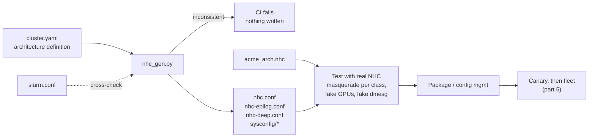

# Architecture-Driven NHC: Generate Health Checks from Your Cluster's Definition

<!-- related-block -->
<div class="reading-time">12 min read</div>
<!-- related-block -->
<div class="related-strip">

**Read first:** [Rolling NHC Out to a Fleet Without Draining Everything](/fields/system-administration/node-health-check/rollout-at-scale.md), [Writing nhc.conf That Actually Fits Your Cluster](/fields/system-administration/node-health-check/writing-nhc-conf.md), [Writing Your Own NHC Checks](/fields/system-administration/node-health-check/custom-checks.md)  ·  **Read next:** [Case Study: "Build Us an NHC", From a Vague Ask to a Validated Proposal](/fields/system-administration/node-health-check/case-study-build-me-an-nhc.md)

</div>


> **Part 9 of the [Node Health Check series](/fields/system-administration/node-health-check/README.md).** The capstone. Parts 3 to 7 taught you to write `nhc.conf` by hand. This part stops doing that: you describe what the cluster *is*, and NHC gets built from that description. Everything here was run against real NHC 1.5, and two of its bugs-in-waiting were found that way.

## Table of Contents
- [Architecture-Driven NHC: Generate Health Checks from Your Cluster's Definition](#architecture-driven-nhc-generate-health-checks-from-your-clusters-definition)
  - [Table of Contents](#table-of-contents)
  - [Three sources of truth, zero agreement](#three-sources-of-truth-zero-agreement)
  - [The idea: health policy as code](#the-idea-health-policy-as-code)
  - [Step 1: describe the architecture](#step-1-describe-the-architecture)
  - [Step 2: the generator](#step-2-the-generator)
  - [Step 3: the architecture check module](#step-3-the-architecture-check-module)
  - [Step 4: prove it with real NHC before it ships](#step-4-prove-it-with-real-nhc-before-it-ships)
  - [Two traps the tests caught](#two-traps-the-tests-caught)
  - [Step 5: ship it through CI](#step-5-ship-it-through-ci)
  - [Onboarding a new hardware generation](#onboarding-a-new-hardware-generation)
  - [Growing the model](#growing-the-model)
    - [References](#references)

The files used on this page:

| File | What it is |
|------|-----------|
| [`cluster-example.yaml`](/fields/system-administration/node-health-check/cluster-example.yaml) | The architecture definition: classes, roles, fabrics, storage, GPUs |
| [`nhc_gen.py`](/fields/system-administration/node-health-check/nhc_gen.py) | Validates the definition, cross-checks `slurm.conf`, writes all NHC configs |
| [`acme_arch.nhc`](/fields/system-administration/node-health-check/acme_arch.nhc) | NHC module with the architecture checks the generated configs call |
| [`nhc_test_harness.sh`](/fields/system-administration/node-health-check/nhc_test_harness.sh) | The Step 4 tests as one CI script with assertions; exits non-zero on any failure |

---

## Three sources of truth, zero agreement

On a cluster that's a few years old, the same facts live in at least three places:

| Fact | `slurm.conf` says | `nhc.conf` says | The hardware says |
|------|-------------------|-----------------|-------------------|
| Memory on `cn001` | `RealMemory=530000` | `512GB` | 503 GB usable |
| GPUs on `gpu07` | `Gres=gpu:h100:4` (copy-paste from the test rack) | 8 | 8 |
| `cn513-516` exist? | Yes, added last month | No line matches them | Yes, running jobs |

Each row is a real failure mode. The first gets every node drained as `Low RealMemory` by Slurm. The second schedules jobs onto half the GPUs. The third is the scariest: four production nodes with **no health checks at all**, and nothing tells you, because a node that matches no line in `nhc.conf` just passes.

Hand-written configs drift because nobody's job is to keep them in sync. So make it a machine's job.

---

## The idea: health policy as code



Three rules make it work:

1. **The YAML is the only thing humans edit.** Generated files carry a "do not edit" header and a hash of their source.
2. **The generator refuses to write anything inconsistent**, with itself or with `slurm.conf`. A bad definition fails CI, not the cluster.
3. **Every generated config is executed by real NHC in CI** before it reaches a node.

---

## Step 1: describe the architecture

Model what the cluster *should* be, at the level an architect would draw it. The example file has five sections:

| Section | Captures | Why it's separate |
|---------|----------|-------------------|
| `storage` | Mounts: path, type, source, read-only | Shared by many classes; change the NFS server in one place |
| `fabrics` | Link rate and the HCAs that must be up | A GPU rail design has 8 HCAs; a CPU node has one |
| `roles` | What a node *does*: services, user-process hygiene | Login and compute nodes can share hardware but not policy |
| `classes` | Hardware classes: node list, CPU, NUMA, memory, fabric, mounts, GPUs | One class per distinct hardware build |
| `defaults` | Fudge factors, timeouts per context, ping targets | Site-wide knobs |

A class reads like a spec sheet:

```yaml
gpu-h100:
  nodes: "gpu[01-30],gpu32"          # gpu31 is out for RMA
  role: compute
  cpu: {sockets: 2, cores: 96, threads: 192}
  numa_nodes: 2
  memory: 2TB
  fabric: ndr-rail                   # 8 x NDR HCAs, defined once under fabrics
  mounts: [home, scratch, apps]
  gpus:
    count: 8
    model: "H100"
    fatal_xids: [48, 79, 94, 95, 119]
    deep_diag_level: 2
```

How each fact becomes a check, and in which context ([part 3](/fields/system-administration/node-health-check/writing-nhc-conf.md#contexts-one-binary-many-personalities)):

| Architecture fact | Generated check | periodic | epilog | deep |
|-------------------|----------------|:--:|:--:|:--:|
| `mounts` | `check_fs_mount_rw` / `_ro` with type and source | ✅ | ✅ | ✅ |
| `gpus.count` | `check_arch_gpu_count` | ✅ | ✅ | ✅ |
| `gpus.fatal_xids` | `check_cmd_dmesg` with a negated Xid regex | ✅ | ✅ | ✅ |
| role `services` | `check_ps_service -S` (self-healing, [part 7](/fields/system-administration/node-health-check/auto-remediation.md)) | ✅ | | ✅ |
| `cpu` | `check_hw_cpuinfo` | ✅ | | ✅ |
| `numa_nodes` | `check_arch_numa_nodes` | ✅ | | ✅ |
| `memory` + fudge | `check_hw_physmem` | ✅ | | ✅ |
| `fabric` | one `check_hw_ib rate dev` per HCA | ✅ | | ✅ |
| `gpus.model` | `check_arch_gpu_model` | ✅ | | ✅ |
| role `user_hygiene` | `check_ps_unauth_users`, `check_ps_userproc_lineage` (log only) | ✅ | | ✅ |
| `gpus.deep_diag_level` | `check_arch_dcgm_diag` | | | ✅ |

Ordering inside each class is cheapest-and-most-likely-first: mounts, then GPUs, then everything else. The epilog context stops after the GPU lines because every second there is added to every job ([part 4](/fields/system-administration/node-health-check/slurm-integration.md#prolog-and-epilog-checks-at-job-boundaries)).

---

## Step 2: the generator

```bash
pip install pyyaml
python3 nhc_gen.py cluster.yaml --out build/ --slurm-conf /etc/slurm/slurm.conf --strict
```

It does four jobs.

**1. Validate the definition.** Every node in exactly one class, every referenced role, fabric and mount defined, `sockets <= cores <= threads`, sizes parseable, every service known to the `SERVICE_MAP`. All problems are reported in one run, not one per attempt.

**2. Cross-check `slurm.conf`.** The generator parses `NodeName` lines (including `NodeName=DEFAULT` and `\` continuations) and compares them with the architecture. Here's the real output against a `slurm.conf` with the three drifts from the table at the top:

```text
$ python3 nhc_gen.py cluster-example.yaml --out build --slurm-conf slurm-drift.conf
ERROR:   slurm.conf: 4 node(s) not covered by any class, so they get no health checks: cn513, cn514, cn515, cn516
ERROR:   class 'cpu-std' vs slurm.conf (cn001 and others): RealMemory=530000 MB exceeds the 524288 MB the node has; Slurm will drain it as 'Low RealMemory'
ERROR:   class 'gpu-h100' vs slurm.conf (gpu01 and others): Gres has 4 GPUs, architecture says 8
Nothing written.
```

And against a consistent one:

```text
$ python3 nhc_gen.py cluster-example.yaml --out build --slurm-conf slurm-good.conf
OK: 545 nodes in 4 classes -> nhc.conf, nhc-epilog.conf, nhc-deep.conf in build/
```

The coverage check is the most valuable line in the whole tool. It turns "nodes silently without health checks" from an invisible state into a failed build.

**3. Translate hostlists.** Slurm and NHC disagree on range syntax ([part 3](/fields/system-administration/node-health-check/writing-nhc-conf.md#match-strings-who-runs-what)): NHC allows one range per name and no commas inside brackets. The generator converts:

| Slurm hostlist (in YAML) | NHC target (generated) |
|---|---|
| `cn[001-480]` | `{cn[001-480]}` |
| `gpu[01-30],gpu32` | `{gpu[01-30],gpu32}` |
| `cn[001-010,015]` | `{cn[001-010],cn015}` |

**4. Emit one file per context**, plus a sysconfig file each, so "early" settings like `TIMEOUT` land where NHC actually reads them ([part 3](/fields/system-administration/node-health-check/writing-nhc-conf.md#variables-and-the-precedence-trap)). An excerpt of the generated periodic config:

```bash
##############################################################################
# nhc.conf for cluster 'acme' -- GENERATED by nhc_gen.py.
# Source sha256:156f1e7b603c346f. Do not edit: change the YAML and regenerate.
##############################################################################

### Global
* || DF_FLAGS="-Tkal"
* || DFI_FLAGS="-Tial"
* || check_fs_mount_rw -f /
* || check_net_ping -W 2 -c 2 slurmctl01

### class gpu-h100 (31 nodes, role compute)
{gpu[01-30],gpu32} || check_fs_mount_rw -t nfs -s 'nas01:/export/home' -f /home
{gpu[01-30],gpu32} || check_fs_mount_rw -t lustre -s '*@o2ib*:/scratch' -f /scratch
{gpu[01-30],gpu32} || check_fs_mount_ro -t nfs -s 'nas01:/export/apps' -f /apps
{gpu[01-30],gpu32} || check_arch_gpu_count 8
{gpu[01-30],gpu32} || check_cmd_dmesg -m '!/NVRM: Xid [(]PCI:[^)]*[)]: (48|79|94|95|119),/' -M 'Fatal GPU Xid in kernel log'
{gpu[01-30],gpu32} || check_ps_service -u root -d sshd -S sshd
{gpu[01-30],gpu32} || check_ps_service -u munge -d munged -S munge
{gpu[01-30],gpu32} || check_hw_cpuinfo 2 96 192
{gpu[01-30],gpu32} || check_arch_numa_nodes 2
{gpu[01-30],gpu32} || check_hw_physmem 2TB 2TB 3%
{gpu[01-30],gpu32} || check_hw_ib 400 mlx5_0
   ... one check_hw_ib line per rail HCA ...
{gpu[01-30],gpu32} || check_arch_gpu_model 'H100'
{gpu[01-30],gpu32} || check_ps_unauth_users log syslog
{gpu[01-30],gpu32} || check_ps_userproc_lineage log syslog
```

It's one cluster-wide file, the way NHC was designed to be used: every node gets the same bytes and picks its own lines.

---

## Step 3: the architecture check module

Built-in checks cover CPUs, memory, mounts and IB. `acme_arch.nhc` adds the architecture facts NHC doesn't know about:

| Check | Verifies |
|-------|----------|
| `check_arch_numa_nodes N` | NUMA nodes online, parsed from `/sys/devices/system/node/online` in pure bash. Catches a BIOS reset to the wrong NPS / sub-NUMA setting, a classic silent performance killer |
| `check_arch_gpu_count N` | GPUs visible to `nvidia-smi` (timeout-bounded, cached) |
| `check_arch_gpu_model S` | Every GPU's name contains `S`. Catches the wrong card swapped in by a well-meaning technician |
| `check_arch_dcgm_diag L [secs]` | `dcgmi diag -r L` reports no failure. Deep context only |

It follows [part 6](/fields/system-administration/node-health-check/custom-checks.md#the-rules-of-the-house)'s rules, including one that testing this page added to the list: **declare module globals with `declare -g`**. More on that below.

Install it next to the built-ins: `/etc/nhc/scripts/acme_arch.nhc`.

---

## Step 4: prove it with real NHC before it ships

Generated configs are only trustworthy if something executes them. NHC 1.5 can run straight from a Git clone and has three features that make a test harness easy:

- `NHC_CFG_CONFDIR` / `NHC_CFG_INCDIR` point it at a test directory instead of `/etc/nhc`.
- `-m host` masquerades as any node, so one CI runner can test every class.
- Module command variables (`ARCH_NVSMI`, `ARCH_NUMA_ONLINE`) and `NHC_DMESG_CMD` can point at fakes.

> [!WARNING]
> **Run these tests only in CI or a throwaway container.** `MARK_OFFLINE=0` stops draining, not fixing: checks with auto-fix flags still act. In testing, NHC tried to start `sshd` and `munge` and created `/scratch` and `/apps` on the test machine. [`nhc_test_harness.sh`](/fields/system-administration/node-health-check/nhc_test_harness.sh) refuses to run outside CI or a container unless you pass `--force`.

```bash
git clone --depth 1 --branch 1.5 https://github.com/mej/nhc.git /tmp/nhc
mkdir -p /tmp/nhctest && cp -r /tmp/nhc/scripts /tmp/nhctest/ && cp acme_arch.nhc /tmp/nhctest/scripts/
mkdir -p /var/run/nhc                      # PID file directory (1.5)

nhc_test() {   # usage: nhc_test <conf> <host> [VAR=value ...]
  local conf=$1 host=$2; shift 2
  NHC_CFG_CONFDIR=/tmp/nhctest NHC_CFG_INCDIR=/tmp/nhctest/scripts \
    /tmp/nhc/nhc -c "$conf" -m "$host" -l- -t 60 -a -v NHC_RM=none MARK_OFFLINE=0 "$@"
}
```

**Test 1: does each node get the right lines?** Count the checks selected per host:

```bash
for h in cn100 cn500 gpu07 gpu31 login01 storage01; do
  printf '%-10s ' "$h"; nhc_test build/nhc.conf "$h" | grep -m1 -oE 'of [0-9]+'
done
```

Real results for the example cluster:

| Host | Checks | Why |
|------|-------:|-----|
| `cn100` | 15 | 4 global + 11 for `cpu-std` |
| `cn500` | 15 | 4 global + 11 for `cpu-bigmem` (different memory size, same count) |
| `gpu07` | 25 | 4 global + 21 for `gpu-h100` (8 HCA lines) |
| `gpu31` | 4 | Out for RMA: excluded from the class, globals only ✅ |
| `login01` | 11 | 4 global + 7 for `login` (no scratch, no hygiene) |
| `storage01` | 4 | Not in the architecture: globals only |
| `gpu07` epilog | 8 | Mounts and GPU lines only |

Turn that table into assertions and a change that accidentally drops a class's checks fails CI.

**Test 2: do the checks pass on a good node and fail on a bad one?** Fake the hardware:

```bash
# fake nvidia-smi with 8 healthy GPUs, and one where a GPU fell off the bus
for n in 8 7; do
  printf '#!/bin/bash\nfor i in $(seq %d); do echo "NVIDIA H100 80GB HBM3"; done\n' "$n" > /tmp/fake-smi$n
done
chmod +x /tmp/fake-smi*; echo "0-1" > /tmp/numa2      # fake 2-NUMA-node layout

nhc_test build/nhc.conf gpu07 ARCH_NVSMI=/tmp/fake-smi8 ARCH_NUMA_ONLINE=/tmp/numa2 | grep -A1 check_arch
nhc_test build/nhc.conf gpu07 ARCH_NVSMI=/tmp/fake-smi7 | grep 'failed:  check_arch_gpu_count'
#  -> Health check failed:  check_arch_gpu_count:  7 GPUs visible, expected 8
```

**Test 3: does the Xid line catch a fatal Xid?** Prepend a line that swaps `dmesg` for a fake log:

```bash
printf '[5012.3] NVRM: Xid (PCI:0000:3b:00): 79, pid=4242, GPU has fallen off the bus.\n' > /tmp/dmesg-bad
printf '[7.1] NVRM: Xid (PCI:0000:3b:00): 13, pid=1, Graphics Exception\n'                   > /tmp/dmesg-ok
for f in dmesg-bad dmesg-ok; do
  { echo "* || NHC_DMESG_CMD=( cat /tmp/$f )"; cat build/nhc-epilog.conf; } > /tmp/ep.conf
  printf '%-10s ' "$f"; nhc_test /tmp/ep.conf gpu07 ARCH_NVSMI=/tmp/fake-smi8 | grep -E 'Xid.*failed|completed' | head -1
done
#  dmesg-bad  Health check failed:  check_cmd_dmesg:  Fatal GPU Xid in kernel log.
#  dmesg-ok   (GPU checks pass: Xid 13 is usually an application fault, not hardware)
```

Real hardware failures are rare and you can't schedule them. Fakes let you prove every check fails when it should, on every commit.

**All three tests in one script.** [`nhc_test_harness.sh`](/fields/system-administration/node-health-check/nhc_test_harness.sh) runs them with assertions. Expected check counts per host live in a block at the top; update them when `cluster.yaml` changes. On the example cluster:

```text
$ CI=true ./nhc_test_harness.sh build
ok   - cn100 nhc: 15 checks
...
ok   - gpu07 nhc-deep: 26 checks
ok   - GPU count passes with 8 GPUs
ok   - GPU count fails with one GPU missing
ok   - Xid check fails on fatal Xid 79
ok   - Xid check passes on benign Xid 13
# 12 passed, 0 failed
```

With the backslash bug from the next section put back into the config, it reports `FAIL - Xid check does NOT fail on fatal Xid 79` and exits 1.

---

## Two traps the tests caught

Both of these were in the first draft of this series. Neither shows up when you test checks with `nhc -e`, only when real NHC reads a real config and loads a real module. That's the whole argument for Step 4.

**Trap 1: backslashes vanish from config lines.** The Xid regex was first written with `\(PCI:...\)`. Through `nhc -e` it worked. Through the config file it **passed even with Xid 79 in the log**: NHC's config parser drops backslashes, `\(` became `(`, and the regex turned into a group that can never match the real line. A health check that always passes is worse than none, because it looks like coverage. The fix is bracket expressions, which need no escaping: `[(]`, `[)]`, `[[]`, `[]]`, `[.]`. The generator emits only those. [Part 3](/fields/system-administration/node-health-check/writing-nhc-conf.md#contexts-one-binary-many-personalities) now carries a warning about it.

**Trap 2: module variables that disappear.** `check_arch_numa_nodes` first failed with `cannot read` and an *empty* path. NHC loads modules by sourcing them **inside a function**, and in bash a plain `declare` inside a function makes a local variable. The module's defaults existed only while the file was being loaded. It hid in testing because passing `ARCH_NVSMI=...` on the command line sets a global that masks the bug, while on a real node, with no override, every GPU node would have drained with "nvidia-smi failed". Fix: `declare -g`. [Part 6](/fields/system-administration/node-health-check/custom-checks.md#the-rules-of-the-house) now lists it as a rule.

A third thing worth knowing from the harness: when NHC couldn't find its modules (a wrong `INCDIR`), it still ended with **"completed successfully; 0 passed"**. Treat "0 passed" as a failure in your tests and your monitoring.

---

## Step 5: ship it through CI

A minimal pipeline, here as GitHub Actions; the shape is the same in GitLab or Jenkins:

```yaml
# .github/workflows/nhc.yml in your cluster-config repo
name: nhc
on: [pull_request, push]
jobs:
  generate-and-test:
    runs-on: ubuntu-latest
    steps:
      - uses: actions/checkout@v4
      - run: pip install pyyaml
      - name: Generate (fails on inconsistency or slurm.conf drift)
        run: python3 nhc/nhc_gen.py nhc/cluster.yaml --out build --slurm-conf slurm/slurm.conf --strict
      - name: Test with real NHC 1.5
        run: sudo -E bash nhc/nhc_test_harness.sh build     # -E keeps CI=true for the safety guard
      - uses: actions/upload-artifact@v4
        with: {name: nhc-build, path: build/}
```

Then deliver `build/` and `acme_arch.nhc` the way you deliver any config: an RPM such as `acme-nhc-config` (with `Requires: lbnl-nhc`, versioned per Git tag, which makes rollback a `dnf downgrade`), or your Ansible role from [part 2](/fields/system-administration/node-health-check/build-and-install.md#getting-it-onto-500-nodes). The rollout itself is still dry run, canary, enforce, behind the circuit breaker ([part 5](/fields/system-administration/node-health-check/rollout-at-scale.md)). Generation makes the config *correct*; it doesn't make it *safe to push to 2,000 nodes at once*.

> [!TIP]
> Keep `slurm.conf` and `cluster.yaml` in the same repository. Then a pull request that adds nodes to Slurm but not to the architecture fails its own CI, and the reviewer sees both halves of the change in one diff.

---

## Onboarding a new hardware generation

The payoff. A new rack of 64 GPU nodes arrives with a different GPU model and a different NUMA layout:

1. **Add one class** to `cluster.yaml`: `gpu-next`, `nodes: "gpx[01-64]"`, its CPU, NUMA, memory, fabric and `gpus` block.
2. **Add the `NodeName` line** to `slurm.conf` in the same pull request.
3. **CI generates and tests.** Forgot the Slurm line? Forgot the class? Typo in the GPU count? The build fails and says which.
4. **Bring the rack up in canary mode** ([part 5](/fields/system-administration/node-health-check/rollout-at-scale.md#phase-3-canary-enforcing-on-a-few-nodes)), then into production.

Every new node gets health checks on day one, without anyone writing an NHC line.

---

## Growing the model

The example covers the essentials. Common next additions, each a YAML field plus a few generator lines:

| Architecture fact | How to check it |
|-------------------|-----------------|
| BIOS version, SMT, power profile | `check_dmi_data_match` against `dmidecode` data |
| Kernel and driver versions | `check_file_contents /proc/sys/kernel/osrelease '<version>*'` and `/proc/driver/nvidia/version` |
| NVLink / GPU topology | Golden copy of `nvidia-smi topo -m` per class, compared by a small module check |
| HCA firmware and port GUIDs | `ibstat` output through `check_cmd_output` |
| CPU frequency governor, THP, hugepages | `check_file_contents` on `/sys` files ([part 6](/fields/system-administration/node-health-check/custom-checks.md#first-do-you-even-need-a-module)) |
| Local NVMe scratch | `check_fs_mount_rw` plus `check_fs_size` per class |

One honest limit: everything here is still a **per-node** truth. A cluster where every node passes can still have a degraded fabric path or one slow GPU dragging a 512-GPU job ([related reading](/fields/devops/kubernetes/nvidia-cluster-readiness-engine.md)). Multi-node tests (NCCL, MPI benchmarks) are the layer above, and they can be generated from the same architecture file.

> **Takeaway:** describe the cluster once, generate NHC from it, refuse to build when it disagrees with `slurm.conf` or leaves nodes uncovered, and run every generated config through real NHC with fakes in CI. The tests on this page found two silent bugs that hand-written configs and `nhc -e` testing never would have.

### References
- [NHC README: match strings, contexts, `-m` masquerade, `NHC_CFG_*` overrides](https://github.com/mej/nhc#configuration)
- [NHC 1.5 release notes](https://github.com/mej/nhc/releases/tag/1.5)
- [`slurm.conf`: node configuration (`NodeName`, `RealMemory`, `Gres`)](https://slurm.schedmd.com/slurm.conf.html#SECTION_NODE-CONFIGURATION)
- [NVIDIA Xid errors catalogue](https://docs.nvidia.com/deploy/xid-errors/index.html)