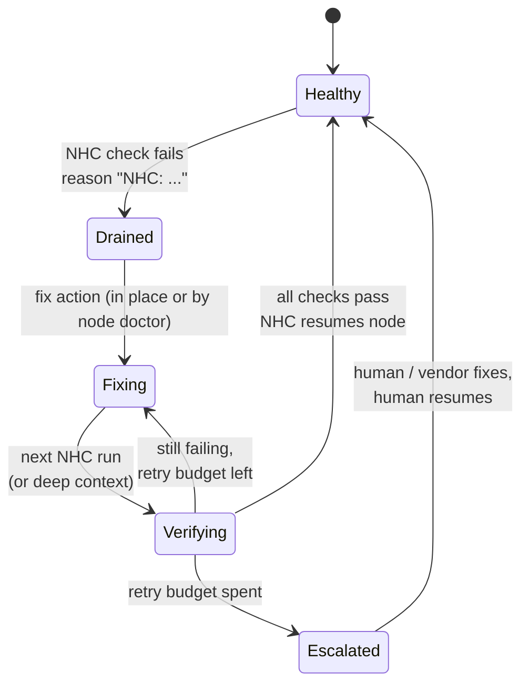

# Auto-Remediation: From Detected to Fixed, Safely

> **Part 7 of the [Node Health Check series](/fields/system-administration/node-health-check/README.md).** Draining a sick node is defense. This page is offense: fixing the boring 80% of failures without a human, while making sure automation never turns one bad node into a hundred.

## Table of Contents
- [The loop](#the-loop)
- [The escalation ladder](#the-escalation-ladder)
- [Rung 0: fix in place with NHC's own flags](#rung-0-fix-in-place-with-nhcs-own-flags)
- [What you must never auto-fix](#what-you-must-never-auto-fix)
- [Rungs 1-2: the node doctor](#rungs-1-2-the-node-doctor)
- [Guard rails, or how not to reboot the whole cluster](#guard-rails-or-how-not-to-reboot-the-whole-cluster)
- [Rung 3: hand off to humans and vendors](#rung-3-hand-off-to-humans-and-vendors)
- [Notifications without the spam](#notifications-without-the-spam)

---

## The loop

Every good remediation system, from a 50-node lab cluster to a hyperscaler's GPU fleet, runs the same loop:



The key insight: **NHC already does half of this.** It detects, it drains with a reason, and it re-verifies and resumes on its next run. All you need to add is the "fix" step, plus rules about when to stop trying.

---

## The escalation ladder

Not every failure deserves the same response. Climb one rung at a time:

| Rung | Action | Example failures | Who acts |
|------|--------|------------------|----------|
| **0. Fix in place** | Restart a daemon, remount a filesystem | `munged` died, NFS mount dropped | NHC itself, during the check |
| **1. Clean reboot** | Drain, wait for jobs to finish, reboot | GPU Xid 79, leaked memory, stuck D-state processes | Node doctor |
| **2. Deep verify** | After reboot, run slow diagnostics before resuming | ECC errors, flaky IB link | Node doctor + deep context |
| **3. Human / RMA** | Ticket, keep drained with a non-NHC reason | Same failure after reboot, DIMM missing, hardware inventory changed | People |

The rule of thumb: **automate what's cheap to get wrong.** Restarting `munged` on a healthy node costs nothing. Rebooting a node with a running 3-day job costs a lot.

---

## Rung 0: fix in place with NHC's own flags

Several built-in checks take a fix action. The pattern is always the same: **the check still fails this run** (so the node drains), the fix runs in the background, and the **next run passes and resumes** the node.

```bash
# Start sshd / munge if they're not running
   * || check_ps_service -u root -S sshd
   * || check_ps_service -u munge -d munged -S munge

# Same idea, with your own start command instead of /sbin/service
   * || check_ps_service -u chrony -d chronyd -e 'systemctl start chronyd' chronyd

# Remount a missing NFS home (best effort, in the background)
   * || check_fs_mount -r -t nfs -s 'nas01:/export/home' -o '*hard*' -f /home

# Run anything when a mount is missing (here: restart the Lustre client service)
   * || check_fs_mount_rw -t lustre -s '*@o2ib*:/scratch' -e '/usr/local/sbin/lustre-remount' -f /scratch
```

The useful flags:

| Check | Flag | Effect |
|-------|------|--------|
| `check_ps_service` | `-S` / `-r` / `-c` | start / restart / stop-then-start the service if not running |
| | `-e cmd` / `-E cmd` | run `cmd` if the process is missing / present |
| | `-s` / `-k` | stop / kill a service that **shouldn't** be running |
| `check_fs_mount*` | `-r` | `mount -o remount_options` in the background |
| | `-e cmd` / `-E cmd` | run `cmd` if missing / found |
| `check_ps_cpu`, `check_ps_mem`, `check_ps_time` | `-r N` / `-k` / `-K` | renice / kill the process / kill its parent |
| `check_net_socket` | `-e cmd` | run `cmd` if the expected socket isn't there |
| Most checks | `-0` | **non-fatal**: log the problem, don't drain |

> [!TIP]
> The fix runs **as root, from NHC, under `slurmd`**. Make fix scripts idempotent, quick and quiet, and give them full paths. If your fix needs more than a few seconds, it's not a rung-0 fix; hand it to the node doctor.

---

## What you must never auto-fix

Automation that hides problems is worse than no automation. Keep your hands off:

- **Anything that kills user processes on a node running jobs.** With `HealthCheckNodeState=ANY`, `check_ps_unauth_users kill` or `check_ps_mem -k` can terminate a legitimate job if your "authorized" logic has a gap. Log first (`log syslog`), watch for weeks, then decide.
- **Resetting error counters** (GPU ECC, IB port counters, `mcelog`) to make a check pass. You just erased the evidence the vendor will ask for.
- **Recurring failures.** A node that needed a reboot three times this week is broken hardware wearing a fake moustache. That's rung 3.
- **Anything during a cluster-wide event.** If 20% of nodes fail the same check at once, the problem is shared (fabric, filesystem, a bad config push). Rebooting 400 nodes makes it worse. That's the circuit breaker's job ([part 5](/fields/system-administration/node-health-check/rollout-at-scale.md#phase-4-enforce-everywhere-with-a-circuit-breaker)).

---

## Rungs 1-2: the node doctor

Rebooting and deep diagnostics don't belong inside NHC: they're slow, and a node can't reliably reboot itself in the middle of its own health check. Run a small **node doctor** on the controller (or wherever you run cluster automation). It reads NHC's drain reasons, matches them against rules, and acts.

Prerequisites: `RebootProgram` set in `slurm.conf` (so `scontrol reboot` works), and **NHC 1.5** on the nodes so post-reboot drain handling is correct ([part 4](/fields/system-administration/node-health-check/slurm-integration.md#boot-and-reboot-the-sneaky-part)).

```bash
#!/bin/bash
# /usr/local/sbin/nhc-node-doctor -- run from cron every 10 minutes on the controller.
# Reads NHC drain reasons and reboots nodes whose failure is on the "safe to reboot" list.
set -uo pipefail

STATE_DIR=/var/lib/nhc-doctor          # per-node attempt history: "<epoch> <reason>" lines
MAX_ATTEMPTS=2                         # reboots per node per window
WINDOW_SECS=$(( 24 * 3600 ))
MAX_CONCURRENT=4                       # max doctor reboots started in the last 30 minutes
DRY_RUN=${DRY_RUN:-1}                  # start in dry-run. Seriously.

# Failure messages (regex) where a reboot is a reasonable first fix
REBOOTABLE='Xid|fallen off the bus|D-state|not mounted|nvidia-smi failed'

mkdir -p "$STATE_DIR"
now=$(date +%s)
log() { logger -t nhc-doctor "$*"; echo "$*"; }

# How many reboots did we start recently? (concurrency guard)
in_flight=$(cat "$STATE_DIR"/* 2>/dev/null | awk -v cut=$(( now - 1800 )) '$1 > cut' | wc -l)

while IFS='|' read -r node reason; do
    [[ "$reason" == NHC:* ]] || continue                # only NHC-owned drains
    [[ "$reason" =~ $REBOOTABLE ]] || continue          # only known-rebootable failures

    hist="$STATE_DIR/$node"
    attempts=$(awk -v cut=$(( now - WINDOW_SECS )) '$1 > cut' "$hist" 2>/dev/null | wc -l)
    recent=$(awk -v cut=$(( now - 1800 )) '$1 > cut' "$hist" 2>/dev/null | wc -l)
    (( recent == 0 )) || continue                       # reboot already requested, give it time

    if (( attempts >= MAX_ATTEMPTS )); then
        log "$node: $attempts reboots in window, escalating: $reason"
        # Rewrite the reason WITHOUT the NHC: prefix, so NHC never auto-resumes it
        (( DRY_RUN )) || scontrol update nodename="$node" reason="ESCALATED: ${reason#NHC: } (doctor gave up)"
        # TODO: open a ticket here (webhook, email, ITSM API)
        continue
    fi
    if (( in_flight >= MAX_CONCURRENT )); then
        log "concurrency limit reached ($MAX_CONCURRENT), skipping $node this round"
        continue
    fi

    log "$node: rebooting (attempt $(( attempts + 1 ))/$MAX_ATTEMPTS): $reason"
    if (( ! DRY_RUN )); then
        echo "$now $reason" >> "$hist"
        # Plain reboot: the node is already drained by NHC, so no new jobs land.
        # It reboots once running jobs finish, and the NHC: reason is kept.
        scontrol reboot "$node"
    fi
    in_flight=$(( in_flight + 1 ))
done < <(sinfo -h -N -R -o '%N|%E' | sort -u)
```

> [!WARNING]
> **No `ASAP`, no `nextstate=` here.** Per the `scontrol` docs, Slurm clears the node's DRAIN flag after an `ASAP` reboot or one with `nextstate=resume`/`down`. The node would rejoin the pool as soon as `slurmd` registers, without waiting for your verification. Since NHC has already drained the node, a plain `scontrol reboot` is all you need.

How the loop closes:

1. NHC drains `gpu07` with `NHC: ... Xid ... 79 ...`.
2. The doctor matches the Xid, records the attempt, and runs `scontrol reboot gpu07`. Running jobs finish first; the drain keeps new ones away.
3. `gpu07` reboots. `slurmd` runs NHC at startup, and NHC 1.5 keeps a freshly rebooted node drained until NHC itself onlines it.
4. Checks pass; the reason still starts with `NHC:`, so NHC resumes the node. Nobody woke up.
5. If it happens again within 24 hours, the doctor tries one more reboot. The third time, it **rewrites the reason** without the `NHC:` prefix. Thanks to the handshake, NHC will now never auto-resume it: it's a human's node.

**Adding rung 2 (deep verify).** For failures like ECC errors, a clean boot isn't proof enough. Before rebooting, the doctor *claims* the node with its own reason, so NHC won't resume it after the reboot:

```bash
scontrol update nodename="$node" reason="nhc-doctor: deep verify pending"
scontrol reboot "$node"
```

On a later round, once the node is back up, it runs the deep context and hands ownership back:

```bash
if ssh "$node" '/usr/sbin/nhc -n nhc-deep -l-'; then
    # NHC: prefix again -> NHC resumes it on its next clean periodic run
    scontrol update nodename="$node" reason="NHC: deep verify passed, awaiting periodic check"
else
    scontrol update nodename="$node" reason="ESCALATED: deep check failed after reboot"
fi
```

Handing a node back with an `NHC:` reason is the neat trick here: you never call `scontrol update state=resume` from automation; NHC does it, only after its own checks pass.

> [!NOTE]
> This is deliberately a ~60-line script, not a platform. It's enough for most clusters. Big GPU fleets often grow this into a proper service (a state machine with a database, vendor ticket integration, dashboards); the rules and guard rails stay the same.

---

## Guard rails, or how not to reboot the whole cluster

The script above already has the four that matter most. Don't remove them:

| Guard rail | Prevents |
|-----------|----------|
| **Dry-run default** | Learning how your regex behaves on production data the hard way |
| **Retry budget per node** (`MAX_ATTEMPTS` in `WINDOW_SECS`) | Infinite reboot loops on genuinely broken hardware |
| **Concurrency limit** (`MAX_CONCURRENT`) | A shared failure turning into a mass reboot |
| **Allowlist of failure types** (`REBOOTABLE`) | Rebooting for problems a reboot can't fix (wrong RAM size, missing DIMM) |

Plus two operational ones:

- **Every action is logged** with node, reason and attempt number. When someone asks "why did gpu07 reboot at 03:12?", the answer is in syslog.
- **Pair it with the circuit breaker.** If the breaker trips, the doctor stops. A shared outage is a human's problem.

---

## Rung 3: hand off to humans and vendors

When automation gives up, make the handoff useful:

- **A reason that tells the story**: `ESCALATED: Xid 79 on GPU 3 after 2 reboots (doctor gave up)` beats `bad`.
- **Evidence collected before anyone touches it**: `dmesg`, `nvidia-smi -q`, `ipmitool sel list`, the last `nhc.log` lines, a `nvidia-bug-report.sh` for GPUs. Vendors ask for these first; collect them automatically into the ticket.
- **NHC's permanent mode** for hardware classes where any failure means RMA: run those nodes' NHC with `-p` (1.5) and failures are tagged `(perm)`, never auto-resumed.

---

## Notifications without the spam

Nobody reads the 400th identical e-mail. Two NHC-native tools help:

- **`nhc-wrapper`** for cron-driven contexts: it compares each run with the previous one and only reports **changes**, plus a reminder every `-X` interval while a problem persists:

  ```bash
  */10 * * * * root /usr/sbin/nhc-wrapper -M ops@example.org -X 12h -n nhc-oob
  ```

- **JSON syslog** (`-j`, 1.5) into your log pipeline, with alerting rules on *rates* ("more than 5 new NHC drains in 15 minutes") rather than individual events.

Page humans for **escalations and breaker trips**. Everything else is a dashboard.

Next, when things don't behave: [part 8, troubleshooting](/fields/system-administration/node-health-check/troubleshooting.md).

> **Takeaway:** NHC already detects, drains, re-verifies and resumes. Add fixes in place with `-S`, `-r`, `-e`, and a small node doctor for reboots, guarded by dry-run, retry budgets, concurrency limits and an allowlist. When automation gives up, drop the `NHC:` prefix so a human owns the node.

### References
- [NHC README: `check_ps_service`, `check_fs_mount`, resource checks](https://github.com/mej/nhc#built-in-checks)
- [`scontrol reboot` (ASAP, nextstate, reason)](https://slurm.schedmd.com/scontrol.html#OPT_reboot)
- [NHC 1.5 release notes: `-p` permanent offline, JSON syslog](https://github.com/mej/nhc/releases/tag/1.5)
- [NVIDIA DCGM diagnostics: which level to use when](https://docs.nvidia.com/datacenter/dcgm/latest/user-guide/dcgm-diagnostics.html)
