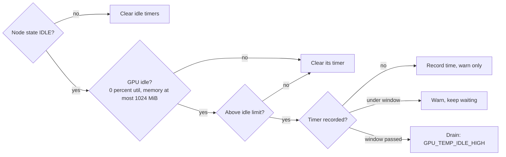

# GPU Temperature in a Health Check: The Idle Timer

> **Part 13 of the [Node Health Check series](/fields/system-administration/node-health-check/README.md).** Dana, Sam, the fleet and every node are invented, and 45 °C, 10 minutes and 1,024 MiB are example values. Commands come from NVIDIA's DCGM and Slurm documentation. The author tested this code and it works; the output samples on the page are synthetic.

Around 03:00, the health check will accuse a GPU of loafing while it is training. Dana will almost agree with it. What stops her is a line in `nvidia-smi`, and the thing she nearly does is a drain.

**By the end of this page you will be able to:**

- Write an idle-GPU temperature rule that warns first and drains only if the heat persists.
- Explain why utilization alone cannot define "idle", and what to check instead.
- Use the Slurm node state as the gate, and know what that gate costs.
- Scan a fleet read-only before the rule is allowed to drain anything.

---

## A scan, a table, and one suspicious row

The ceiling from [part 12](/fields/system-administration/node-health-check/gpu-temperature/gpu-temperature-ceiling.md) catches a GPU that is dangerously hot. Dana wants a second rule for a GPU that is warm and has nothing to do, because that is usually a sign of airflow or a cooling fault that the ceiling will not see for hours.

Before enforcing anything, she runs the read-only scan across a synthetic fleet and gets a table. One row stands out:

```text
NODE          SLURM STATE  GPU  TEMP  UTIL  MEM MiB  GPU STATUS  WOULD TRIGGER
gpu-node-31   MIXED        0    47C   0%    ...      IDLE        IDLE_HIGH
```

An idle GPU at 47 °C, above the 45 °C limit. The tidy move is to drain the node and let Sam look.

---

## Three definitions of idle, one of them dangerous

**Attempt 1: idle means 0% utilization.** The row says 0%. Done.

**Attempt 2: idle means no GPU in the node's Slurm allocation.** Dana reads which GPUs Slurm has handed out and treats the rest as free.

**Attempt 3: drain it.** Her cursor is on the command when Sam asks one question:

> **Sam:** Did you look at what `nvidia-smi` says about GPU 0?

It shows about 90 GB of memory in use and a training process. The job is alive.

Three attempts, and two of them believed a single instant. What is "idle", if not "0% right now"?

---

## Why 0% right now lies

Utilization is a snapshot. A busy GPU can read 0% for a moment between kernels, during a data-loading pause or a checkpoint. A sample taken in that dip says "idle" about a GPU with a workload attached.


*One sample at 0% says idle. The memory bar says a workload is attached.*

Dana's second attempt failed for a different reason. Slurm's way of reporting which GPUs a node has allocated differs between nodes in the author's fleet:

- Some nodes report `GresUsed=gpu:8` with no per-GPU list.
- Others report something like `gpu:h200:4(IDX:0-3)`.
- A parser that reads only the `IDX` part sees no allocated GPUs on the first kind, and so treats a running job as idle.

That is the author's observation, not a documented guarantee, and it is why the final rule does not parse allocation at all.

---

## The two gates an idle GPU has to pass

The rule applies only to a node that Slurm calls **idle**, and then only to a GPU that is idle on two independent readings.

**Gate 1: the node state.** `scontrol show node` prints a `State=`.

```bash
scontrol show node $(hostname -s) | grep -E 'State=|GresUsed|AllocTRES'
```

- The idle rule runs only when `State=` starts with `IDLE`. That includes `IDLE+DRAIN`.
- It does not run when the state contains `COMPLETING`.
- A node that is `MIXED` or `ALLOCATED` gets the ceiling rule only.

**Gate 2: the GPU itself.** On an idle node, a GPU counts as idle only if both hold:

- utilization is 0%, and
- memory in use is at most `GPU_IDLE_MEM_MAX_MIB` (1,024 in this page).

Anything else (utilization above 0%, or memory in use) is "busy without a job", for example a sysadmin test. It is not idle, and its timer is cleared.

---

## Warn first, drain later

A GPU that has just finished a job is warm and needs time to cool. So the rule gives it a window, and it keeps the window on disk.



*The idle rule runs every cycle, after the ceiling rule from part 12. A ceiling drain does not skip it, and an unreadable `dcgmi` skips both.*

The mechanics, in order:

- **First sighting:** an idle GPU above `GPU_IDLE_TEMP_MAX` (45 in this page) only raises a warning. The time is written to a small file, one per GPU, under `GPU_TEMP_STATE_DIR` (`/var/tmp/nhc_gpu_temp/gpu<N>.hot_since`).
- **A later run:** if the same GPU is still idle and still above the limit, and `GPU_IDLE_WINDOW_MIN` minutes (10 in this page) have passed since the recorded time, the node drains with `GPU_TEMP_IDLE_HIGH`.
- **The timer is discarded** if the node leaves IDLE, utilization rises above 0%, memory is in use, or the GPU cools to the limit or below.
- **A recorded time from before the last boot, or in the future, is discarded** and restarted, so a reboot or a clock jump can't create a false drain.
- **An unreadable utilization (`N/A`) counts as not idle.**
- **If `dcgmi` or the Slurm state can't be read**, the rule warns and skips that run. It never drains on its own.

```bash
if (( hot_min < GPU_IDLE_WINDOW_MIN )); then
    echo "  WARNING: GPU-$idx idle at ${temp}C for ${hot_min}m (window ${GPU_IDLE_WINDOW_MIN}m) - not drained yet."
else
    msg="GPU_TEMP_IDLE_HIGH: GPU-$idx idle above ${GPU_IDLE_TEMP_MAX}C for ${hot_min}m (now ${temp}C)"
    flag_gpu_temp "GPU_TEMP_IDLE_HIGH" "warning" "$msg"
    record_error "15_check_gpu_temp_idle" "$msg"       # drains at the end of the run
fi
```

The five variables sit at the top of the temperature block:

| Variable | Example value | Meaning |
|---|---|---|
| `GPU_TEMP_CEILING` | 87 | Any GPU above this drains the node (part 12) |
| `GPU_IDLE_TEMP_MAX` | 45 | An idle GPU above this starts the timer |
| `GPU_IDLE_WINDOW_MIN` | 10 | Minutes it must stay idle and hot before the drain |
| `GPU_IDLE_MEM_MAX_MIB` | 1024 | Memory in use above this means a workload is attached |
| `GPU_TEMP_STATE_DIR` | `/var/tmp/nhc_gpu_temp` | One "hot since" file per GPU |

---

## The trade-off nobody likes to write down

Gating on the node state fixed the false positive, and it costs something.

- **A MIXED node with free, hot GPUs is no longer checked by the idle rule.** Only the ceiling covers it.
- **The 45 °C limit is a fleet choice**, not a physics constant. The author took it from a quick look at what idle GPUs in the fleet actually read. Yours will differ.
- **The window is a guess about cooling.** A GPU coming off a heavy job may take longer than 10 minutes to cool, so check how long yours takes on real nodes.
- **The window and the run interval interact.** If the health check runs less often than every few minutes, short jobs between runs are missed. Compare the window with your check's interval (the author's interval is still unknown).

---

## Scan before you let it drain anything

The scan script applies the same rules read-only and never drains. It connects to each node over ssh, reads the same `dcgmi dmon` fields and the node's `scontrol show node`, and prints what the check would do. Load the key once, then run it:

```bash
eval "$(ssh-agent -s)"; ssh-add
./gpu_temp_scan.sh nodelist.yml
```

The node list is a small YAML file, one node per line:

```yaml
nodes:
  - gpu-node-01
  - gpu-node-02   # a trailing comment is fine
```

The script is [`gpu_temp_scan.sh`](/fields/system-administration/node-health-check/gpu-temperature/gpu_temp_scan.sh): 20 nodes in parallel by default, with `CEILING`, `IDLE_MAX`, `IDLE_MEM_MAX`, `WINDOW` and `PARALLEL` as environment variables. It writes counts, a table of flagged GPUs, a per-node summary and two CSV files (`all_gpus.csv`, `flagged.csv`).

On a synthetic fleet of 200 nodes the summary line looks like:

```text
Nodes in list: 200   scanned OK: 190   unreachable: 6   no dcgmi data: 4
Nodes flagged: 3   (CEILING: 0, IDLE_HIGH: 3)
```

Reading it:

- **Unreachable and no-data nodes are unknown, not fine.** Hot GPUs there are invisible to the scan.
- **A flagged `IDLE_HIGH` row is a snapshot.** The real check drains only if the GPU is still idle and hot after the window.
- **Every flagged row should be on an `IDLE` or `IDLE+DRAIN` node**, because the idle rule never applies to the others.

Handy one-liners on the scan folder:

```bash
sort -t, -k4 -nr gpu_temp_scan_*/all_gpus.csv | head -10          # hottest GPUs
for f in /var/tmp/nhc_gpu_temp/*; do echo "$f: $(( ( $(date +%s) - $(cat $f) ) / 60 )) min since recorded"; done   # on a node
```

> [!NOTE]
> Rollback is simple: restore the previous script and remove `/var/tmp/nhc_gpu_temp/`.

---

## The false positive, solved

Back at 03:00, Dana runs the corrected scan. The row for `gpu-node-31` now reads `ALLOCATED`: the node is `MIXED`, so the idle rule is not applied, and only the ceiling is. The three rows that remain are `IDLE_HIGH` on `IDLE+DRAIN` nodes, empty and already out of service, with 0 MiB in use.

Sam looks at those three instead of draining a node with a live job. Dana adds one line to the series' notes:

> **Dana:** utilization is a snapshot. State and memory are the evidence.

**Next:** what do you do with a drained node once the heat is gone? Resume is manual, and the pattern for automating it safely is in [auto-remediation](/fields/system-administration/node-health-check/checks-and-remediation/auto-remediation.md). **Just the steps:** [quick guide](/fields/system-administration/node-health-check/gpu-temperature/quick-guide.md).

---

## 📜 The Scroll (keep this)

```text
Gate 1:     idle rule only when Slurm State= starts with IDLE and not COMPLETING (MIXED/ALLOCATED: ceiling only)
Gate 2:     GPU idle = 0% utilization AND memory in use <= GPU_IDLE_MEM_MAX_MIB
Timer:      first sighting above GPU_IDLE_TEMP_MAX -> record time, warn only
Drain:      still idle and hot after GPU_IDLE_WINDOW_MIN minutes -> GPU_TEMP_IDLE_HIGH
Discard:    node leaves IDLE, util > 0, memory in use, cooled, time before boot or in the future
Fail safe:  dcgmi or Slurm state unreadable -> warn, skip, never drain
Do not:     define idle by utilization alone; trust Slurm allocation parsing across nodes
```

## References

- [NVIDIA DCGM: `dcgmi dmon` reference](https://docs.nvidia.com/datacenter/dcgm/latest/reference/command-line-reference/dcgmi/dcgmi-dmon.html)
- [NVIDIA DCGM: field identifiers](https://docs.nvidia.com/datacenter/dcgm/latest/reference/field-identifiers.html)
- [Slurm: `scontrol` (show node, State, GresUsed)](https://slurm.schedmd.com/scontrol.html)
- [Slurm: `sinfo` (node states)](https://slurm.schedmd.com/sinfo.html)
- [CoreWeave: Slurm node states (IDLE, MIXED, ALLOCATED, COMPLETING)](https://docs.coreweave.com/docs/products/sunk/manage_sunk/slurm-node-states)
- [Upstream NHC (LBNL)](https://github.com/mej/nhc)
