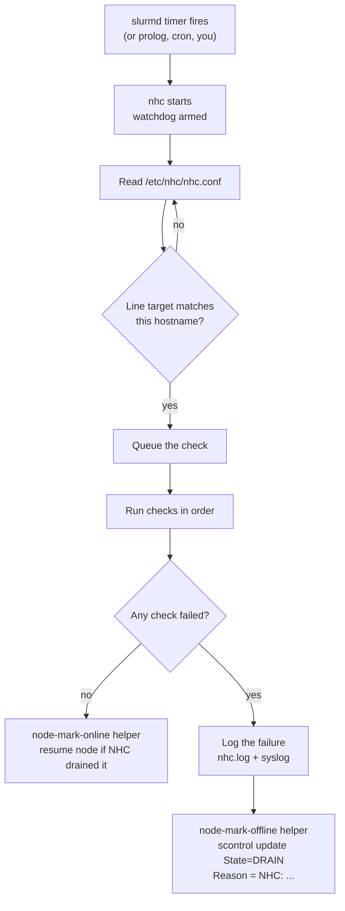

# Why Your Cluster Needs a Bouncer

> **Part 1 of the [Node Health Check series](/fields/system-administration/node-health-check/README.md).** No commands to run yet. Grab the tea, this one is the "why" and the mental model everything else hangs on.

## Table of Contents
- [The night one node ate 400 jobs](#the-night-one-node-ate-400-jobs)
- [Meet NHC](#meet-nhc)
- [How it works, in one picture](#how-it-works-in-one-picture)
- [The "NHC:" handshake](#the-nhc-handshake)
- [Four moments to check a node](#four-moments-to-check-a-node)
- [What NHC is not](#what-nhc-is-not)
- [Where we go next](#where-we-go-next)

---

## The night one node ate 400 jobs

Picture `cn042`. Its `/scratch` Lustre mount dropped at 23:10. Everything else on the node is fine: `slurmd` is up, it answers pings, the scheduler sees it as **IDLE**.

So the scheduler does exactly what it's built to do. It hands `cn042` a job. The job dies in two seconds because `/scratch/$USER` doesn't exist. `cn042` is now idle again, and it's the *most* available node in the partition, so it gets the next job. And the next.

By morning, 400 jobs have "completed" in a few seconds each, users are filing tickets about their "broken code", and your job-failure dashboard looks like a heart monitor in a horror film.

HPC folks call this a **black-hole node**: a node that fails fast and therefore looks permanently available, sucking in work like a drain. The faster your scheduler, the bigger the hole.

The fix isn't a smarter scheduler. It's a **bouncer at the door**: something on every node that asks, every few minutes and before work lands, *"are you actually fit to run a job?"*, and if the answer is no, takes the node out of rotation with a reason a human can read.

> [!NOTE]
> Slurm, PBS/TORQUE and friends all have a hook for exactly this, usually called a *node health check program*. They provide the hook. You provide the program. NHC is the program almost everybody ends up using.

---

## Meet NHC

**LBNL Node Health Check (NHC)** was started at Lawrence Berkeley National Laboratory in late 2010 (it was called *Warewulf NHC* until 1.4.2) and has been running in production on clusters of every size since. It's maintained by Michael Jennings at [github.com/mej/nhc](https://github.com/mej/nhc), BSD-style licensed, and its latest release is **1.5** (October 2026).

Why did it win over the thousand home-grown `healthcheck.sh` scripts out there? Its design goals, straight from the project:

| Goal | What it means in practice |
|------|---------------------------|
| **Reliable** | A watchdog timer kills hung checks, and NHC itself, so a dead NFS server can't wedge your node's health check forever. |
| **Fast** | Written almost entirely in native bash (4.3+), avoiding `grep`/`awk`/`sed` forks wherever possible. Less overhead, less OS jitter for your MPI jobs. |
| **Flexible** | Anything you can write as a shell function can be a check. |
| **Extensible** | Drop a `.nhc` file in the scripts directory, reference the check in the config, done. |
| **Reusable** | One config file for the whole cluster, with per-host targeting. Runs from the RM daemon, cron, or by hand via `pdsh`/`clush`. |

Big users publish their own extensions on top of it. Azure's **AzNHC** is NHC plus GPU, NVLink, InfiniBand and NCCL checks for their AI VMs, and LANL contributed GPU, Kubernetes and network modules upstream.

---

## How it works, in one picture



A few things worth burning into memory:

1. **One config for the whole cluster.** Every line in `nhc.conf` looks like `target || check`. Each node only runs the lines whose target matches its own hostname. More on this in [part 3](/fields/system-administration/node-health-check/writing-nhc-conf.md).
2. **First failure wins (by default).** NHC stops at the first failing check, reports it and exits non-zero. Use `-a` when you want to see *every* failure, which is exactly what you want while debugging.
3. **Silence is golden.** A healthy run prints nothing and exits `0`. Details go to `/var/log/nhc.log`.
4. **NHC takes action itself.** The scheduler only *runs* the program. Slurm's own docs say any action must be performed by the program, and NHC's helper scripts do the draining and resuming.

---

## The "NHC:" handshake

This is the single most important idea in the series, so it gets its own section.

When NHC drains a node, it writes a reason that **starts with `NHC:`**:

```text
$ sinfo -R
REASON                                   USER      TIMESTAMP           NODELIST
NHC: check_fs_mount:  /scratch not mou   root      2026-10-27T23:10:42 cn042
```

When a later run passes, NHC only resumes the node **if the current reason still starts with `NHC:`**. If the node is drained with no reason, or with a reason someone else wrote, NHC leaves it alone.

That one rule gives you a clean ownership contract:

| Who drained it | Reason looks like | Will NHC auto-resume it? |
|----------------|-------------------|--------------------------|
| NHC | `NHC: <failure message>` | ✅ Yes, as soon as checks pass again |
| You, for maintenance | `HW ticket 4711: DIMM swap` | ❌ No, it's yours until you resume it |
| Anyone, no reason given | *(empty)* | ❌ No, by default |

> [!TIP]
> Want NHC to *keep its hands off* a node it drained, say while you investigate? Just change the reason: `scontrol update nodename=cn042 reason="ahmed: investigating lustre"`. The node stays drained and NHC no longer considers it its own.

---

## Four moments to check a node

Health checks aren't one thing. Mature sites check at several moments, each with a different budget:

| Moment | Trigger | Time budget | Good for |
|--------|---------|-------------|----------|
| **Boot / daemon start** | `slurmd` startup, before it registers | Seconds to a minute | "Did this node come up right?" Mounts, NICs, GPUs present, BIOS settings |
| **Periodic** | `HealthCheckInterval` timer | Well under a minute, every few minutes | Cheap, continuous checks: mounts, daemons, memory, link state |
| **Job boundaries** | Prolog / Epilog | Seconds (it delays jobs!) | "Is it safe to start?" / "Did the last job break something?" |
| **On demand / deep** | You, cron, after a drain | Minutes are fine | Stress tests, DCGM level 2-3 diagnostics, burn-in |

NHC can serve all four with **contexts**: separate configs for the same binary (see [part 3](/fields/system-administration/node-health-check/writing-nhc-conf.md#contexts-one-binary-many-personalities)). The golden rule: *the more often a check runs, the cheaper it must be.*

---

## What NHC is not

Knowing the edges saves you from asking it to do things it was never built for:

- **Not a monitoring system.** It answers a yes/no question about one node right now. Trends, graphs and capacity planning belong in Prometheus, Grafana and friends.
- **Not a hardware diagnostic suite.** It can *call* `dcgmi diag`, `memtester` or vendor tools, but it doesn't replace them.
- **Not a cluster-wide performance validator.** A single slow GPU or a degraded fabric path can pass every per-node check and still drag down a 512-GPU job. That takes multi-node tests (NCCL, MPI benchmarks).
- **Not magic.** It only finds what you tell it to look for. Your config *is* your health policy.

---

## Where we go next

Enough theory. In [part 2](/fields/system-administration/node-health-check/build-and-install.md) we get NHC built, installed and passing its own test suite on a node.

> **Takeaway:** a fast-failing node looks like the most available node in the cluster. NHC is the bouncer that drains it with a readable `NHC:` reason, and resumes it once it's healthy again, without touching nodes a human drained.

### References
- [LBNL NHC README and source](https://github.com/mej/nhc)
- [NHC 1.5 release notes](https://github.com/mej/nhc/releases/tag/1.5)
- [`slurm.conf` man page: HealthCheckProgram](https://slurm.schedmd.com/slurm.conf.html#OPT_HealthCheckProgram)
- [Azure: Automated HPC/AI compute node health checks integrated with Slurm](https://techcommunity.microsoft.com/blog/azurehighperformancecomputingblog/automated-hpcai-compute-node-health-checks-integrated-with-the-slurm-scheduler/3113454)
