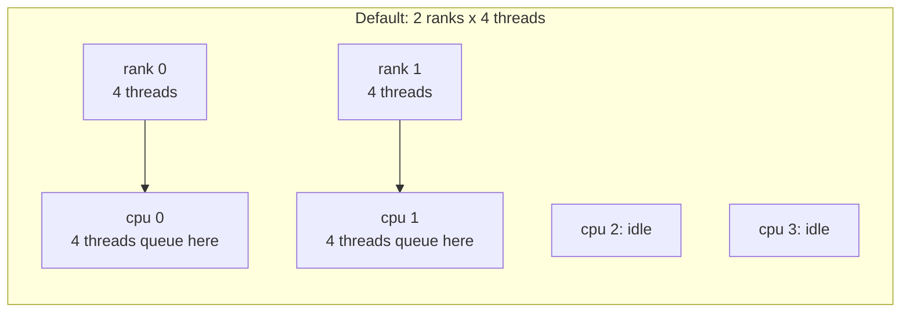
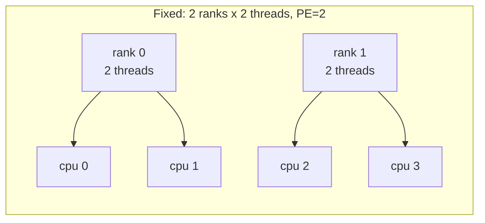

# Kitchens With Cooks: Hybrid MPI+OpenMP and the Binding Trap

> **Part 5 of 8.** By the end you'll know why the two models are combined, what "binding" means, how to see it, and the one-line fix for the most common hybrid mistake.

The scene: you reserve a nice 4-core node, start 2 ranks with 4 threads each, and the job runs. No error. No warning. It is just a bit slow, and slow is the one thing a cluster never complains about. Meanwhile half your cores are doing a very good impression of a break room.

## Contents

- [Why combine them](#why-combine-them)
- [Binding in one paragraph](#binding-in-one-paragraph)
- [The trap, caught on camera](#the-trap-caught-on-camera)
- [Try it before you scroll](#try-it-before-you-scroll)
- [The fix](#the-fix)
- [Proof it matters](#proof-it-matters)
- [A surprise on the way](#a-surprise-on-the-way)
- [The safe path](#the-safe-path)

---

## Why combine them

Back to the kitchens (part 1). A real cluster is many machines (kitchens), each with many cores (cooks).

- **All MPI** means one rank per core. It works, but every cook has private ingredients and every shared fact must be sent as a message. Memory gets copied and message counts grow.
- **All OpenMP** is impossible past one machine.
- **Hybrid** puts one rank per machine (or per socket) and OpenMP threads across the cores that rank owns. Fewer messages, shared data inside each kitchen, MPI only between kitchens.

Hybrid is not always faster. It is one more thing to get right, and the thing most people get wrong is **binding**.

> [!NOTE]
> Written against Ubuntu 26.04.1 (Linux 7.0), gcc 15.2.0, Open MPI 5.0.10, in a throwaway VM with 1 socket and 4 cores. Binding defaults come from the Open MPI 5.0.x manual and may differ in other versions.

---

## Binding in one paragraph

**Binding** (also called pinning or affinity) tells the operating system "this process may only run on these CPUs". Open MPI binds each rank by default, so ranks don't wander between cores. Good for MPI. But a rank's OpenMP threads inherit its allowed CPUs, so if a rank is bound to **one** core, all its threads share **one** core.

Open MPI's defaults, from its [mpirun manual](https://docs.open-mpi.org/en/v5.0.x/man-openmpi/man1/mpirun.1.html):

| Number of processes | Default binding |
|---------------------|-----------------|
| 2 or fewer | to a **core** |
| more than 2 | to a **package** (a socket) |
| oversubscribed | no binding |

So the trap bites hardest on small test runs of one or two ranks, which is exactly what you do while debugging.

---

## The trap, caught on camera

A hybrid hello. Each thread reports the CPU it is on, and each rank reports how many CPUs it is allowed to use (`sched_getaffinity`):

```c
#define _GNU_SOURCE
#include <mpi.h>
#include <omp.h>
#include <sched.h>
#include <stdio.h>
int main(int argc, char **argv) {
    int provided;
    MPI_Init_thread(&argc, &argv, MPI_THREAD_FUNNELED, &provided);  /* MPI + threads: only the main thread calls MPI */
    int rank; MPI_Comm_rank(MPI_COMM_WORLD, &rank);
    cpu_set_t set; sched_getaffinity(0, sizeof set, &set);          /* which CPUs may this rank use? (the binding) */
    if (rank == 0) printf("provided=%d (FUNNELED=%d)\n", provided, MPI_THREAD_FUNNELED);
    #pragma omp parallel                       /* each rank forks its own team of threads */
    {
        #pragma omp critical
        printf("rank %d thread %d/%d on cpu %d, rank may use %d cpus\n", rank,
               omp_get_thread_num(), omp_get_num_threads(), sched_getcpu(), CPU_COUNT(&set));   /* the CPU I'm on now; how many my rank may use */
    }
    MPI_Finalize();
    return 0;
}
```

```bash
mpicc -O2 -fopenmp hybrid.c -o hybrid
OMP_NUM_THREADS=4 mpirun -np 2 ./hybrid       # 2 ranks x 4 threads on a 4-CPU machine
```

```text
provided=1 (FUNNELED=1)
rank 0 thread 3/4 on cpu 0, rank may use 1 cpus
rank 0 thread 1/4 on cpu 0, rank may use 1 cpus
rank 0 thread 2/4 on cpu 0, rank may use 1 cpus
rank 0 thread 0/4 on cpu 0, rank may use 1 cpus
rank 1 thread 3/4 on cpu 1, rank may use 1 cpus
rank 1 thread 1/4 on cpu 1, rank may use 1 cpus
rank 1 thread 2/4 on cpu 1, rank may use 1 cpus
rank 1 thread 0/4 on cpu 1, rank may use 1 cpus
```



Read the last column: **"rank may use 1 cpus"**. Four threads per rank, all on cpu 0 (rank 0) or cpu 1 (rank 1). Four chefs, one stove burner, and two other stoves sitting cold. The program runs without a single error message. This is the whole trap.

You can also see the pinning without writing code, through `--report-bindings` on the plain MPI hello:

```text
[twins:04434] Rank 0 bound to package[0][core:L0]
[twins:04434] Rank 1 bound to package[0][core:L1]
```

Each rank bound to one core (`core:L0`, `core:L1`).

Four threads, two ranks, and "rank may use 1 cpus". So how do you get the second CPU?

---

## Try it before you scroll

☕ Ten seconds. Each rank is allowed one CPU and needs two. What would you tell `mpirun` to change?

Hint: the manual describes a qualifier that means "reserve n CPUs for each process". Its name is a pair of letters.

---

## The fix

The answer is `PE`. Tell Open MPI to give each rank as many CPUs as it has threads:

```bash
OMP_NUM_THREADS=2 mpirun -np 2 --map-by slot:PE=2 --bind-to core ./hybrid
```

`PE=2` ("processing elements") means "reserve 2 CPUs per rank". The manual describes it as binding n CPUs to each process.

```text
provided=1 (FUNNELED=1)
rank 1 thread 0/2 on cpu 2, rank may use 2 cpus
rank 1 thread 1/2 on cpu 3, rank may use 2 cpus
rank 0 thread 0/2 on cpu 0, rank may use 2 cpus
rank 0 thread 1/2 on cpu 1, rank may use 2 cpus
```



Now the output reads "may use 2 cpus", and the four threads sit on four different CPUs (0, 1, 2, 3). The rule of thumb:

> **ranks × threads per rank = cores you reserved, and each rank's binding must hold its threads.**

Fixed on paper. But does it matter in practice, or is this a purist's complaint? Let's put a stopwatch on it.

---

## Proof it matters

A busy loop of 400 million iterations, 2 ranks × 2 threads. This is a demonstration of the effect, not a benchmark: the machine is a small VM and the loop is trivial.

| Launch | Time per rank |
|--------|---------------|
| default binding (1 core per rank) | 0.38 s and 0.41 s in two runs |
| `--map-by slot:PE=2 --bind-to core` | 0.19 s |
| `--bind-to none` | 0.19 s |

Same work, same threads, **twice as long** under the default, because two threads shared one core. Same chefs, same recipe, half the stove. `--bind-to none` also recovered the time, but it lets the operating system move processes around, and on real multi-socket nodes you usually want the explicit binding.

---

## A surprise on the way

My first attempt at the `PE=2` run **failed** (of course it did) with exit code 213. The error text was hidden behind the missing-help-file message (part 3), and only its topic name survived: `span-packages-multiple`. That first VM had libvirt's default CPU layout, which I did not record. I changed the VM to present **1 socket with 4 cores** and the same command worked. My reading, from the topic name only: Open MPI would not give a rank two CPUs that straddle two sockets. Treat that as a guess, but the lesson is real: **on a VM whose CPU layout is odd, binding can fail where bare metal works**, so check `lscpu` first.

I also found `--report-bindings` working on 5.0.10, although the manual lists it as deprecated in favour of `--display bindings`. I ran the latter once and saw no binding lines in that run, and did not investigate further.

---

## The safe path

1. **Dry run.** Start tiny: 2 ranks, 2 threads, `--report-bindings`, and a program that prints how many CPUs each rank may use (the `hybrid.c` above).
2. **Check the numbers.** "may use N cpus" must be at least your thread count, and the CPUs should differ between ranks.
3. **Canary.** Run the real program on one node for a minute, watch `top -H` or your monitoring, and confirm every core you reserved is busy.
4. **Scale up.** Only then run across nodes.
5. **Rollback.** If binding misbehaves, `--bind-to none` is the escape hatch. It works, but check the thread placement afterwards.

OpenMP has its own placement controls (`OMP_PLACES`, `OMP_PROC_BIND`). I did not test them here. Binding that MPI sets first limits what OpenMP can choose from, which is why this page starts with the MPI side.

**Takeaway:** In a hybrid job, check "rank may use N cpus" before you trust any timing, because the default can quietly give every rank one core.

One last question. Both standards just shipped a big new version, OpenMP 6.0 and MPI 5.0. Do you have to rewrite everything you've seen in this series? Two Monday tickets say otherwise, in [part 6](/fields/system-administration/openmp-and-open-mpi/where-they-are-going.md).

---

## References

- [Open MPI mpirun manual, v5.0.x: default binding, `--map-by`, `PE=n`, `--bind-to`](https://docs.open-mpi.org/en/v5.0.x/man-openmpi/man1/mpirun.1.html)
- [MPI standard: MPI_Init_thread and thread levels](https://www.mpi-forum.org/docs/)
- [Parallel Execution and Affinity (this repo): the wider affinity picture, Slurm and NUMA](/fields/benchmarks/parallel-execution-affinity-master-guide.md)
- Every output block on this page: Ubuntu 26.04.1, Linux 7.0, gcc 15.2.0, Open MPI 5.0.10, 1 socket × 4 cores.
