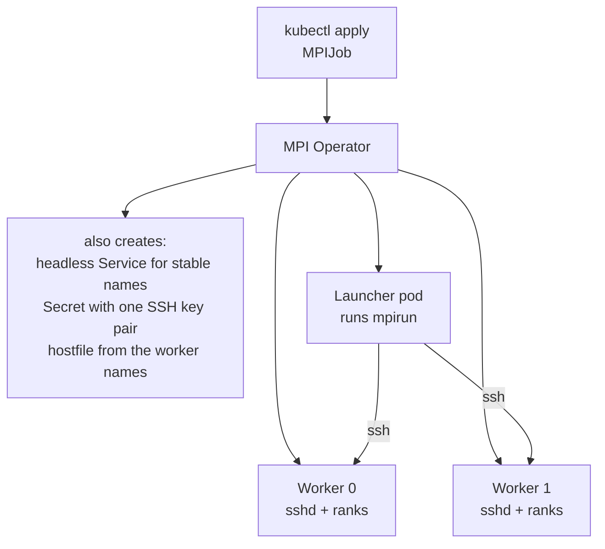

# No Login Node, No Hostfile: OpenMP and MPI on Kubernetes

<!-- related-block -->
<div class="reading-time">9 min read</div>
<!-- related-block -->
<div class="related-strip">

**Read first:** [Who Starts the Ranks? OpenMP and MPI Under Slurm](/fields/system-administration/openmp-and-open-mpi/mpi-and-openmp-under-slurm.md)  ·  **See also:** [Kubernetes in Five Nouns, Explained Like You Just Inherited the Cluster](/fields/devops/kubernetes/kubernetes-in-five-nouns.md), [The Job Execution Journey: From `kubectl apply` to the First All-Reduce](/fields/devops/kubernetes/job-execution-journey.md)

</div>


> **Part 8 of 8, the last one.** Slurm hands MPI a building with a manager and fixed addresses. Kubernetes hands it a city of shipping containers. By the end of this page you'll know what the MPI Operator builds so `mpirun` can find its workers, which three numbers must agree in an `MPIJob`, and why "OpenMP on 100 nodes" is still a ticket you can answer in thirty seconds.

## Contents

- [Two tickets from the new platform](#two-tickets-from-the-new-platform)
- [The city of shipping containers](#the-city-of-shipping-containers)
- [Under the hood: what an MPIJob builds](#under-the-hood-what-an-mpijob-builds)
- [Try it before you scroll](#try-it-before-you-scroll)
- [An MPIJob for the hybrid program](#an-mpijob-for-the-hybrid-program)
- [Three numbers that must agree](#three-numbers-that-must-agree)
- [Back to the two tickets](#back-to-the-two-tickets)

---

## Two tickets from the new platform

The platform team moved an MPI workload from Slurm to Kubernetes. Monday, two tickets arrive.

**Ticket 1:** *"The launcher pod is Running, the worker pods are Running, but `mpirun` can't find its workers."*

**Ticket 2:** *"It runs now. The hybrid job on 8-core workers is slower than it was on Slurm."*

A junior engineer reads both and writes: "Kubernetes doesn't do HPC. Go back to Slurm." Closes both.

They're wrong twice, and the second time they'd be wrong even if they were right the first time. Both tickets are the old problems from parts 5 and 7 in a new costume: **who tells the ranks about each other**, and **how many cores does each rank get**. Kubernetes just answers them differently. To see how, look at the city.

---

## The city of shipping containers

On Slurm, a manager gave every kitchen a fixed address and started the chefs. On Kubernetes, kitchens are **pods**: shipping containers that start on their own, may be replaced on any node, and get a new IP address each time. Nobody hands your `mpirun` an address book. So what does MPI need, and where does it come from?

| What MPI needs | On Slurm (part 7) | On plain Kubernetes | With the MPI Operator |
|----------------|-------------------|---------------------|-----------------------|
| A name for every worker | Node names from the allocation | Pod IPs, which change | Stable DNS names from a headless Service |
| Someone to start ranks on every worker | `slurmstepd` with PMIx | Nobody: a pod just runs its own command | A launcher pod runs `mpirun`, which reaches the workers |
| A way in | Slurm's own channel | None by default | One SSH key pair shared through a Secret |
| The hostfile | Not needed with `srun` | You write it | Generated from the worker names |
| Cores that match threads | `--cpus-per-task` and `--cpu-bind` | CPU requests and limits | Same: your pod spec |

The MPI Operator is the **moving company with a concierge**: it unpacks the containers, writes the address book, hands every kitchen the same key and puts one chef at the front door to say "start."

---

## Under the hood: what an MPIJob builds

You write one object, an `MPIJob` (API `kubeflow.org/v2beta1`). The operator reads its two roles, **Launcher** and **Worker**, and builds the rest. The picture below follows the operator's design proposal for the SSH-based version; check it against the version you install.



Four facts from the proposal explain the whole picture:

- **Workers run an SSH server** instead of `sleep`; the launcher's `mpirun` connects to each one.
- **One key pair** is generated and shared through a `kubernetes.io/ssh-auth` Secret mounted in the launcher and the workers.
- **A headless Service** gives each worker a stable name. "Because the names are stable, the controller can generate the hostfile statically."
- **The launcher is a Job**, so the Job controller handles retries.

> [!NOTE]
> **Why SSH and not `kubectl exec`?** The first version used `kubectl exec`, which "keeps a connection open for control for the whole job" and loads the API server as jobs grow. It also needed a ServiceAccount and a Role listing every pod. SSH removes all of that. An older tutorial that mentions `kubexec.sh` describes the old way.

So Ticket 1 usually means a piece of the picture is missing: workers not ready, no stable name, no key. Check pod events and the launcher log before blaming MPI. I haven't reproduced a failed launch, so this is a checklist from the design, not a measured diagnosis.

What decides how many ranks land on each worker?

---

## Try it before you scroll

☕ Ten seconds. You want 4 ranks with 4 OpenMP threads each, on 2 worker pods. The `MPIJob` field `slotsPerWorker` "specifies the number of slots per worker used in hostfile. Defaults to 1." What should `slotsPerWorker` be, and how many CPUs should each worker pod get?

Hint: a slot is where one rank goes. Count the chefs per kitchen.

**Answer:** 4 ranks on 2 workers is 2 ranks per worker, so `slotsPerWorker: 2`. Each rank runs 4 threads, so each worker needs 2 × 4 = **8 CPUs**. The launcher then runs `mpirun -n 4`. Leave `slotsPerWorker` at its default of 1 and the hostfile gives each worker one slot, so the same job would need 4 workers.

---

## An MPIJob for the hybrid program

Here is the answer as a manifest. **Not run: this page is written from the operator's documentation and API types**, and the image name is a placeholder for an image holding `hybrid` from part 5 with an SSH server and a non-root user:

```yaml
apiVersion: kubeflow.org/v2beta1
kind: MPIJob
metadata:
  name: hybrid-demo
spec:
  slotsPerWorker: 2                 # 2 ranks per worker pod
  sshAuthMountPath: /home/mpiuser/.ssh   # default is /root/.ssh; match your image's user
  mpiImplementation: OpenMPI        # the default; Intel and MPICH exist too
  mpiReplicaSpecs:
    Launcher:
      replicas: 1
      template:
        spec:
          containers:
            - name: launcher
              image: registry.example.com/hybrid:1.0     # placeholder
              command: ["mpirun", "-n", "4", "-x", "OMP_NUM_THREADS=4", "./hybrid"]
    Worker:
      replicas: 2
      template:
        spec:
          containers:
            - name: worker
              image: registry.example.com/hybrid:1.0     # placeholder
              resources:
                requests: { cpu: "8", memory: 4Gi }      # 2 ranks x 4 threads
                limits:   { cpu: "8", memory: 4Gi }      # requests = limits: see the next section
```

Three lines carry the plot:

- `-x OMP_NUM_THREADS=4` is Open MPI's way to "export an environment variable, optionally specifying a value" to the started processes. Ranks are started over SSH, so don't assume an `env:` entry in the Worker spec reaches them. Part 3's hello would show it: if you see the wrong thread count, this is the first line to check.
- `-n 4` must equal `replicas × slotsPerWorker`, here 2 × 2.
- Don't reach for `--allow-run-as-root`: the Open MPI manual marks it "STRONGLY DISCOURAGED". Use a normal user and point `sshAuthMountPath` at its home.

---

## Three numbers that must agree

Part 5's trap came from a mismatch between threads and cores. Part 7 fixed it with two Slurm lines. Here it's three numbers in one manifest:

| Number | Where | Must equal |
|--------|-------|------------|
| Ranks per worker | `slotsPerWorker` | what you'd write as `--ntasks-per-node` on Slurm |
| Threads per rank | `OMP_NUM_THREADS` (through `-x`) | the CPUs you give each rank |
| CPUs per worker | `resources.requests.cpu` and `limits.cpu` | `slotsPerWorker × OMP_NUM_THREADS` |

Then the question Slurm's `--cpu-bind` answered: does each rank actually keep its cores? The Kubernetes docs say how it works:

- Only containers that are in a `Guaranteed` pod (requests equal limits for every resource) **and** have **integer** CPU requests get exclusive CPUs, and only when the node's kubelet runs the **static** CPU manager policy.
- The default policy is `none`. By default the kubelet "uses CFS quota to enforce pod CPU limits", so CPU-bound workloads can move between cores and get throttled when they use more than their quota.

So the manifest above (integer 8, requests equal limits) is the right shape, but whether you get pinned cores depends on a **node setting you may not control**. Ask your admins which policy the node pool runs, then run the hybrid program from part 5 as a first job and read "rank may use N cpus" in its output. That check is the same one that caught the trap on Ubuntu, and it costs one pod.

---

## Back to the two tickets

| Ticket | Likely cause | First check |
|--------|--------------|-------------|
| 1: `mpirun` can't find workers | A piece of the picture missing: workers not ready, no stable name, no shared key | Pod events, the headless Service, the Secret mount path vs the image's user |
| 2: hybrid job slower than on Slurm | CPU requests not integer or not equal to limits, so no exclusive cores, or threads not matching slots | `requests = limits = slotsPerWorker × OMP_NUM_THREADS`, then the part 5 check |

And the junior engineer's "go back to Slurm"? Wrong both times. Kubernetes can run MPI; it just needs the address book written by something, and that something is the operator.

> [!NOTE]
> **The operator is moving.** Kubeflow Trainer v2 offers MPI as a runtime behind a `TrainJob`, and says migrating an `MPIJob` "is not a direct field-by-field conversion". The manifest above is the operator's `v2beta1` API (release v0.8.2 when I read it, maybe not the newest). Read the current docs before you copy it.

**Takeaway:** Kubernetes has no manager to unlock doors, so the MPI Operator builds the address book (a headless Service, a generated hostfile, one shared SSH key) and puts a launcher at the door, while three numbers in your manifest (`slotsPerWorker`, `OMP_NUM_THREADS`, CPUs per worker) decide whether the binding trap bites.

That's the whole route, and here's your closing challenge. A colleague pings you: *"Please run my OpenMP code on 100 Kubernetes nodes."* Can you say in thirty seconds why that ticket is part 1 again, which of the two (OpenMP or MPI) can cross a pod wall, and what you'd ask them before you write a single line of YAML? If so, you're ready for the real thing. Go deeper into the cluster side with [the job execution journey](/fields/devops/kubernetes/job-execution-journey.md) and [Kubernetes in five nouns](/fields/devops/kubernetes/kubernetes-in-five-nouns.md), into placement with [Parallel Execution and Affinity](/fields/benchmarks/parallel-execution-affinity-master-guide.md), or start the series again from [the overview](/fields/system-administration/openmp-and-open-mpi/README.md) with a friend who is still lost.

---

> [!NOTE]
> **What was and wasn't tested.** Nothing on this page was run. The `MPIJob`, the launch order and the CPU behaviour come from the sources below (the MPI Operator repository, its design proposal and API types, the Kubernetes CPU management docs, the Open MPI 5.0 `mpirun` manual and the Kubeflow Trainer migration guide), not from a cluster. Treat the manifest as a pattern to check against your operator version.

## References

- [MPI Operator (kubeflow/mpi-operator): README and example MPIJob](https://github.com/kubeflow/mpi-operator)
- [MPI Operator: MPIJob v2beta1 API types (`slotsPerWorker`, `sshAuthMountPath`, `mpiImplementation`)](https://github.com/kubeflow/mpi-operator/blob/master/pkg/apis/kubeflow/v2beta1/types.go)
- [MPI Operator: design proposal for a scalable, robust operator](https://github.com/kubeflow/mpi-operator/blob/master/proposals/scalable-robust-operator.md)
- [Kubernetes: CPU management policies](https://kubernetes.io/docs/tasks/administer-cluster/cpu-management-policies/)
- [Open MPI 5.0 `mpirun` manual: `-x`, `--allow-run-as-root`](https://docs.open-mpi.org/en/v5.0.x/man-openmpi/man1/mpirun.1.html)
- [Kubeflow Trainer: migrating to Trainer v2 (MPIJob and the MPI runtime)](https://trainer.kubeflow.org/en/latest/operator-guides/migration.html)
