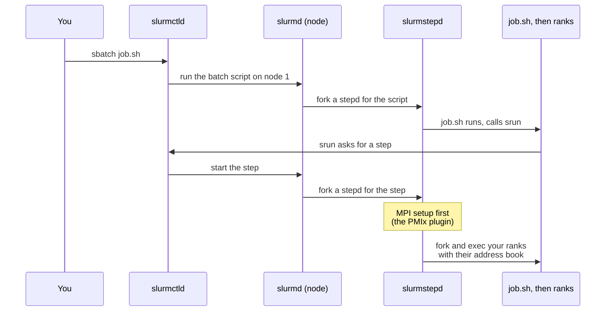

# Who Starts the Ranks? OpenMP and MPI Under Slurm

> **Part 7 of 8.** On your laptop you type `mpirun`. On a cluster somebody else owns the machines, the doors and the clock. By the end of this page you'll know who really starts your ranks under Slurm, what a rank needs before it can talk to its neighbours, and which two job-script lines decide whether part 5's binding trap bites you.

## Contents

- [Two tickets, one job script](#two-tickets-one-job-script)
- [The building manager](#the-building-manager)
- [Under the hood: the road from sbatch to rank](#under-the-hood-the-road-from-sbatch-to-rank)
- [Try it before you scroll](#try-it-before-you-scroll)
- [Two lines decide the binding trap](#two-lines-decide-the-binding-trap)
- [A job script you can trust](#a-job-script-you-can-trust)
- [Back to the two tickets](#back-to-the-two-tickets)

---

## Two tickets, one job script

Monday, two tickets land in the cluster team's queue. Same user, same program, two different symptoms.

**Ticket 1:** *"I asked Slurm for 4 tasks. The program printed `rank 0 of 1` four times."*

**Ticket 2:** *"Now the ranks are fine, but my OpenMP part runs like it has one core."*

A junior engineer reads both and writes: "MPI is broken on the cluster, reinstall Open MPI." Closes both.

They're wrong twice, and neither ticket is about the install. Ticket 1 is about **who started the ranks and whether anybody introduced them to each other**. Ticket 2 is part 5's binding trap wearing a Slurm badge. To see both, you need to know who actually unlocks the kitchen doors on a cluster.

---

## The building manager

Back to the kitchens from part 1. On your laptop you own the building, so you walk in and start the chefs yourself: that's `mpirun`. On a cluster, the building has a **manager**. That's Slurm. It decides which kitchens (nodes) and which burners (cores) you get, and it keeps the keys.

So there's one question: **who unlocks each kitchen and tells every head chef the names of the other kitchens?** The Slurm MPI guide lists three answers:

| Mode | Who starts the ranks | What the guide says |
|------|----------------------|---------------------|
| **1. Direct launch** | Slurm, with `srun` | "Slurm directly launches the tasks and performs initialization of communications through the PMI-1, PMI-2 or PMIx APIs." |
| **2. `mpirun` in an allocation** | `mpirun`, using Slurm's machinery | "Slurm creates a resource allocation for the job and then mpirun launches tasks using Slurm's infrastructure (srun)." |
| **3. Outside Slurm** | `mpirun` over SSH or RSH | "Slurm is not directly launching the user application in case 3," and the guide calls it "not a recommended way". |

For Open MPI, the guide names mode 1 as the winner: "This is the preferred mode of operation since accounting features and affinity done by Slurm will become available." Mode 3 is the back door that sneaks into a kitchen the manager never knew was in use, which is why the repo has a page on [locking it with pam_slurm_adopt](/fields/schedulers/slurm-cluster-operations/slurm-pam-adopt-ssh-access.md).

What is the "initialization of communications" that mode 1 performs? That's where the ticket 1 mystery hides.

---

## Under the hood: the road from sbatch to rank

Every rank, once it starts, has the same first problem: **who else is in my job?** Part 3's `MPI_Init` answers that by asking a launcher. The question and the answer travel over **PMI**: the Process Management Interface, a small address-book protocol between a rank and whoever started it. Slurm speaks three dialects, PMI-1, PMI-2 and **PMIx**. Open MPI "natively supports" PMIx since version 3.1, per the guide.

Here is the road a direct-launch job travels:



The key line is in the box: before the stepd starts your first instruction, its first job is "performs MPI setup, using the appropriate plugin" (see [slurmstepd](/fields/schedulers/slurm-inside-a-job/slurm-slurmstepd.md) for the full order). Slurm builds the address book before the ranks exist, then hands each rank its copy. Which plugin is used?

- The cluster default comes from `MpiDefault` in `slurm.conf`.
- You override it per job with `srun --mpi=<type>`.
- `srun --mpi=list` prints what your Slurm offers. The guide's example lists `cray_shasta`, `none`, `pmi2` and `pmix`.

And the srun manual describes `none` as "No special MPI processing", the default. Put the pieces together and Ticket 1 falls out:

> [!NOTE]
> **Expected, not run on a cluster for this page:** an MPI rank that gets no address book starts as a team of one. Part 1 showed that on a real machine: an MPI program started without a launcher printed `rank 0 of 1`. Four such ranks, one per task, would print `rank 0 of 1` four times. That matches Ticket 1. The cheap check is `scontrol show config | grep MpiDefault` and `srun --mpi=list`; the fix is `srun --mpi=pmix` (or `MpiDefault=pmix` set by the admins).

Mode 2 doesn't need the plugin: `mpirun` asks Slurm's `srun` to start its helpers, and **those** start your ranks. It works, but your ranks are one more hop from the manager, and the guide's "preferred" word goes to the mode with fewer hops.

One sharp edge from the same guide: "OpenMPI has a limitation that does not support calls to `MPI_Comm_spawn()` from within a Slurm allocation."

So the launch itself is settled. Which leaves Ticket 2, the one about cores.

---

## Try it before you scroll

☕ Ten seconds. One 32-core node, this script:

```bash
#SBATCH --nodes=1
#SBATCH --ntasks=4
export OMP_NUM_THREADS=8
srun --mpi=pmix ./sim
```

You wanted 4 ranks with 8 threads each, which is exactly 32 cores. How many cores did Slurm actually reserve for each rank?

Hint: the script never said how many cores a rank gets.

The srun manual answers: `--cpus-per-task` "The default is one CPU per process". Nothing in the script asked for more, so each rank gets **one** core, and `OMP_NUM_THREADS=8` is a wish OpenMP can't fulfil. Eight threads per rank, one burner each. That is part 5's trap, produced by a missing line.

---

## Two lines decide the binding trap

Part 5's rule was: the number of threads must match the number of CPUs each rank may use. Under Slurm, **you** tell Slurm those numbers, and Slurm hands them to the ranks:

| You write | Slurm hands the program | In kitchen terms |
|-----------|-------------------------|------------------|
| `--ntasks=N` (or `-n N`) | N ranks | N kitchens |
| `--cpus-per-task=M` (or `-c M`) | M CPUs per rank, and `SLURM_CPUS_PER_TASK=M` | M burners per kitchen |
| `export OMP_NUM_THREADS=$SLURM_CPUS_PER_TASK` | M threads per rank | M chefs per kitchen |

Three points from the srun manual that keep the bill honest:

1. `SLURM_CPUS_PER_TASK` is "only set if either the `--cpus-per-task` option or the `--tres-per-task=cpu=#` option is specified". Skip the option and the variable is empty, so `OMP_NUM_THREADS=$SLURM_CPUS_PER_TASK` exports an empty string. Part 4 warned you about that line; now you know why.
2. Binding is used "only when the task/affinity plugin is enabled", and with no `--cpu-bind` "the default binding mode will depend upon Slurm's configuration and the step's resource allocation". Auto binding applies when the allocation's sockets, cores or threads match tasks times cpus-per-task. Translation: ask for the full shape, `-n` and `-c`, and Slurm can bind each rank to its own cores. Ask for half the shape, and it may not.
3. `--cpu-bind=verbose` prints what Slurm did, per task.

> [!WARNING]
> **Slurm binds, then Open MPI may bind again.** In mode 2, `mpirun` has its own default binding (part 5: the core when 2 ranks or fewer, the package above that). I have not run mode 2 under Slurm for this page. If you use it, read the report from your own `hybrid` run ("rank may use N cpus", from part 5) instead of assuming. In mode 1, `srun` is the only binder, and that is one more reason it is the preferred mode.

---

## A job script you can trust

This is the pattern from part 4 with the missing pieces added. **Not run on a cluster for this page**, so check it against your site's Slurm version and its `MpiDefault`:

```bash
#!/bin/bash
#SBATCH --nodes=2
#SBATCH --ntasks-per-node=4          # 4 ranks per node, 8 in total
#SBATCH --cpus-per-task=8            # 8 cores per rank: this line is the cure for Ticket 2

export OMP_NUM_THREADS=${SLURM_CPUS_PER_TASK:?set --cpus-per-task}   # fail loudly instead of exporting ""
srun --mpi=pmix --cpu-bind=verbose ./hybrid                          # Slurm starts the ranks, builds the address book, binds
```

`${VAR:?message}` is plain bash: the script stops loudly if `--cpus-per-task` is forgotten, which beats a silent slow job. `srun --mpi=pmix` takes mode 1 (harmless if your site's `MpiDefault` is already `pmix`), and `--cpu-bind=verbose` means Ticket 2 can't hide.

The `hybrid` program from [part 5](/fields/system-administration/openmp-and-open-mpi/hybrid-and-the-binding-trap.md) is the right first job on any new cluster: it prints `rank R thread T/N on cpu C, rank may use K cpus`. If K is smaller than N, you have the trap.

---

## Back to the two tickets

| Ticket | Cause | Fix |
|--------|-------|-----|
| 1: `rank 0 of 1`, four times | `MpiDefault=none` gave the ranks no address book, so each started alone (expected from the docs and part 1, not run here) | `srun --mpi=pmix`, after checking `srun --mpi=list` |
| 2: OpenMP crawls | No `--cpus-per-task`: Slurm's default is one CPU per task, while `OMP_NUM_THREADS` asked for more | `--cpus-per-task=M` plus `OMP_NUM_THREADS=$SLURM_CPUS_PER_TASK`, then read `--cpu-bind=verbose` |

Neither ticket needed a reinstall. Both needed someone to know who unlocks the kitchen doors.

**Takeaway:** under Slurm, `srun` starts the ranks and gives them their address book through PMIx, `--ntasks` and `--cpus-per-task` are the two lines that decide ranks and threads, and `--cpu-bind=verbose` shows you whether the binding trap bit.

Slurm gave you the kitchens for a while, with a manager who knows every key. Now picture the same program on a city whose kitchens are shipping containers that appear, vanish and change address between breakfast and lunch. How does `mpirun` write an address book for that? That's [part 8](/fields/system-administration/openmp-and-open-mpi/mpi-and-openmp-on-kubernetes.md).

---

> [!NOTE]
> **What was and wasn't tested.** Everything here comes from the Slurm documentation (the MPI Users Guide and the `srun` manual, for Slurm 26.05) and from the earlier parts' real runs on Ubuntu 26.04.1 with Open MPI 5.0.10. The job script, the `rank 0 of 1` symptom under `MpiDefault=none`, and mode 2's binding behaviour were **not** run under a real Slurm in this series. Treat them as the documented pattern, not as measured results.

## References

- [Slurm MPI Users Guide: launch modes, PMI/PMIx, Open MPI notes](https://slurm.schedmd.com/mpi_guide.html)
- [srun manual: `--mpi`, `--cpus-per-task`, `--cpu-bind`, `SLURM_CPUS_PER_TASK`](https://slurm.schedmd.com/srun.html)
- [slurmstepd: The Small Daemon That Actually Runs Your Job (this repo)](/fields/schedulers/slurm-inside-a-job/slurm-slurmstepd.md)
- [Locking SSH access with pam_slurm_adopt (this repo)](/fields/schedulers/slurm-cluster-operations/slurm-pam-adopt-ssh-access.md)
