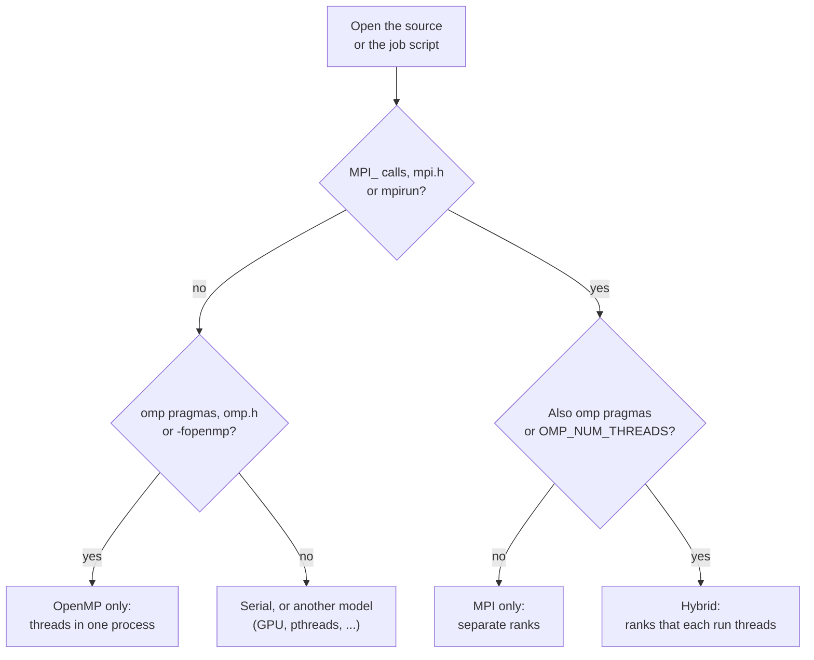

# Know It on Sight: Reading OpenMP and MPI Code, Builds and Job Scripts

> Part 4 of 6. By the end, you'll be able to open an unfamiliar source tree, Makefile or job script and say "this uses OpenMP", "this uses MPI" or "this uses both", and know what each line is asking of the machine.

Think of this page as a detective's pocket guide. Every suspect leaves fingerprints: an include line here, a function prefix there, a launch command at the scene. Learn the five fingerprints and you can name the culprit before you've finished your tea.

## Contents

- [The 30-second triage](#the-30-second-triage)
- [Spotting OpenMP](#spotting-openmp)
- [Spotting MPI](#spotting-mpi)
- [Spotting both: the hybrid fingerprint](#spotting-both-the-hybrid-fingerprint)
- [Reading a job script](#reading-a-job-script)
- [Three look-alikes that fool people](#three-look-alikes-that-fool-people)

---

## The 30-second triage

Someone hands you a project. Before reading a line of logic, run three searches:

```bash
grep -rlE 'omp\.h|#pragma omp|!\$omp' src/    # files that use OpenMP
grep -rlE 'mpi\.h|MPI_Init'            src/    # files that use MPI
grep -rlE 'omp\.h|#pragma omp' src/ | xargs grep -lE 'mpi\.h'   # files that use both
```

Then follow the trail:



I ran the three searches on the test programs from part 3: the first listed the five OpenMP files, the second listed the three MPI ones, the third listed the two files that use both. (`!$omp` is how OpenMP is written in Fortran; I did not run Fortran here.)

---

## Spotting OpenMP

OpenMP is **hints written into ordinary code**. Strip the hints and what remains is a normal serial program, which is by design.

| You see | It means |
|---------|----------|
| `#include <omp.h>` | The program calls OpenMP functions |
| `#pragma omp parallel` (C/C++) or `!$omp parallel` (Fortran) | "Run this block on a team of threads" |
| `#pragma omp parallel for` | "Split this loop's iterations among the threads" |
| `reduction(+:total)` | Each thread keeps a private `total`; they are added at the end |
| `private(x)` / `shared(y)` | Which variables each thread copies, and which all threads share |
| `critical`, `atomic` | Only one thread at a time may run this (or update this) |
| `barrier` | Everyone waits here until all have arrived |
| `omp_get_thread_num()`, `omp_get_num_threads()` | "Which thread am I?" and "how many are there?" |
| `-fopenmp` in a Makefile or build log | The compiler is told to honour all of the above |
| `OMP_NUM_THREADS=8` in a script | Team size |
| `OMP_PLACES`, `OMP_PROC_BIND` | Where threads may run: part of the thread-affinity controls added in OpenMP 4.0 |
| `#pragma omp target` | Offload this region to an accelerator such as a GPU (device support arrived in OpenMP 4.0) |

The marker for "OpenMP and nothing else": no `MPI_` anywhere, started as a plain `./prog`. A chef with no delivery window.

> [!WARNING]
> Pragmas are only comments to a compiler that doesn't know them. No `-fopenmp`, no error, no speed-up (part 3).

---

## Spotting MPI

MPI is **a library you call**. Everything is a function whose name starts with `MPI_`. Strip them out and the program stops working, because the communication is the program.

| You see | It means |
|---------|----------|
| `#include <mpi.h>` | The program calls MPI |
| `MPI_Init` / `MPI_Init_thread`, `MPI_Finalize` | The brackets around every MPI program |
| `MPI_Comm_rank`, `MPI_Comm_size`, `MPI_COMM_WORLD` | "Who am I?", "how many of us?", "everyone started together" |
| `if (rank == 0) { ... }` | One rank does a special job, usually reading input or printing |
| `MPI_Send`, `MPI_Recv` | One rank sends a message to another (point to point) |
| `MPI_Isend`, `MPI_Irecv`, `MPI_Wait` | The same, but non-blocking: start now, finish later |
| `MPI_Bcast`, `MPI_Scatter`, `MPI_Gather` | One rank hands out, or collects, data from all |
| `MPI_Reduce`, `MPI_Allreduce` | Combine one value from every rank (sum, max, ...); `Allreduce` gives everyone the result |
| `MPI_Barrier` | Everyone waits here |
| `mpicc`, `mpicxx`, `mpifort` | Compiler wrappers that add the MPI headers and libraries (`mpicc --showme` prints what they add) |
| `mpirun -np 16 ./prog` or `mpiexec ...` | Start 16 ranks |
| `srun ./prog` inside a Slurm job | Slurm starts the ranks instead of `mpirun` |

Two reading habits pay off, and they have saved me from more than one afternoon of staring:

1. **Everything between `MPI_Init` and `MPI_Finalize` runs in every rank**, unless an `if (rank == ...)` fences it off.
2. **A collective call must be made by every rank in the communicator.** If a collective sits inside an `if` that only some ranks enter, the others wait forever: a deadlock.

---

## Spotting both: the hybrid fingerprint

The rarest sighting, and the one that makes people hold their coffee more tightly.

A hybrid program has **both** includes, usually `MPI_Init_thread` instead of `MPI_Init`, and pragmas inside functions that also call `MPI_`. The ask for thread support is a one-line fingerprint:

```c
MPI_Init_thread(&argc, &argv, MPI_THREAD_FUNNELED, &provided);
```

The MPI standard defines four levels you may request: `SINGLE`, `FUNNELED` (only the main thread calls MPI), `SERIALIZED` (any thread, one at a time) and `MULTIPLE` (any thread, any time). The library tells you what it will actually give in `provided`. On my Open MPI 5.0.10 install, asking for `FUNNELED` returned `provided=1`, which is the value `MPI_THREAD_FUNNELED` has there (the program printed both to compare).

> [!TIP]
> `FUNNELED` is the common choice: OpenMP threads compute, the main thread talks. If you see `MPI_THREAD_MULTIPLE`, the code lets many threads call MPI at once, which is harder to get right.

---

## Reading a job script

A Slurm script tells you the shape of the job. Pattern, **not run here**, so check it against your site's Slurm settings:

```bash
#!/bin/bash
#SBATCH --nodes=2
#SBATCH --ntasks-per-node=4        # 4 MPI ranks per node
#SBATCH --cpus-per-task=8          # 8 cores reserved for each rank
export OMP_NUM_THREADS=$SLURM_CPUS_PER_TASK   # each rank runs 8 OpenMP threads
srun ./prog
```

Decode it: **ntasks = ranks**, **cpus-per-task = threads per rank**. Here that is 2 × 4 = 8 ranks, each with 8 threads, 64 cores in total. Slurm's manual says `SLURM_CPUS_PER_TASK` is "only set if either the --cpus-per-task option or the --tres-per-task=cpu=# option is specified", so a script that uses it without the option exports an empty value. If `--cpus-per-task` is missing but `OMP_NUM_THREADS` is large, every thread competes for one core. Part 5 shows that trap on a real machine.

| Script says | Reading |
|-------------|---------|
| Only `--ntasks=N`, no `OMP_NUM_THREADS` | Pure MPI |
| `--ntasks=1 --cpus-per-task=N` plus `OMP_NUM_THREADS` | Pure OpenMP |
| `--ntasks=N --cpus-per-task=M` plus `OMP_NUM_THREADS` | Hybrid |

---

## Three look-alikes that fool people

| Looks like | Actually |
|------------|----------|
| `OpenMP` and `Open MPI` | Different things (part 1). `openmpi-bin` installs MPI, not OpenMP |
| `libgomp` | gcc's OpenMP runtime. A binary that loads it uses OpenMP, with or without MPI |
| `mpicc` | gcc with extra flags, not a different compiler. It does not add `-fopenmp` |

**Takeaway:** `#pragma omp` and `OMP_` mean threads in one process; `MPI_` and `mpirun` mean separate ranks; `MPI_Init_thread` plus pragmas means both.

Next: [Hybrid and the binding trap](/fields/system-administration/openmp-and-open-mpi/hybrid-and-the-binding-trap.md), part 5: running both at once, and the default that silently halves your speed.

---

## References

- [OpenMP API specifications (directives, clauses, environment variables)](https://www.openmp.org/specifications/)
- [OpenMP 4.0 press release: devices, SIMD, task dependencies, thread affinity](https://www.openmp.org/press-release/openmp-4-0-api-released/)
- [MPI standard (function names, thread levels)](https://www.mpi-forum.org/docs/)
- [Slurm sbatch manual: --ntasks, --cpus-per-task](https://slurm.schedmd.com/sbatch.html)
- Tested on this page: the three `grep` commands and the `provided` value, on Ubuntu 26.04.1 with Open MPI 5.0.10. The Slurm script is a pattern, not run.
