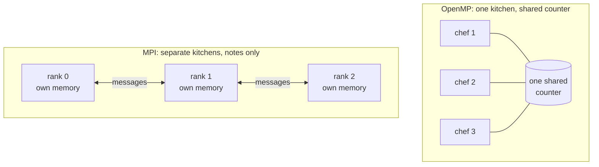

# Not Twins, Not Even Cousins: OpenMP, MPI and Open MPI

> **Part 1 of 6.** Two names that differ by one space, and one that is not even a program. By the end of this page you'll be able to say, without hesitation, what each of the three is, and you'll know which one to blame when the ticket comes back.

## Contents

- [The meeting where nobody understood anybody](#the-meeting-where-nobody-understood-anybody)
- [Three names, three jobs](#three-names-three-jobs)
- [The kitchen analogy](#the-kitchen-analogy)
- [Try it before you scroll](#try-it-before-you-scroll)
- [Proof that Open MPI is not OpenMP](#proof-that-open-mpi-is-not-openmp)
- [The cheat table](#the-cheat-table)

---

## The ticket that came back

Monday, a ticket lands in the cluster team's queue:

**Ticket 1:** *"Please install Open MPI so my OpenMP code runs on more nodes."*

A junior engineer types `apt install openmpi-bin`, writes "done", and closes it.

Friday, the same user is back:

**Ticket 2:** *"Still one node. Still slow. Did the install even work?"*

The install worked perfectly. It also did nothing for this user, because the ticket asked for the wrong thing in a way that sounds exactly right. To see why, you need to pull apart three names.

The names are the problem. `OpenMP` and `Open MPI` differ by one space. Say them aloud and they differ by nothing, like "affect" and "effect", except with a job queue attached. Pull them apart and the confusion goes away, because they are not related the way the names suggest.

If they were on a family-DNA website, the result would read: *"Relationship: none. Both parents are called Open, which is probably how this started."*

---

## Three names, three jobs

| Name | What it is | Kind of thing | Where your program's pieces live |
|------|-----------|---------------|----------------------------------|
| **OpenMP** | An API (an agreed set of directives, functions and variables) for sharing work between **threads** | A specification, built into compilers | One process, one shared memory |
| **MPI** | The **M**essage **P**assing **I**nterface: an agreed set of functions for **processes** to send each other messages | A specification (a document) | Many processes, each with its own memory, possibly on many machines |
| **Open MPI** | One program that implements the MPI specification | Software you install | Same as MPI: it is MPI |

Read that table twice. The only name that is software you install is **Open MPI**. The other two are rulebooks. Ticket 1 asked for the one name that is software, to fix a problem in the rulebook that isn't.

- OpenMP describes itself as an API that "supports multi-platform shared-memory parallel programming in C/C++ and Fortran" ([OpenMP FAQ](https://www.openmp.org/about/openmp-faq/)).
- The Open MPI project calls itself "an open source, freely available implementation of the MPI specifications" ([Open MPI FAQ](https://www.open-mpi.org/faq/?category=general)).

So: **Open MPI is to MPI what a browser is to the HTML spec.** Nobody says "I installed HTML to open this page", and nobody should say "I installed OpenMP so my cluster can talk".

Chrome and Firefox both implement HTML. Open MPI and MPICH both implement MPI. OpenMP is a different rulebook altogether.

That is the theory. The kitchen version is easier to remember.

> [!NOTE]
> "Open" in both names is a coincidence of branding, not a family tie. The two projects have different authors, different goals and different release schedules. The next part tells where each one came from.

---

## The kitchen analogy

Keep one picture and every later page gets easier.

| | OpenMP | MPI |
|---|---|---|
| Picture | **One kitchen**, several cooks sharing one counter | **Several kitchens**, one cook each, passing notes through a delivery window |
| Sharing | Everyone sees the same ingredients. Fast, and easy to trip over each other | Nobody sees anyone else's ingredients. You must send them |
| Scale | As many cooks as the kitchen has stove burners (the cores of one machine) | As many kitchens as you can build, in one building or across a city |
| Classic mistake | Two cooks grab the same egg (a data race) | A cook waits for a note that never comes (a deadlock) |



OpenMP stops at the kitchen wall: the chefs can shout at each other all day, but they cannot shout across town. MPI is what lets kitchens cooperate, with all the paperwork that implies. Big jobs use both: several kitchens (MPI), each with several cooks (OpenMP). That is part 5.

So where do those chefs and kitchens come from in software? Hold that thought for one pause.

---

## Try it before you scroll

☕ Ten seconds. A colleague installs Open MPI on a fresh machine, then compiles an OpenMP program with `mpicc` and runs it. Will it run with threads?

Hint: what did `mpicc` get installed to do, and who turns on OpenMP?

---

## Proof that Open MPI is not OpenMP

The answer is no, and here is the evidence, from a throwaway Ubuntu 26.04 VM with Open MPI 5.0.10 installed from the distribution's packages (`openmpi-bin`, `libopenmpi-dev`) and gcc 15.2.

**1. `mpicc` is just gcc with extra flags.** It adds the MPI headers and library and nothing about threads:

```bash
mpicc --showme
```

```text
gcc -I/usr/lib/x86_64-linux-gnu/openmpi/include -I/usr/lib/x86_64-linux-gnu/openmpi/include/openmpi -L/usr/lib/x86_64-linux-gnu/openmpi/lib -lmpi
```

**2. OpenMP comes from a different place.** Thread support is turned on by your compiler's own flag, `-fopenmp` in gcc, and its runtime is the compiler's library (`libgomp` for gcc). Compile an OpenMP program through `mpicc` without that flag and the OpenMP functions are not found:

```text
omp_hello.c:(.text.startup+0x6): undefined reference to `omp_get_num_threads'
omp_hello.c:(.text.startup+0xd): undefined reference to `omp_get_thread_num'
collect2: error: ld returned 1 exit status
```

Installing Open MPI gave that program no OpenMP at all. The two are installed, switched on and versioned separately. That is Ticket 1: the install had nothing to do with the user's real problem (threads can't leave one machine), so the user was still on one node on Friday.

**3. An MPI program does not even need a cluster.** Started without `mpirun`, an MPI program just runs as a team of one:

```text
rank 0 of 1 on twins
sum of ranks = 0
```

---

## The cheat table

| If you hear... | Think... | You need... |
|----------------|----------|-------------|
| "OpenMP" | Threads inside one machine | A compiler with OpenMP support (`gcc -fopenmp`) |
| "MPI" | Messages between processes, maybe across machines | An MPI implementation: Open MPI, MPICH or a vendor one |
| "Open MPI" | One implementation of MPI | The `openmpi-bin` / `libopenmpi-dev` packages, or a module on your cluster |
| "Hybrid MPI+OpenMP" | Both, at once | Both. Part 5 |

**Takeaway:** OpenMP shares work between threads, MPI passes messages between processes, and Open MPI is merely one program that implements MPI.

So here's the question this raises: if both rulebooks solve "make a program parallel", why did anyone write two? The answer is in [part 2: where they came from](/fields/system-administration/openmp-and-open-mpi/where-they-came-from.md), and it starts in the early 1990s with a very annoying hotel.

---

## References

- [OpenMP FAQ (openmp.org): what OpenMP is](https://www.openmp.org/about/openmp-faq/)
- [Open MPI FAQ, general category: what MPI and Open MPI are](https://www.open-mpi.org/faq/?category=general)
- [About Open MPI (open-mpi.org)](https://www.open-mpi.org/about/)
- Evidence on this page: run on Ubuntu 26.04.1, Linux 7.0, gcc 15.2.0, Open MPI 5.0.10, in a throwaway VM.
