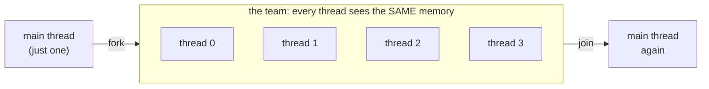
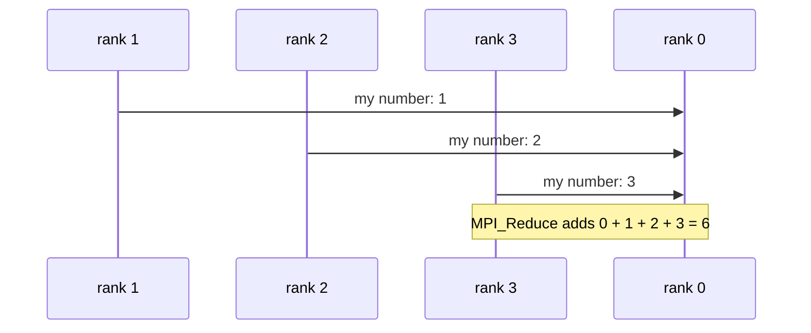

# Cooks and Kitchens: Threads, Ranks and the One Mental Model

> **Part 3 of 6.** By the end you'll know what a **thread** and a **rank** are, you'll have seen both run, and you'll understand the one bug each style invites.

The case file: I asked four threads to count to 100 million. Two out of three times they proudly reported **75 million**. Nobody lied. Nobody crashed. Twenty-five million counts simply vanished, without a single error message. This page is about how that happens.

## Contents

- [The mental model in two sentences](#the-mental-model-in-two-sentences)
- [OpenMP: one process, many threads](#openmp-one-process-many-threads)
- [Try it before you scroll](#try-it-before-you-scroll)
- [The bug OpenMP invites: a data race](#the-bug-openmp-invites-a-data-race)
- [MPI: many processes, many ranks](#mpi-many-processes-many-ranks)
- [The bug MPI invites: not enough slots, and waiting forever](#the-bug-mpi-invites-not-enough-slots-and-waiting-forever)
- [Side by side](#side-by-side)

---

## The mental model in two sentences

An OpenMP program is **one process** that, at marked spots, splits into a team of **threads** which all see the same memory, then joins back into one. An MPI program is **a team of separate processes**, called **ranks**, started together, each with its own private memory, which cooperate only by sending messages.

Everything else in both worlds is detail on top of that. Here are the two shapes:



*OpenMP: the process forks into a team, the team shares memory, the team joins.*



*MPI: separate processes, each with its own number, combined only because they sent it.*

> [!NOTE]
> Written against Ubuntu 26.04.1 (Linux 7.0), gcc 15.2.0 and Open MPI 5.0.10, run in a throwaway 4-CPU VM. Output order and exact numbers will differ on your machine. That is the point of parallel code: nothing promises the order.

---

## OpenMP: one process, many threads

```c
#include <omp.h>
#include <stdio.h>
int main(void) {
    #pragma omp parallel                  /* FORK: the block below runs once per thread */
    {
        #pragma omp critical              /* one thread at a time, so lines don't interleave */
        printf("hello from thread %d of %d\n",
               omp_get_thread_num(),      /* "which thread am I?"  0, 1, 2, ... */
               omp_get_num_threads());    /* "how many of us?"     the team size */
    }                                     /* JOIN: back to a single thread */
    return 0;
}
```

`#pragma omp parallel` is the whole trick: the next block runs once **per thread**. `critical` lets only one thread print at a time so lines don't get mixed up.

```bash
gcc -O2 -Wall -fopenmp omp_hello.c -o omp_hello
OMP_NUM_THREADS=4 ./omp_hello
```

```text
hello from thread 0 of 4
hello from thread 2 of 4
hello from thread 3 of 4
hello from thread 1 of 4
```

Two knobs to remember:

- **`-fopenmp`** tells gcc to honour the pragmas. Other compilers have their own spelling.
- **`OMP_NUM_THREADS`** sets the team size. Unset, it printed 4 lines on this 4-CPU VM, but the standard leaves the default to the implementation, so set it yourself.

> [!WARNING]
> Forget `-fopenmp` and the pragmas are **silently ignored**. A program with only pragmas builds clean (gcc warns only with `-Wall`) and runs on one thread. I tested a four-thread `printf` region: with the flag it printed 4 lines, without it, 1. If your OpenMP program is mysteriously slow, check the flag first.

That's the happy path. Now let's give four threads a job they can get wrong.

---

## Try it before you scroll

☕ Ten seconds. Four threads share one variable, `racy`, and each one runs `racy += 1` twenty-five million times. What is `racy` at the end?

Hint: `+=` is not one step for a CPU. It is three: read the old value, add one, write the new value back. What happens if two threads do the reading before either does the writing?

---

## The bug OpenMP invites: a data race

Threads share memory, so two threads can touch the same variable at once. Count to 100 million with four threads, the wrong way and the right way:

```c
long racy = 0, safe = 0;
#pragma omp parallel for
for (long i = 0; i < N; i++) racy += 1;           /* all threads write one variable */
#pragma omp parallel for reduction(+:safe)
for (long i = 0; i < N; i++) safe += 1;           /* each thread keeps its own copy, summed at the end */
```

Three runs, four threads, expected 100000000 every time (the program prints the three lines `expected`, `racy`, `reduction`; condensed here):

```text
racy      75000000      reduction 100000000
racy     100000000      reduction 100000000
racy      75000000      reduction 100000000
```

The racy total was wrong in two runs out of three, and right in the third by luck. That is the nasty part: the program that is wrong sometimes will happily pass the one test you ran before shipping it. I did not dig into why it landed on those exact numbers. The lesson stands: **a race gives wrong answers that change from run to run**, so a pass proves nothing. `reduction(+:var)` is the standard fix for "everyone adds to one total".

That's the threads' signature bug. The other kitchens have their own way to go wrong, but first they need to run at all.

---

## MPI: many processes, many ranks

```c
#include <mpi.h>
#include <stdio.h>
int main(int argc, char **argv) {
    MPI_Init(&argc, &argv);                       /* every MPI program starts here... */
    int rank, size, len; char host[MPI_MAX_PROCESSOR_NAME];
    MPI_Comm_rank(MPI_COMM_WORLD, &rank);
    MPI_Comm_size(MPI_COMM_WORLD, &size);
    MPI_Get_processor_name(host, &len);
    int sum = 0;
    MPI_Reduce(&rank, &sum, 1, MPI_INT, MPI_SUM, 0, MPI_COMM_WORLD);
                                                  /* everyone sends `rank`; rank 0 receives the sum */
    printf("rank %d of %d on %s\n", rank, size, host);
    if (rank == 0) printf("sum of ranks = %d\n", sum);
    MPI_Finalize();                               /* ...and ends here */
    return 0;
}
```

Everything between `Init` and `Finalize` runs in **every** rank at once. That is why the one printed `sum of ranks` line is wrapped in `if (rank == 0)`: without it, all four ranks would print it.

- `MPI_COMM_WORLD` is "everyone who was started together".
- `MPI_Get_processor_name` just reports which machine the rank runs on (here the VM is called `twins`).
- `rank` is your number in that group (0 to size-1); `size` is how many there are.
- `MPI_Reduce` is a **collective**: every rank calls it, and rank 0 receives the sum of everyone's value.

```bash
mpicc -O2 -Wall mpi_hello.c -o mpi_hello
mpirun -np 4 ./mpi_hello
```

```text
rank 3 of 4 on twins
rank 2 of 4 on twins
rank 1 of 4 on twins
rank 0 of 4 on twins
sum of ranks = 6
```

0 + 1 + 2 + 3 = 6. Four separate processes each held one number in private memory, and the library carried the numbers together, like four kitchens each handing a single note through the window to rank 0. No rank could simply read another's `rank` variable. That is the "separate kitchens" rule.

Both programs run. So what is the first thing that goes wrong when you ask for more kitchens than the building has?

---

## The bug MPI invites: not enough slots, and waiting forever

Ask for more ranks than the machine has slots and Open MPI refuses to start (exit code 1):

```bash
mpirun -np 8 ./mpi_hello     # on a 4-CPU VM: refused
mpirun --oversubscribe -np 8 ./mpi_hello    # allowed, exit 0
```

`--oversubscribe` means "yes, I know there are only 4 slots, and I would like to seat eight guests anyway". Use it for testing, not for speed.

> [!WARNING]
> On this Ubuntu 26.04 install, the refusal message is hidden behind `Sorry!  You were supposed to get help about: prte-rmaps-base:alloc-error` plus "couldn't open the help file". The packages looked for the help text under `/usr/lib/x86_64-linux-gnu/prrte3/share/prte/`, and I found one such file only under `/usr/share/doc/libprrte-dev/`. On such a system, `alloc-error` means "not enough slots". The same missing file also breaks `mpirun --version`; `ompi_info --version` works.

The other classic MPI bug I did not run here, because it hangs by design: a **deadlock**, where two ranks each wait for a message the other has not sent. It is the mirror of the data race: instead of a wrong answer, you get no answer. Think of two people at a door, each insisting "after you", forever.

---

## Side by side

| | OpenMP threads | MPI ranks |
|---|----------------|-----------|
| What runs in parallel | Threads inside one process | Separate processes |
| Memory | Shared | Private to each rank |
| How they cooperate | By reading and writing shared variables | By calling library functions to send and receive |
| How you start it | `./prog` (set `OMP_NUM_THREADS`) | `mpirun -np N ./prog` |
| How you build it | `gcc -fopenmp` | `mpicc` (a gcc wrapper) |
| Reach | One machine | One machine or many |
| Signature bug | Data race: wrong, changing answers | Deadlock or too few slots: no answer |

**Takeaway:** a thread shares memory and needs care about who writes what; a rank owns its memory and needs messages to cooperate.

You've now seen both models run and both models break. The next skill is the one you'll use every week: someone hands you a repo or a job script, and in thirty seconds you have to say which kitchen you're standing in. That's [part 4](/fields/system-administration/openmp-and-open-mpi/spotting-openmp-and-mpi-code.md).

---

## References

- [OpenMP API specification: parallel construct, reduction clause, OMP_NUM_THREADS](https://www.openmp.org/specifications/)
- [MPI standard (MPI Forum): MPI_Init, communicators, MPI_Reduce](https://www.mpi-forum.org/docs/)
- [Open MPI mpirun manual (v5.0.x)](https://docs.open-mpi.org/en/v5.0.x/man-openmpi/man1/mpirun.1.html): slots and `--oversubscribe`
- Every output block on this page: run on Ubuntu 26.04.1, Linux 7.0, gcc 15.2.0, Open MPI 5.0.10, 4 vCPUs.
