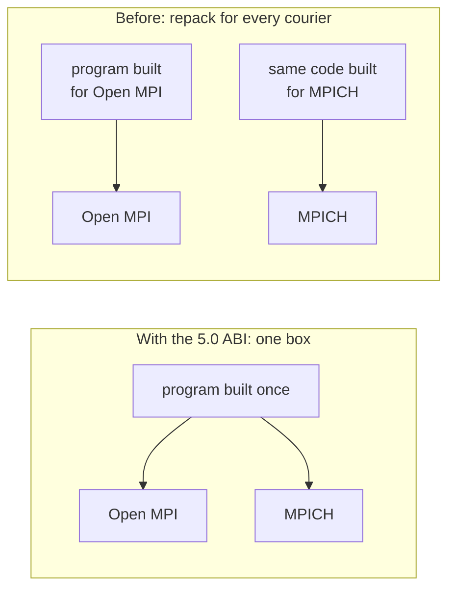

# Two Tickets About the Future: OpenMP 6, MPI 5 and What Never Expires

<!-- related-block -->

9 min read

<!-- related-block -->

**Read first:** [Two Tribes, One Problem: Where OpenMP and MPI Came From](/fields/system-administration/openmp-and-open-mpi/where-they-came-from.md)

> **Part 6 of 8.** Both standards shipped a big new version. By the end of this page you'll know what each one added, why the answer to "do we have to rewrite everything?" is mostly no, and the one caveat hiding in it.

## Contents

- [Two tickets in the Monday queue](#two-tickets-in-the-monday-queue)
- [OpenMP: the kitchen gets a loading dock](#openmp-the-kitchen-gets-a-loading-dock)
- [MPI: the delivery box gets a standard size](#mpi-the-delivery-box-gets-a-standard-size)
- [Try it before you scroll](#try-it-before-you-scroll)
- [Open MPI today](#open-mpi-today)
- [The tickets, answered](#the-tickets-answered)
- [The whole series in six lines](#the-whole-series-in-six-lines)

---

## Two tickets in the Monday queue

Monday morning, two tickets land in the platform team's queue.

**Ticket 1:** *"OpenMP 6.0 is out. Our code is full of `parallel for` loops from years ago. Do we have to rewrite everything?"*

**Ticket 2:** *"MPI 5.0 is out and the news keeps saying 'ABI'. What is that, and do we have to recompile?"*

A junior engineer reads both, writes "yes, upgrade everything, it's a new major version", and closes them.

They're wrong, and not in the same way twice. One answer is "mostly no, with a caveat". The other is "no, and here's what you get if you want it". To see why, look at what each version actually added, using the two kitchens from [part 1](/fields/system-administration/openmp-and-open-mpi/the-name-mixup.md).

First, the trail, with dates from the official lists ([OpenMP](https://www.openmp.org/specifications/), [MPI](https://www.mpi-forum.org/docs/)):

| | OpenMP | MPI |
|---|--------|-----|
| The pilot | Fortran 1.0, October 1997 | MPI-1.0, 1994 |
| The big widening | **4.0, July 2013** | 3.0, September 2012 |
| The recent big one | 5.0 (2018), 5.1 (2020), 5.2 (2021) | **4.0, June 2021**, then 4.1 (November 2023) |
| **Latest** | **6.0, November 14, 2024** | **5.0, June 5, 2025** |

A rule for reading version numbers: a jump in the **first** digit is a bigger storyline; a jump in the second is mostly tidying.

Ticket 1 first. What did OpenMP learn?

---

## OpenMP: the kitchen gets a loading dock

For years, OpenMP's whole plot was "several chefs share one kitchen". Then, in **4.0 (July 2013)**, the kitchen got a loading dock. Per the [4.0 announcement](https://www.openmp.org/press-release/openmp-4-0-api-released/):

| New in 4.0 | In kitchen terms |
|------------|------------------|
| **Accelerator devices** (`#pragma omp target`) | The head chef can send a dish to an annex kitchen next door, the GPU |
| **SIMD** | One chef, one knife stroke, eight carrots chopped |
| **Task dependencies** | "Dice the onions *before* you fry them", written down |
| **Thread affinity** | Which stove each chef stands at (you met the trouble with that in [part 5](/fields/system-administration/openmp-and-open-mpi/hybrid-and-the-binding-trap.md)) |
| User-defined reductions, cancellation | Custom ways to combine results, and a way to say "stop, the order was cancelled" |

Then came **6.0 (November 14, 2024)**, which per [the release page](https://www.openmp.org/home-news/openmp-arb-releases-openmp-6-0-for-easier-programming/) brought easier tasks, finer control over memory, loop transformations such as fusion, reversal and interchange, support for recent C, C++ and Fortran standards, and a clean-out: **features that were deprecated in 5.0, 5.1 and 5.2 were removed**. [The OpenMP blog](https://www.openmp.org/blog/openmp-6/) says Intel and GCC compilers already ship first implementations of some 6.0 features. There is also a **6.1** public comment draft dated July 2026. That is a trailer, not a release.

So Ticket 1 isn't a "yes". It's a "mostly no, with one caveat": your plain `parallel for` loops are the heart of OpenMP and were never the target. What 6.0 removed is the stuff that had been **deprecated**, meaning already marked "please stop using this". If your old code used only the basics, you have nothing to do. If it used something that was flagged along the way, that's where to look.

> [!NOTE]
> A spec version is not a compiler version. What matters for you is what your cluster's compiler supports, so check its documentation before leaning on a brand-new directive.

That settles the threads. But the other ticket mentions an acronym that sounds suspiciously like a new bug.

---

## MPI: the delivery box gets a standard size

Before 5.0, here's a thing nobody tells beginners. A compiled MPI program was quietly married to **one specific MPI implementation**. Small details, such as how a communicator looks inside memory, differed between Open MPI and MPICH. Compile against one, and the binary only really worked with that one. Switch implementations and you recompiled.

Picture a delivery window where every courier company has its own box size. To change courier, you repack every parcel.

**MPI 5.0 (June 5, 2025)** adds the **standard ABI** (Application Binary Interface): one agreed box size. In its own words it "exists in parallel with existing implementation ABIs", so nothing that already works breaks, and the standard promises "any valid MPI-4.1 program is a valid MPI-5.0 program".

There's a catch, and it's the same catch as OpenMP's compilers: a standard is a promise, and an implementation has to keep it. At ISC25, MPICH was described as already supporting the ABI, and Open MPI's support as work in progress ([MPI 5.0 announcement](https://lists.mpi-forum.org/pipermail/mpi-forum/2025-June/007905.html), [ISC25 slides](https://www.mpi-forum.org/bofs/2025-06-MPI-BOF-ISC25.pdf)).

The season before that, **MPI 4.0 (June 2021)** had added, per the MPI-4.1 document: **large counts** (message sizes no longer limited by what a plain `int` can hold), **persistent collectives** (set up a repeating operation once, run it many times), **partitioned communication**, and **sessions**, a new way to start MPI.

So Ticket 2 is a "no". The ABI is something you *may* use once your MPI supports it, not something you must do on Monday.

Time to see if it stuck.

---

## Try it before you scroll

☕ Ten seconds. A colleague upgrades from Open MPI 4.1 to 5.0 and says: *"The MPI standard promises compatibility, so my job script will run unchanged."*

What part of that sentence could still bite?

Hint: think about what the standard actually promises, and what a job script contains.

**Answer:** the standard promises that your **program** stays valid. It says nothing about your **launch line**: `mpirun` flags, binding defaults, and error messages belong to the implementation, not to MPI. I tested 5.0.10 only: its `mpirun` shipped with PMIx and PRRTE packages, and on Ubuntu 26.04 hid its error text behind a missing help file (part 3). I did not test 4.1, so I can't tell you which flags differ. The right move is the oldest one in the book: read the version's manual before you reuse the script.

---

## Open MPI today

Per its [downloads page](https://www.open-mpi.org/software/ompi/) when I wrote this:

| Series | Status |
|--------|--------|
| v6.0 | Upcoming, no date listed |
| v5.0 | Current stable; latest 5.0.11 (September 16, 2026) |
| v4.1 | Still supported |
| v4.0 and older | Retired |

Its [about page](https://www.open-mpi.org/about/) says it offers full MPI-3.1 conformance with many MPI-4.0 elements. Remember the cast from part 1: MPI is the script, and Open MPI is one of the actors reading it, so the script's version and the actor's version are different questions.

---

## The tickets, answered

Back to Monday's queue.

| Ticket | Verdict | Why |
|--------|---------|-----|
| "OpenMP 6.0: rewrite everything?" | **Mostly no.** Check anything that was deprecated | Basic loops are the core and stay. 6.0 removed features that were already deprecated in 5.0 to 5.2 |
| "MPI 5.0 ABI: recompile?" | **No.** The ABI is optional | Valid 4.1 programs are valid 5.0 programs; the ABI runs alongside the old ones, and not every implementation has it yet |

Notice what neither verdict needed: knowing the new features. It needed the **models** from this series. Threads share memory and need care about who writes what. Ranks own their memory and need messages. Binding decides where the work lands. Those storylines have run since the 1990s and no version number cancels them.

---

## The whole series in six lines

| Part | One line |
|------|----------|
| 1 | OpenMP = threads, MPI = messages, Open MPI = one implementation of MPI |
| 2 | Two tribes in the 1990s solved the same headache from opposite sides |
| 3 | One kitchen with many chefs vs many kitchens passing notes; race vs deadlock |
| 4 | `omp.h` + `#pragma omp` + `-fopenmp` vs `mpi.h` + `MPI_` + `mpirun`; both = hybrid |
| 5 | Check "rank may use N cpus": the default can pin each rank to one core |
| 6 | OpenMP 6.0 and MPI 5.0 are current, and the core ideas are the stable part |

**Takeaway:** a new version number adds vocabulary, but the two ideas underneath, share memory between threads or send messages between processes, are the part that doesn't expire.

The standards are the stable part. The next question is about where your job actually runs: on a cluster someone else manages. Next time a Slurm script says `--ntasks=4` and your program prints `rank 0 of 1` four times, can you say who forgot to introduce the ranks? That's [part 7: who starts the ranks under Slurm](/fields/system-administration/openmp-and-open-mpi/mpi-and-openmp-under-slurm.md), and Kubernetes follows in part 8.

---

## References

- [OpenMP specifications: release dates and the 6.1 draft](https://www.openmp.org/specifications/)
- [OpenMP 4.0 release announcement (July 26, 2013)](https://www.openmp.org/press-release/openmp-4-0-api-released/)
- [OpenMP ARB releases OpenMP 6.0 (November 2024)](https://www.openmp.org/home-news/openmp-arb-releases-openmp-6-0-for-easier-programming/)
- [OpenMP 6.0 blog: first implementations](https://www.openmp.org/blog/openmp-6/)
- [MPI Forum: standard versions and dates](https://www.mpi-forum.org/docs/)
- [MPI-5.0 standard: background, ABI chapter](https://www.mpi-forum.org/docs/mpi-5.0/mpi50-report/node20.htm)
- [MPI-4.1 standard: summary of the MPI-4.0 additions](https://mpi-forum.org/docs/mpi-4.1/mpi41-report/node17.htm)
- [MPI 5.0 voted in (MPI Forum mailing list)](https://lists.mpi-forum.org/pipermail/mpi-forum/2025-June/007905.html)
- [MPI Forum ISC25 BoF slides: ABI implementation status](https://www.mpi-forum.org/bofs/2025-06-MPI-BOF-ISC25.pdf)
- [Open MPI downloads: release series](https://www.open-mpi.org/software/ompi/)
- [About Open MPI](https://www.open-mpi.org/about/)
