# Time_Series_Analysis_Guide.ipynb

<div class="code-file">

Notebook from the repository  ·  [View on GitHub](https://github.com/AhmedYousriSobhi/aCupOfTea/blob/main/fields/tabular-data/concept-in-time-series/Time_Series_Analysis_Guide.ipynb)  ·  [Raw file](https://raw.githubusercontent.com/AhmedYousriSobhi/aCupOfTea/main/fields/tabular-data/concept-in-time-series/Time_Series_Analysis_Guide.ipynb)  ·  [Open in Colab](https://colab.research.google.com/github/AhmedYousriSobhi/aCupOfTea/blob/main/fields/tabular-data/concept-in-time-series/Time_Series_Analysis_Guide.ipynb)

</div>


<font color='red' size='5px'/> Time Series Analysis Basics<font/>

# <font color='blue' size='5px'/> General Search<font/>

## 1 Time Series Analysis

Time series analysis is a statistical method used to analyze and interpret data points collected over regular intervals of time. It focuses on understanding the patterns, trends, and dependencies present in the data to make predictions or derive meaningful insights. In time series analysis, the data points are ordered chronologically, making it suitable for analyzing data that changes over time.

## 2 Componenet of Time Series

Time series data can be decomposed into several components, which help in understanding the underlying patterns and variations within the data. The main components of a time series are:

1. Trend: The long-term movement or pattern in the data, which indicates the overall direction of change over time. It can be increasing, decreasing, or stationary.

2. Seasonality: The repetitive and periodic pattern observed at fixed intervals within the data. Seasonality is often influenced by factors like time of year, day of the week, or other regular cycles.

3. Cyclical Variation: Non-periodic fluctuations in the data that occur over longer time frames, typically lasting for multiple periods. These variations are often influenced by economic, political, or societal factors.

4. Residuals: The random and unexplained fluctuations that remain after removing the trend, seasonality, and cyclical components from the data. Residuals represent the unpredictable or irregular component of the time series.

```python
from IPython.display import Image
```

```python
Image('https://i.postimg.cc/vBnB5FDG/Time-Series-components-1-A-time-series-is-a-sequence-of-observations-measured-at.jpg')
```

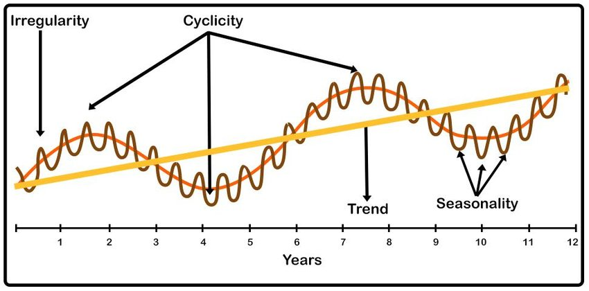

```python
Image('https://i.postimg.cc/44tPxYfS/component-of-time-series.png')
```

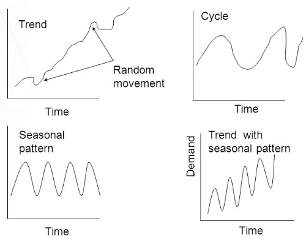

```python
Image('https://i.postimg.cc/tCQr3hvb/1-R7wt5-Exv-Hw-Dxr-Bmesxj-YSA.png')
```

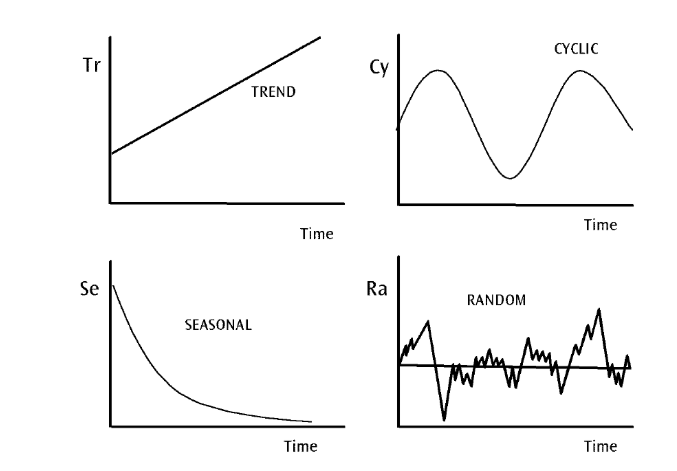

## 3 Time Series Analysis Techniques

Time series analysis employs various techniques to extract insights and make predictions. Here are some commonly used methods:

1. Descriptive Analysis: This involves visualizing the time series data to understand its overall behavior, identify trends, and detect outliers. Techniques like:
  - Line plots,
  - Scatter plots,
  - Histograms

2. Smoothing Techniques: Smoothing methods help in reducing noise and revealing underlying trends in the data and to show patterns, such as:
  - Moving averages
  - Exponential smoothing,

3. Autocorrelation Analysis: Autocorrelation measures the correlation between a time series and a lagged version of itself.
  - It helps in identifying the presence of correlation or dependencies between past and future observations.
  - Commonly used tools for autocorrelation analysis:
    - Autocorrelation plots, autocorrelation function (ACF)
    - Partial autocorrelation function (PACF) are s.

4. Time Series Models: Time series models aim to capture the underlying patterns and make predictions based on historical data.
  - Common models include:
    - ARIMA (Autoregressive Integrated Moving Average),
    - SARIMA (Seasonal ARIMA),
    - GARCH (Generalized Autoregressive Conditional Heteroskedasticity).
  - These models take into account the trend, seasonality, and other components of the time series to forecast future values.

5. Machine Learning Techniques: Machine learning algorithms, such as recurrent neural networks (RNNs), can be used for time series analysis.

  - Long Short-Term Memory (LSTM) and Gated Recurrent Unit (GRU), are effective in capturing long-term dependencies and making accurate predictions in time series data.

## 4 TSA Essence

In time series analysis, many tasks can be broadly categorized into forecasting future values and extracting patterns (insights) or components from the data. Here's a breakdown of the typical steps involved:

1. Forecasting: This involves using historical time series data to predict or forecast future values. Various forecasting techniques can be applied, such as ARIMA, exponential smoothing, or machine learning algorithms. The goal is to estimate future trends, patterns, or levels in the time series.

2. Trend Extraction: Trend refers to the long-term upward or downward movement in a time series. Extracting the trend component helps identify the underlying direction of the series, which can be useful for understanding long-term patterns and making informed decisions.

3. Seasonality Extraction: Seasonality refers to regular and repetitive patterns that occur within a fixed time frame, such as daily, weekly, or yearly cycles. Extracting the seasonality component helps isolate and understand the periodic fluctuations, allowing for better planning and decision-making.

4. Cyclical Pattern Analysis: Cyclical patterns are longer-term fluctuations that occur irregularly and are not tied to fixed time frames like seasonality. These patterns often reflect economic or business cycles. Analyzing cyclical patterns helps identify and understand longer-term ups and downs in the time series.

5. Residual Analysis: Residuals are the differences between the observed values and the predicted values (forecasted or trend-plus-seasonality). Residual analysis is performed to assess the goodness of fit of the model, check for any remaining patterns or structures in the residuals, and identify any outliers or anomalies that may need further investigation.

## 5 TSA Forcasting Models

In time series analysis, several models can be used to analyze and forecast data. Here are some commonly used models along with their advantages and disadvantages:


1. Autoregressive Integrated Moving Average (ARIMA):

  - Advantages:
    - Handles a wide range of time series patterns, including trend and seasonality.
    - Provides interpretable results and can capture long-term dependencies.
    - Can be extended to include external variables (ARIMAX) or seasonal components (SARIMA).
  - Disadvantages:
    - Assumes the data is stationary, meaning that the statistical properties do not change over time.
    - May struggle with nonlinear relationships or complex patterns.
    - Difficult to select appropriate model orders (p, d, q) without domain knowledge or proper model evaluation.


2. Exponential Smoothing Methods:

  - Advantages:
    - Simple to implement and computationally efficient.
    - Can handle data with trend, seasonality, and changing variances.
    - Provides flexibility with different variations such as Simple Exponential Smoothing, Holt's Linear Smoothing, and Holt-Winters' Method.
  - Disadvantages:
    - Assumes that the patterns are smooth and do not change abruptly.
    - May not capture complex nonlinear relationships.
    - Can be sensitive to initial parameter values and require tuning.


3. Seasonal Decomposition of Time Series (STL):

  - Advantages:
    - Decomposes the time series into trend, seasonal, and residual components, allowing separate analysis of each component.
    - Handles irregular and non-constant seasonal patterns.
    - Provides interpretability and facilitates anomaly detection.
  - Disadvantages:
    - Assumes that the seasonal patterns are constant throughout the time series.
    - May not perform well for time series with high noise levels.
    - Does not handle long-term dependencies or non-additive relationships.


4. Prophet:

  - Advantages:
    - Handles time series with multiple seasonality patterns and changing trends.
    - Automatically detects outliers, holidays, and trend changes.
    - Provides flexibility to incorporate additional regressors.
  - Disadvantages:
    - Limited ability to capture complex nonlinear relationships.
    - May require significant computational resources for large datasets.
    - Does not handle irregularly spaced time series well.

5. Recurrent Neural Networks (RNNs) and Long Short-Term Memory (LSTM):

  - Advantages:
    - Can capture complex nonlinear relationships and long-term dependencies.
    - Handles irregular time intervals and missing data.
    - Provides flexibility for handling multivariate time series.
  - Disadvantages:
    - Requires a large amount of data for training, which can be a limitation for some time series.
    - Prone to overfitting, requiring careful regularization and tuning.
    - Training and optimization can be computationally intensive.

### 5.1 XGBRegressor

### 5.2 ARIMA

### 5.3 LSTM

### 5.4 Prophet

## 6 TSA Extract Insights

### 6.1 Trend Extraction

Trend extraction is a process in time series analysis that involves separating the long-term, underlying movement or direction of a time series from other components such as seasonality, cyclical patterns, and noise. The trend represents the overall upward or downward trend in the data over an extended period.


There are several techniques commonly used for trend extraction in time series analysis. Here are three widely used methods:


  1. Moving Averages: Moving averages smooth out the fluctuations in the data by taking the average of a fixed window of observations.

    - The window size determines the level of smoothing.

    - Simple Moving Average (SMA) considers the average of the past 'k' observations, while Weighted Moving Average (WMA) assigns different weights to each observation.

    - Exponential Moving Average (EMA) assigns exponentially decreasing weights to the observations.


  2. Polynomial Regression: Polynomial regression fits a polynomial function to the time series data.

    - It captures the overall trend by estimating the coefficients of a polynomial equation.

    - Higher-degree polynomial models can capture more complex trends, but caution should be exercised to avoid overfitting.


  3. Hodrick-Prescott Filter: The Hodrick-Prescott (HP) filter is a widely used technique for trend extraction. It decomposes a time series into a trend component and a cyclical component by minimizing the fluctuations in the data.

    - The HP filter separates the trend and cyclical components by minimizing the sum of the squared deviations of the original data from the estimated trend.


The choice of a specific trend extraction technique depends on various factors, including the characteristics of the data, the presence of noise or outliers, and the desired level of smoothing.


### 6.2 Seasonality Extraction

Seasonality extraction is the process of identifying and isolating the repetitive patterns or seasonal variations in a time series. Seasonality refers to the regular, predictable fluctuations that occur within a fixed time frame, such as daily, weekly, monthly, or yearly cycles.

There are several techniques commonly used for seasonality extraction in time series analysis. Here are three widely used methods:

1. Moving Averages: Moving averages can be applied to extract seasonality by removing the trend component from the time series.

  - By taking the average of observations within a specific window or period, the overall trend is smoothed out, leaving behind the seasonal component.

2. Seasonal Subseries Plot: This graphical technique involves creating subseries plots to visualize the pattern within each seasonal cycle.

  - The time series is divided into subsets based on the seasonal period, and each subset is plotted separately.

  - By examining the patterns within each subset, the seasonal component can be identified and extracted.

3. Seasonal Decomposition of Time Series: Seasonal decomposition is a commonly used method for extracting seasonality from a time series.

  - It decomposes the original time series into three components: trend, seasonality, and residuals.

  - The seasonal component represents the repeating pattern within the data.

  - Popular decomposition methods include:
    - The Classical Decomposition
    - The Seasonal and Trend decomposition using Loess (STL).


The choice of a specific technique for seasonality extraction depends on the characteristics of the data, the nature of the seasonal patterns, and the objectives of the analysis.

### 6.3 Cyclical pattern analysis

Cyclical pattern analysis in time series refers to the identification and analysis of longer-term fluctuations that occur irregularly and are not tied to fixed time frames like seasonality. These cyclical patterns typically reflect economic or business cycles, and understanding them can provide valuable insights into the overall behavior of the time series.


Cyclical patterns often span multiple years or economic cycles and can have varying durations and amplitudes. Analyzing cyclical patterns helps in understanding the medium to long-term ups and downs in the time series, which can be useful for predicting turning points, assessing economic or business cycles, and making informed decisions.


There are several techniques commonly used for cyclical pattern analysis in time series:


1. Spectral Analysis: Spectral analysis, specifically through the Fourier Transform, helps identify cyclical patterns by decomposing the time series into different frequencies.

  - The presence of dominant frequencies in specific ranges indicates the presence of cyclical behavior.

2. Autocorrelation Function (ACF): The ACF measures the correlation between observations at different lags within the time series.

  - Cyclical patterns often result in significant autocorrelations at specific lags, reflecting the cyclical nature of the data.

3. Rolling Statistics: By calculating rolling statistics such as the rolling mean or rolling standard deviation, one can observe patterns that may indicate cyclical behavior. Peaks and troughs in rolling statistics can suggest the presence of cyclical patterns.

4. Economic Indicators: Economic indicators such as GDP, employment rates, or stock market indices can be used to identify and analyze cyclical patterns.

  - These indicators often exhibit cyclical behavior and can provide insights into the broader economic cycles.

5. Business Surveys: Surveys conducted among businesses or industry experts can provide valuable information on cyclical patterns. These surveys capture sentiment, expectations, or assessments of future economic conditions, allowing for cyclical analysis and prediction.


The choice of a specific technique for cyclical pattern analysis depends on the characteristics of the data, the frequency and duration of the cycles, and the objectives of the analysis. It's often beneficial to combine multiple techniques to gain a comprehensive understanding of the cyclical behavior in the time series.

### 6.4  Residual analysis

Residual analysis is an important step in time series analysis that involves examining the residuals or errors of a model to assess its goodness of fit and identify any remaining patterns or structures in the data. Residuals are the differences between the observed values and the predicted values obtained from a model or forecasting method.

Residual analysis serves several purposes:

1. Goodness of Fit: Residuals can be used to evaluate how well a model fits the data. A good model should have residuals that are randomly distributed around zero, indicating that the model captures the underlying patterns and structures in the data.

2. Model Assumptions: Residual analysis helps assess whether the assumptions of the model are met. For example, in linear regression, residuals should be normally distributed with constant variance (homoscedastic) and independent of each other.

3. Remaining Patterns: Residuals can reveal any remaining patterns or structures in the data that were not captured by the model. If there are systematic patterns or correlations in the residuals, it suggests that the model may be missing important information or that additional components need to be considered.


Various techniques and statistical tests can be applied in residual analysis. Here are a few commonly used ones:


1. Residual Plots: Scatter plots or time series plots of the residuals can be visually examined for any remaining patterns or trends. Patterns such as increasing or decreasing variance, outliers, or non-linear relationships may indicate model inadequacies.

2. Autocorrelation Function (ACF) and Partial Autocorrelation Function (PACF): The ACF and PACF of the residuals can help identify any autocorrelation or partial autocorrelation in the residual series. Significant correlations at certain lags suggest the presence of patterns that were not captured by the model.

3. Ljung-Box Test: The Ljung-Box test is a statistical test that assesses whether there is any residual autocorrelation in the data. It tests the null hypothesis that the residuals are independently distributed. A significant result indicates the presence of autocorrelation.

4. Shapiro-Wilk Test: The Shapiro-Wilk test is used to assess the normality of the residuals. It tests the null hypothesis that the residuals are normally distributed. Deviations from normality may suggest issues with the model assumptions.

5. Residual Mean and Variance: Checking the mean and variance of the residuals can provide insights into whether they are centered around zero and exhibit consistent variability. Deviations from zero mean or changing variance may indicate problems with the model.

The specific techniques and tests used in residual analysis depend on the type of model and the assumptions made. It is important to carefully analyze the residuals to ensure the model's validity and make any necessary adjustments or improvements.

## 7 Applicaiton of Time Series Analysis

Time series analysis has various applications across different fields. Here are some common applications:

1. Financial Forecasting: Time series analysis is widely used in finance for forecasting stock prices, exchange rates, commodity prices, and other financial variables.It helps investors, traders, and financial institutions make informed decisions about investments and risk management.

2. Demand Forecasting: Businesses often use time series analysis to forecast demand for their products or services. By analyzing historical sales data, they can make accurate predictions about future demand patterns, optimize inventory management, and plan production schedules.

3. Economic Analysis: Time series analysis is essential in economics for studying macroeconomic variables such as GDP, inflation rates, unemployment rates, and interest rates. It helps economists understand economic trends, evaluate policy measures, and make predictions about future economic conditions.

4. Weather and Climate Forecasting: Meteorologists use time series analysis to analyze historical weather data and make predictions about future weather patterns. It is crucial for weather forecasting, climate modeling, and understanding long-term climate change trends.

5. Health and Epidemiology: Time series analysis plays a vital role in studying infectious diseases, analyzing health-related data, and predicting disease outbreaks. It helps public health officials and researchers understand disease patterns, estimate the impact of interventions, and develop effective strategies for disease prevention and control.

6. Energy Demand and Load Forecasting: Utilities and energy companies use time series analysis to forecast energy demand and optimize power generation and distribution. It helps them plan energy production, manage load fluctuations, and make informed decisions regarding infrastructure investment and resource allocation.

7. Website Traffic and User Behavior Analysis: Time series analysis is useful for analyzing website traffic data, tracking user behavior, and predicting website performance. It helps businesses optimize their online presence, target marketing efforts, and improve user experience.

8. Quality Control and Process Monitoring: Time series analysis is applied in manufacturing and industrial settings to monitor and control production processes. It helps detect anomalies, identify quality issues, and improve overall process efficiency and reliability.

## 8 Applications of Time Series Analysis in Cryptocurrency

Time series analysis helps in understanding market dynamics, identifying trends, and making informed decisions. Some common applications of time series analysis in the cryptocurrency domain include:

1. Price Prediction: Analyzing historical price data using time series models or machine learning techniques to predict future price movements.

2. Volatility Analysis: Assessing the volatility of cryptocurrency prices using statistical measures like standard deviation, volatility clustering, or GARCH models.
  - Understanding volatility patterns can aid in risk management and portfolio optimization.

3. Market Trend Identification: Identifying long-term trends in cryptocurrency markets using trend analysis techniques.
  - This can help traders and analysts understand the overall direction of the market and adjust their strategies accordingly.

4. Seasonality Analysis: Detecting and analyzing seasonal patterns in cryptocurrency markets, which can be influenced by factors like holidays, regulatory changes, or market events.
  - Seasonality analysis helps in understanding recurring market behavior.

5. Correlation Analysis: Studying the correlation between different cryptocurrencies or between cryptocurrencies and other financial assets.
  - Correlation analysis can provide insights into market interdependencies and diversification opportunities.


## 9 TSA Project Pipeline

1. Data Collection: Gather a comprehensive dataset of historical dataset prices, preferably including timestamps and corresponding price values.
  - Ensure that the dataset is reliable, accurate, and covers a sufficiently long period for meaningful analysis.

2. Data Preprocessing: Prepare the dataset by cleaning, formatting, and transforming the data as necessary.
  - This step involves handling missing values, removing outliers, and converting timestamps into a suitable format for time series analysis.

3. Trend Analysis: Analyze the data to identify the trend component.
  - You can use techniques such as moving averages, exponential smoothing, or regression models to capture the long-term movement in the dataset prices.

4. Seasonality Detection: Explore the data for seasonal patterns.
  - Apply methods like seasonal decomposition of time series, autocorrelation analysis, or Fourier analysis to detect and quantify the seasonal component of the dataset prices.

5. Cyclical Variation: Investigate the data for cyclical patterns that occur over longer time frames. This can involve examining economic factors, market events, or external influences that contribute to cyclical variations.
  - Consider incorporating economic indicators or sentiment analysis to capture cyclical behavior.

6. Residual Analysis: Calculate the residuals by removing the trend, seasonality, and cyclical components from the original data.
  - Analyze the residuals for randomness, autocorrelation, or any significant patterns that may remain.
  - Residual analysis can provide insights into unexpected or unexplained movements in dataset prices.

7. Model Selection: Choose an appropriate time series model that accommodates trend, seasonality, and cyclical variations, such as:
  - SARIMA (Seasonal Autoregressive Integrated Moving Average),
  - Prophet,
  - LSTM (Long Short-Term Memory) networks.

8. Model Training and Evaluation: Split the dataset into training and testing sets. Use the training data to train the selected model, and then evaluate its performance using the testing data.
  - Consider metrics such as mean squared error (MSE), mean absolute error (MAE), or accuracy for evaluating the model's predictive power.

9. Model Refinement and Optimization: Fine-tune the model by adjusting parameters, experimenting with different configurations, or employing techniques like regularization or optimization algorithms. Iterate on the model refinement process to improve its accuracy and generalizability.

10. Prediction and Interpretation: Use the trained model to make future price predictions for the dataset of interest. Interpret the predictions in the context of the trend, seasonality, cyclical variations, and residual analysis to make informed decisions or generate insights.


## 10 TSA Modeling Pipeline

The following is a structured framework to organize the different steps involved in a typical time series analysis.

1. Data Loading and Preprocessing:

    - This section involves loading the time series data into your analysis environment and performing necessary preprocessing steps. It may include tasks like data import, handling missing values, data cleaning, and converting data types.

2. Exploratory Data Analysis (EDA):

    - In this section, you explore the time series data to gain insights and understanding. You can examine the statistical properties, visualize the data, identify patterns, trends, and seasonality, and perform basic descriptive analysis.

3. Trend, Seasonality, and Cyclical Analysis:

    - This section focuses on decomposing the time series into its components to identify and understand the underlying trends, seasonal patterns, and cyclical variations. Techniques like decomposition, differencing, and autocorrelation analysis can be used here.

4. Modeling and Forecasting:

    - In this section, you build models to capture the patterns and dependencies in the time series data and make future predictions. It includes selecting appropriate models such as ARIMA, SARIMA, exponential smoothing, or machine learning algorithms, estimating model parameters, and generating forecasts.

5. Model Evaluation and Validation:

    - Here, you assess the performance and accuracy of the models developed in the previous step. You can use evaluation metrics like Mean Squared Error (MSE), Mean Absolute Error (MAE), or visual inspections of forecasted values compared to actual values. Cross-validation techniques and backtesting may also be employed.

6. Residual Analysis and Model Refinement:

    - This section involves analyzing the residuals of the model to identify any remaining patterns or issues. It includes checking for autocorrelation, heteroscedasticity, and normality of residuals. Based on the analysis, model refinements or adjustments may be made.

7. Forecast Visualization and Reporting:

    - Here, you present the forecasted values and the results of your analysis in a visual and accessible manner. This may involve creating plots, charts, and reports to communicate the findings, insights, and uncertainty associated with the forecasts.


## 11 Notes


### 11.1 Set index to date

In time series analysis (TSA), setting the index of the time series data is important for several reasons:

1. Time-based operations: By setting the index to the time component of the data, such as dates or timestamps, you enable time-based operations. This allows you to easily perform calculations, filtering, and slicing based on specific time intervals, such as daily, monthly, or yearly.

2. Time alignment: Indexing the data by time ensures that the observations are properly aligned in chronological order. Time series analysis relies on the temporal order of the data points, and having a well-defined index helps maintain the correct order when performing analysis or modeling tasks.

3. Time-based visualization: Indexing by time enables intuitive visualization of time series data. Plotting the time series with a time-based index on the x-axis provides a clear representation of the temporal patterns, trends, and seasonality in the data.

4. Time-based calculations: Many time series analysis techniques and models, such as ARIMA and exponential smoothing, require a time-based index to perform calculations. These models utilize the time component to capture trends, seasonality, and other time-dependent patterns in the data.

Setting the index as the time component of the data is a common practice in time series analysis to leverage the inherent temporal nature of the data and enable efficient analysis and modeling. It facilitates time-based operations, ensures data alignment, supports meaningful visualization, and allows the utilization of various time series modeling techniques.

### 11.2 Why to use Normalization Techniques


Normalization in TSA helps in achieving comparability, improving modeling performance, enhancing pattern detection, enabling statistical tests, and enhancing forecasting accuracy. It ensures that the analysis and modeling processes are robust and reliable, leading to meaningful insights and accurate predictions.

Normalizing continuous data is a common practice in data analysis and modeling for several reasons:

1. Comparability:

    - Time series data often consists of multiple variables with different scales or units of measurement.

    - Normalization allows for fair and meaningful comparisons between these variables.

    - By scaling the data to a common range, the relative changes and patterns in the variables become more apparent, facilitating comparisons and interpretations.


2. Modeling requirements:

    - Many TSA models and algorithms, such as ARIMA, SARIMA, or neural networks, perform better when the input variables are on a similar scale.

    - Normalizing the time series data ensures that each variable contributes proportionally to the model fitting process, preventing any single variable from dominating the analysis.


3. Pattern detection:

    - Normalizing time series data can help in identifying patterns and trends that may be masked by differences in scales or magnitudes.

    - By removing the scale effect, patterns such as trends, seasonality, or cyclical variations become more visible and easier to analyze.


4. Statistical tests:

    - Normalization can aid in conducting statistical tests and hypothesis testing on time series data.

    - Many statistical tests, such as correlation analysis or significance testing, assume that the variables are on a similar scale. Normalizing the data ensures that the assumptions of these tests are met, leading to more reliable and valid results.

5. Forecasting accuracy:

    - Normalization can improve the accuracy of time series forecasting models. When the data is normalized, the model can focus on capturing the underlying patterns and relationships without being influenced by the different scales of the variables. This can result in more accurate and reliable forecasts.

### 11.3 Normalization Techniques


In Time Series Analysis (TSA), similar to general data analysis, several normalization techniques can be applied to continuous data. Some commonly used normalization techniques in TSA include:


1. Min-Max Scaling:

    - This technique scales the data to a specific range, typically between 0 and 1.

    - It is achieved by subtracting the minimum value from each data point and dividing it by the range (maximum value minus minimum value).

    - The formula is as follows: normalized = (x - min(x)) / (max(x) - min(x))

    - Min-Max scaling preserves the relative relationships between the data points and is suitable for TSA when the data does not have extreme outliers.


2. Z-Score Standardization:

    - This technique transforms the data to have a mean of 0 and a standard deviation of 1.

    - It involves subtracting the mean from each data point and dividing it by the standard deviation.

    - The formula is as follows: normalized = (x - mean(x)) / std(x)

    - Z-score standardization is useful in TSA for normalizing data with different means and variances. It enables direct comparison of data points in terms of their deviation from the mean.

3. Log Transformation:

    - This technique applies a logarithmic function to the data.

    - It is beneficial when the data exhibits exponential growth or has a skewed distribution.

    - Log transformation compresses large values and stretches small values, making the data more symmetric and suitable for certain TSA models and analyses.

4. Box-Cox Transformation:

    - The Box-Cox transformation is a family of power transformations that includes the logarithmic transformation as a special case.

    - It allows for a parameterized transformation to normalize data that may have different levels of skewness or non-constant variance.

    - The optimal transformation parameter can be determined through statistical techniques.


The choice of normalization technique depends on the specific characteristics of the data and the requirements of the analysis or modeling task. It is important to consider the distribution of the data, the presence of outliers, and the intended use of the normalized data when selecting an appropriate technique.

# <font color='blue' size='5px'/> Code Trials With Different Datasets<font/>

## 1 ChatGPT Example Code


```python
import pandas as pd
from statsmodels.tsa.arima.model import ARIMA
from statsmodels.tsa.holtwinters import ExponentialSmoothing
from statsmodels.tsa.seasonal import STL
from fbprophet import Prophet

# Step 1: Load and preprocess the data
df = pd.read_csv("cryptocurrency_data.csv")  # Replace with your dataset file
df['date'] = pd.to_datetime(df['date'])  # Convert date column to datetime format

# Step 2: Prepare the data for modeling
data = df.set_index('date')['price']  # Set the date column as the index and select the price column

# Step 3: Split the data into training and testing sets
train_data = data[:-100]  # Use the first portion of the data for training
test_data = data[-100:]  # Use the last portion of the data for testing

# Step 4: Build and fit the ARIMA model
arima_model = ARIMA(train_data, order=(1, 1, 1))
arima_model_fit = arima_model.fit()

# Step 5: Build and fit the Exponential Smoothing model
exp_smoothing_model = ExponentialSmoothing(train_data, trend="add", seasonal="add", seasonal_periods=7)
exp_smoothing_model_fit = exp_smoothing_model.fit()

# Step 6: Build and fit the STL model
stl_model = STL(train_data)
stl_model_fit = stl_model.fit()

# Step 7: Build and fit the Prophet model
prophet_model = Prophet()
train_df = pd.DataFrame({'ds': train_data.index, 'y': train_data.values})
prophet_model.fit(train_df)

# Step 8: Make predictions on the testing set
arima_predictions = arima_model_fit.forecast(len(test_data))
exp_smoothing_predictions = exp_smoothing_model_fit.predict(start=len(train_data), end=len(train_data) + len(test_data) - 1)
stl_predictions = stl_model_fit.forecast(len(test_data))
prophet_df = pd.DataFrame({'ds': test_data.index})
prophet_predictions = prophet_model.predict(prophet_df)['yhat']

# Step 9: Evaluate the models
arima_mse = ((arima_predictions - test_data) ** 2).mean()
exp_smoothing_mse = ((exp_smoothing_predictions - test_data) ** 2).mean()
stl_mse = ((stl_predictions - test_data) ** 2).mean()
prophet_mse = ((prophet_predictions - test_data.values) ** 2).mean()

print("ARIMA MSE:", arima_mse)
print("Exponential Smoothing MSE:", exp_smoothing_mse)
print("STL MSE:", stl_mse)
print("Prophet MSE:", prophet_mse)
```

## [ 2 Cryprocurrency prices for the year](https://www.kaggle.com/datasets/artemburenok/cryprocurrency-prices-for-the-year?resource=download)


##  [ 3 Cryptocurrency Price & Market Data](https://www.kaggle.com/datasets/thedevastator/cryptocurrency-price-market-data?select=coin_gecko_2022-03-17.csv)


[Click Herer](https://github.com/emirhanai/Cryptocurrency-Prediction-with-Artificial-Intelligence/blob/main/Cryptocurrency%20Prediction%20with%20Artificial%20Intelligence.ipynb)


##  [ 4 Cryptocurrency Prediction Artificial Intelligence](https://www.kaggle.com/datasets/emirhanai/cryptocurrency-prediction-artificial-intelligence)

### 1 Packages

```python
from google.colab import drive
drive.mount('/content/drive')
```

```output
Drive already mounted at /content/drive; to attempt to forcibly remount, call drive.mount("/content/drive", force_remount=True).
```

```python
!pip install --upgrade setuptools
!pip install --upgrade wheel
!pip install pystan==2.19.1.1
!pip install fbprophet
from fbprophet import Prophet
```

```python
import pandas as pd
import matplotlib.pyplot as plt
```

```python
from statsmodels.tsa.arima.model import ARIMA
from statsmodels.tsa.holtwinters import ExponentialSmoothing
from statsmodels.tsa.seasonal import STL
```

```python
!pip install dataprep
```

```python
from dataprep.eda import plot_correlation, plot_missing
from dataprep.eda import create_report
from dataprep.eda import plot
```

```python
from tensorflow.keras import layers
from tensorflow.keras.models import Sequential
from tensorflow.keras.layers import Activation, Dense, Dropout, LSTM
import matplotlib.pyplot as plt
import numpy as np
import pandas as pd
from sklearn.metrics import mean_absolute_error
```

### 2 Data Loading and Preprocessing

[Cryptocurrency Prediction Artificial Intelligence](https://www.kaggle.com/datasets/emirhanai/cryptocurrency-prediction-artificial-intelligence)

```python
ETH_data=pd.read_csv("/content/drive/MyDrive/Datasets/Time_Series_Analysis/Crypto/ETH_USDT_01012018_15062023.csv")
print(data.head(-1))
```

```output
                  DateTime     open     high      low    close        volume
0      2018-01-01 00:00:00   733.01   734.52   720.03   727.62    2105.90100
1      2018-01-01 01:00:00   727.01   732.00   716.80   717.97    2305.97086
2      2018-01-01 02:00:00   717.67   725.75   717.59   724.05    2166.45725
3      2018-01-01 03:00:00   723.95   737.99   722.70   734.50    2160.90450
4      2018-01-01 04:00:00   734.99   744.98   730.01   744.82    2335.33705
...                    ...      ...      ...      ...      ...           ...
47655  2023-06-14 17:00:00  1738.49  1745.00  1731.43  1743.46   14902.09720
47656  2023-06-14 18:00:00  1743.45  1747.31  1720.01  1733.74   43336.32900
47657  2023-06-14 19:00:00  1733.75  1739.50  1726.89  1728.33   14344.84950
47658  2023-06-14 20:00:00  1728.34  1728.98  1630.43  1638.43  172022.29260
47659  2023-06-14 21:00:00  1638.44  1656.00  1631.28  1654.53   35891.04860

[47660 rows x 6 columns]
```

```python
BTC_data=pd.read_csv("/content/drive/MyDrive/Datasets/Time_Series_Analysis/Crypto/BTC_USDT_01012018_15062023.csv")
print(data.head(-1))
```

```output
               high      low     open    Volume XRP   Volume USDT    close
date                                                                      
2021-12-27  0.92370  0.92000  0.92000  2.384512e+06  2.198450e+06  0.92260
2021-12-26  0.93340  0.90520  0.92520  1.634385e+08  1.499400e+08  0.92000
2021-12-25  0.93500  0.89810  0.91140  2.500749e+08  2.302303e+08  0.92520
2021-12-24  0.99660  0.89640  0.99410  5.672341e+08  5.377035e+08  0.91150
2021-12-23  1.01670  0.93720  0.95380  4.794362e+08  4.729372e+08  0.99410
...             ...      ...      ...           ...           ...      ...
2018-05-09  0.81894  0.75690  0.80667  1.398238e+07  1.101481e+07  0.79481
2018-05-08  0.84802  0.79200  0.82490  1.297130e+07  1.057184e+07  0.80667
2018-05-07  0.86886  0.80000  0.86482  1.730349e+07  1.419228e+07  0.82490
2018-05-06  0.91800  0.83774  0.90280  1.600204e+07  1.399714e+07  0.86483
2018-05-05  0.93500  0.88800  0.88980  1.681617e+07  1.528200e+07  0.90280

[1333 rows x 6 columns]
```

```python
data = pd.read_csv("/content/drive/MyDrive/Datasets/Time_Series_Analysis/Crypto/12 (2) (Data).csv")
print(data.head(-1))
```

```output
              unix        date    symbol     open     high      low    close  \
0     1.640560e+12  12-27-2021  XRP-USDT  0.92000  0.92370  0.92000  0.92260   
1     1.640480e+12  12-26-2021  XRP-USDT  0.92520  0.93340  0.90520  0.92000   
2     1.640390e+12  12-25-2021  XRP-USDT  0.91140  0.93500  0.89810  0.92520   
3     1.640300e+12  12-24-2021  XRP-USDT  0.99410  0.99660  0.89640  0.91150   
4     1.640220e+12  12-23-2021  XRP-USDT  0.95380  1.01670  0.93720  0.99410   
...            ...         ...       ...      ...      ...      ...      ...   
1328  1.525820e+12    5-9-2018  XRP-USDT  0.80667  0.81894  0.75690  0.79481   
1329  1.525740e+12    5-8-2018  XRP-USDT  0.82490  0.84802  0.79200  0.80667   
1330  1.525650e+12    5-7-2018  XRP-USDT  0.86482  0.86886  0.80000  0.82490   
1331  1.525560e+12    5-6-2018  XRP-USDT  0.90280  0.91800  0.83774  0.86483   
1332  1.525480e+12    5-5-2018  XRP-USDT  0.88980  0.93500  0.88800  0.90280   

        Volume XRP   Volume USDT  
0     2.384512e+06  2.198450e+06  
1     1.634385e+08  1.499400e+08  
2     2.500749e+08  2.302303e+08  
3     5.672341e+08  5.377035e+08  
4     4.794362e+08  4.729372e+08  
...            ...           ...  
1328  1.398238e+07  1.101481e+07  
1329  1.297130e+07  1.057184e+07  
1330  1.730349e+07  1.419228e+07  
1331  1.600204e+07  1.399714e+07  
1332  1.681617e+07  1.528200e+07  

[1333 rows x 9 columns]
```

```python
data = data.loc[:,['date','high','low','open','Volume XRP','Volume USDT','close']]
print(data.head(-1))
```

```output
            date     high      low     open    Volume XRP   Volume USDT  \
0     12-27-2021  0.92370  0.92000  0.92000  2.384512e+06  2.198450e+06   
1     12-26-2021  0.93340  0.90520  0.92520  1.634385e+08  1.499400e+08   
2     12-25-2021  0.93500  0.89810  0.91140  2.500749e+08  2.302303e+08   
3     12-24-2021  0.99660  0.89640  0.99410  5.672341e+08  5.377035e+08   
4     12-23-2021  1.01670  0.93720  0.95380  4.794362e+08  4.729372e+08   
...          ...      ...      ...      ...           ...           ...   
1328    5-9-2018  0.81894  0.75690  0.80667  1.398238e+07  1.101481e+07   
1329    5-8-2018  0.84802  0.79200  0.82490  1.297130e+07  1.057184e+07   
1330    5-7-2018  0.86886  0.80000  0.86482  1.730349e+07  1.419228e+07   
1331    5-6-2018  0.91800  0.83774  0.90280  1.600204e+07  1.399714e+07   
1332    5-5-2018  0.93500  0.88800  0.88980  1.681617e+07  1.528200e+07   

        close  
0     0.92260  
1     0.92000  
2     0.92520  
3     0.91150  
4     0.99410  
...       ...  
1328  0.79481  
1329  0.80667  
1330  0.82490  
1331  0.86483  
1332  0.90280  

[1333 rows x 7 columns]
```

```python
print(data['date'])
```

```output
0       12-27-2021
1       12-26-2021
2       12-25-2021
3       12-24-2021
4       12-23-2021
           ...    
1329      5-8-2018
1330      5-7-2018
1331      5-6-2018
1332      5-5-2018
1333      5-4-2018
Name: date, Length: 1334, dtype: object
```

```python
data = data.set_index('date')
data.index = pd.to_datetime(data.index,unit='ns')
print(data.index)
```

```output
DatetimeIndex(['2021-12-27', '2021-12-26', '2021-12-25', '2021-12-24',
               '2021-12-23', '2021-12-22', '2021-12-21', '2021-12-20',
               '2021-12-19', '2021-12-18',
               ...
               '2018-05-13', '2018-05-12', '2018-05-11', '2018-05-10',
               '2018-05-09', '2018-05-08', '2018-05-07', '2018-05-06',
               '2018-05-05', '2018-05-04'],
              dtype='datetime64[ns]', name='date', length=1334, freq=None)
```

### 3 Exploratory Data Analysis (EDA):

```python
train_data = data.iloc[200:]
test_data = data.iloc[:200]

def line_plot(line1, line2, label1=None, label2=None, title='', lw=2):
    fig, ax = plt.subplots(1, figsize=(13, 7))
    ax.plot(line1, label=label1, linewidth=lw)
    ax.plot(line2, label=label2, linewidth=lw)
    ax.set_ylabel('XRP/USDT', fontsize=14)
    ax.set_title(title, fontsize=16)
    ax.legend(loc='best', fontsize=16);
```

```python
aim = 'close'
line_plot(train_data[aim], test_data[aim], 'training', 'test', title='')
```

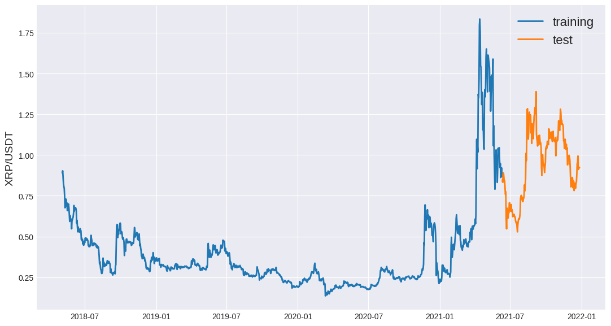

1. normalise_zero_base(continuous):

     - This function performs zero-based normalization on a given continuous series of data.
     - It calculates the percentage change in each data point relative to the first data point in the series

     - By dividing each data point by the first data point and subtracting 1, the resulting values will be centered around zero. This normalization technique is useful for comparing the relative changes in the data over time.

2. normalise_min_max(continuous):

    - This function performs min-max normalization on a given continuous series of data.
    - It scales the data to a range between 0 and 1 based on the minimum and maximum values in the series.
    - By subtracting the minimum value from each data point and dividing it by the range between the maximum and minimum values, the resulting values will be in the range of 0 to 1.
    - This normalization technique is useful for comparing the relative positions of data points within the overall range of the data.

```python
def normalise_zero_base(continuous):
    return continuous / continuous.iloc[0] - 1

def normalise_min_max(continuous):
    return (continuous - continuous.min()) / (data.max() - continuous.min())
```

### 4 Trend, Seasonality, and Cyclical Analysis:

### 5 Modeling and Forecasting

```python
def extract_window_data(continuous, window_len=5, zero_base=True):
    window_data = []
    for idx in range(len(continuous) - window_len):
        tmp = continuous[idx: (idx + window_len)].copy()
        if zero_base:
            tmp = normalise_zero_base(tmp)
        window_data.append(tmp.values)
    return np.array(window_data)
```

```python
def prepare_data(continuous, aim, window_len=10, zero_base=True, test_size=0.2):
    X_train = extract_window_data(train_data, window_len, zero_base)
    X_test = extract_window_data(test_data, window_len, zero_base)
    y_train = train_data[aim][window_len:].values
    y_test = test_data[aim][window_len:].values
    if zero_base:
        y_train = y_train / train_data[aim][:-window_len].values - 1
        y_test = y_test / test_data[aim][:-window_len].values - 1

    return train_data, test_data, X_train, X_test, y_train, y_test
```

```python
def build_lstm_model(input_data, output_size, neurons, activ_func='linear',
                     dropout=0.2, loss='mse', optimizer='adam'):
    model = Sequential()
    model.add(LSTM(neurons, input_shape=(input_data.shape[1], input_data.shape[2])))
    model.add(Dropout(dropout))
    model.add(Dense(units=output_size))
    model.add(Activation(activ_func))

    model.compile(loss=loss, optimizer=optimizer)
    return model
np.random.seed(245)
window_len = 5
test_size = 0.2
zero_base = True
lstm_neurons = 50
epochs = 20
batch_size = 32
loss = 'mse'
dropout = 0.24
optimizer = 'adam'
train_data, test_data, X_train, X_test, y_train, y_test = prepare_data(
    data, aim, window_len=window_len, zero_base=zero_base, test_size=test_size)
```

```python
print(train_data.shape)
print(test_data.shape)
print(X_train.shape)
print(X_test.shape)
print(y_train.shape)
print( y_test.shape)
```

```output
(1134, 6)
(200, 6)
(1129, 5, 6)
(195, 5, 6)
(1129,)
(195,)
```

```python
train_data
```

```output
               high      low     open    Volume XRP   Volume USDT    close
date                                                                      
2021-06-10  0.92980  0.85220  0.92180  5.926466e+08  5.240328e+08  0.86860
2021-06-09  0.92180  0.83000  0.87300  7.989945e+08  6.951836e+08  0.92180
2021-06-08  0.88610  0.78380  0.86190  9.892872e+08  8.389846e+08  0.87310
2021-06-07  0.97600  0.83800  0.94690  6.739070e+08  6.236606e+08  0.86180
2021-06-06  0.94930  0.91700  0.92300  3.954432e+08  3.698422e+08  0.94700
...             ...      ...      ...           ...           ...      ...
2018-05-08  0.84802  0.79200  0.82490  1.297130e+07  1.057184e+07  0.80667
2018-05-07  0.86886  0.80000  0.86482  1.730349e+07  1.419228e+07  0.82490
2018-05-06  0.91800  0.83774  0.90280  1.600204e+07  1.399714e+07  0.86483
2018-05-05  0.93500  0.88800  0.88980  1.681617e+07  1.528200e+07  0.90280
2018-05-04  1.50000  0.50000  0.50000  2.089021e+07  1.894672e+07  0.88990

[1134 rows x 6 columns]
```

```python
print(X_train.shape)
```

```output
(1129, 5, 6)
```

```python
model = build_lstm_model(
    X_train, output_size=1, neurons=lstm_neurons, dropout=dropout, loss=loss,
    optimizer=optimizer)
modelfit = model.fit(
    X_train, y_train, validation_data=(X_test, y_test), epochs=epochs, batch_size=batch_size, verbose=1, shuffle=True)
```

```output
Epoch 1/20
36/36 [==============================] - 5s 29ms/step - loss: 0.0173 - val_loss: 0.0073
Epoch 2/20
36/36 [==============================] - 0s 5ms/step - loss: 0.0085 - val_loss: 0.0048
Epoch 3/20
36/36 [==============================] - 0s 5ms/step - loss: 0.0060 - val_loss: 0.0039
Epoch 4/20
36/36 [==============================] - 0s 6ms/step - loss: 0.0053 - val_loss: 0.0051
Epoch 5/20
36/36 [==============================] - 0s 5ms/step - loss: 0.0046 - val_loss: 0.0044
Epoch 6/20
36/36 [==============================] - 0s 5ms/step - loss: 0.0046 - val_loss: 0.0039
Epoch 7/20
36/36 [==============================] - 0s 5ms/step - loss: 0.0039 - val_loss: 0.0043
Epoch 8/20
36/36 [==============================] - 0s 5ms/step - loss: 0.0036 - val_loss: 0.0046
Epoch 9/20
36/36 [==============================] - 0s 5ms/step - loss: 0.0034 - val_loss: 0.0049
Epoch 10/20
36/36 [==============================] - 0s 5ms/step - loss: 0.0032 - val_loss: 0.0047
Epoch 11/20
36/36 [==============================] - 0s 5ms/step - loss: 0.0028 - val_loss: 0.0034
Epoch 12/20
36/36 [==============================] - 0s 5ms/step - loss: 0.0022 - val_loss: 0.0045
Epoch 13/20
36/36 [==============================] - 0s 5ms/step - loss: 0.0024 - val_loss: 0.0028
Epoch 14/20
36/36 [==============================] - 0s 6ms/step - loss: 0.0019 - val_loss: 0.0026
Epoch 15/20
36/36 [==============================] - 0s 5ms/step - loss: 0.0018 - val_loss: 0.0022
Epoch 16/20
36/36 [==============================] - 0s 5ms/step - loss: 0.0016 - val_loss: 0.0023
Epoch 17/20
36/36 [==============================] - 0s 5ms/step - loss: 0.0015 - val_loss: 0.0015
Epoch 18/20
36/36 [==============================] - 0s 5ms/step - loss: 0.0014 - val_loss: 0.0014
Epoch 19/20
36/36 [==============================] - 0s 5ms/step - loss: 0.0013 - val_loss: 0.0021
Epoch 20/20
36/36 [==============================] - 0s 5ms/step - loss: 0.0011 - val_loss: 0.0015
```

```python
plt.plot(modelfit.history['loss'],'r',linewidth=2, label='Training loss')
plt.plot(modelfit.history['val_loss'], 'g',linewidth=2, label='Validation loss')
plt.title('LSTM Neural Networks - XRP Model')
plt.xlabel('Epochs numbers')
plt.ylabel('MSE numbers')
plt.show()
```

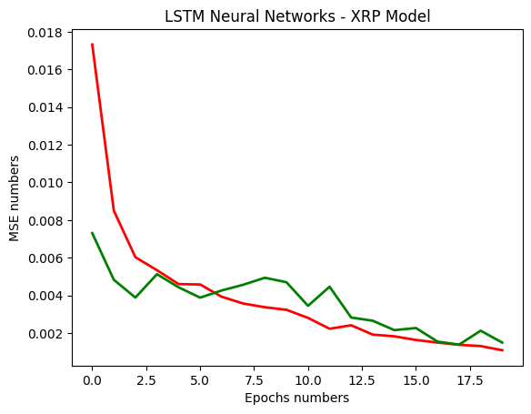

```python
import joblib
```

```python
# Save the model weights
file_path = "/content/drive/MyDrive/Colab Notebooks/AI Projects/4 Timeseries Analysis/Crypto_Currency_Omdena/LSTM_weights.h5"  # Specify the file path where you want to save the weights
model.save_weights(file_path)
```

```python
# Build and fit the ARIMA model
arima_model = ARIMA(train_data, order=(1, 1, 1))
arima_model_fit = arima_model.fit()

#  Build and fit the Exponential Smoothing model
exp_smoothing_model = ExponentialSmoothing(train_data, trend="add", seasonal="add", seasonal_periods=7)
exp_smoothing_model_fit = exp_smoothing_model.fit()
```

### 6 Model Evaluation and Validation

```python
targets = test_data[aim][window_len:]
preds = model.predict(X_test).squeeze()
mean_absolute_error(preds, y_test)
```

```output
7/7 [==============================] - 0s 3ms/step
```

```output
0.020041995535428615
```

```python
from sklearn.metrics import mean_squared_error
SCORE_MSE=mean_squared_error(preds, y_test)
SCORE_MSE
```

```output
0.0014877218418582396
```

```python

from sklearn.metrics import r2_score
r2_score=r2_score(y_test, preds)
r2_score*100
```

```output
95.54300509985426
```

### 7 Residual Analysis and Model Refinement:

### 8 Forecast Visualization and Reporting

```python
preds = test_data[aim].values[:-window_len] * (preds + 1)
preds = pd.Series(index=targets.index, data=preds)
line_plot(targets, preds, 'actual', 'prediction', lw=3)
```

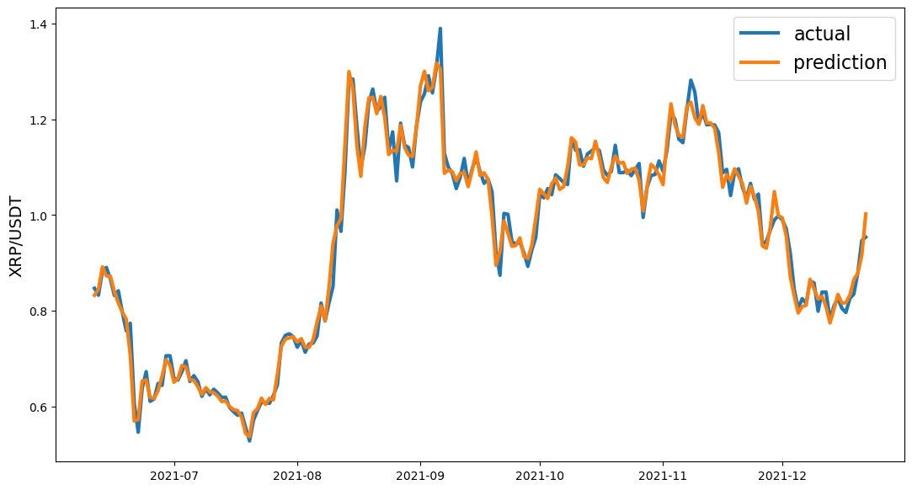


##  5 ETH

### 0 Dataset

Here's a breakdown of each feature:

- **open_time:** This represents the opening time of a specific period in Unix time format. Unix time is a way to represent time as the number of seconds that have elapsed since January 1, 1970.

- **open:** This refers to the opening price of the trading instrument at the given period.

- **high:** This represents the highest price reached by the trading instrument during the specified period.

- **low:** This denotes the lowest price reached by the trading instrument during the specified period.

- **close:** This indicates the closing price of the trading instrument at the given period.

- **volume:** This refers to the total volume, typically the quantity of the trading instrument, traded during the specified period.

- **close_time:** This represents the closing time of the specific period in Unix time format.

- **quote_volume:** This refers to the total volume in terms of the quote asset. The quote asset is the asset used to determine the value of the trading instrument.

- **count:** This represents the number of trades that occurred during the specified period.

- **taker_buy_volume:** This denotes the volume of the quote asset bought by takers (market takers) during the specified period.

- **taker_buy_quote_volume:** This represents the volume of the base asset bought by takers (market takers) during the specified period.

### 1 Packages

```python
from google.colab import drive
drive.mount('/content/drive')
```

```output
Mounted at /content/drive
```

```python
pip install prophet
```

```output
Requirement already satisfied: prophet in /usr/local/lib/python3.10/dist-packages (1.1.4)
Requirement already satisfied: cmdstanpy>=1.0.4 in /usr/local/lib/python3.10/dist-packages (from prophet) (1.1.0)
Requirement already satisfied: numpy>=1.15.4 in /usr/local/lib/python3.10/dist-packages (from prophet) (1.22.4)
Requirement already satisfied: matplotlib>=2.0.0 in /usr/local/lib/python3.10/dist-packages (from prophet) (3.7.1)
Requirement already satisfied: pandas>=1.0.4 in /usr/local/lib/python3.10/dist-packages (from prophet) (1.5.3)
Requirement already satisfied: LunarCalendar>=0.0.9 in /usr/local/lib/python3.10/dist-packages (from prophet) (0.0.9)
Requirement already satisfied: convertdate>=2.1.2 in /usr/local/lib/python3.10/dist-packages (from prophet) (2.4.0)
Requirement already satisfied: holidays>=0.25 in /usr/local/lib/python3.10/dist-packages (from prophet) (0.27.1)
Requirement already satisfied: python-dateutil>=2.8.0 in /usr/local/lib/python3.10/dist-packages (from prophet) (2.8.2)
Requirement already satisfied: tqdm>=4.36.1 in /usr/local/lib/python3.10/dist-packages (from prophet) (4.65.0)
Requirement already satisfied: importlib-resources in /usr/local/lib/python3.10/dist-packages (from prophet) (5.12.0)
Requirement already satisfied: pymeeus<=1,>=0.3.13 in /usr/local/lib/python3.10/dist-packages (from convertdate>=2.1.2->prophet) (0.5.12)
Requirement already satisfied: ephem>=3.7.5.3 in /usr/local/lib/python3.10/dist-packages (from LunarCalendar>=0.0.9->prophet) (4.1.4)
Requirement already satisfied: pytz in /usr/local/lib/python3.10/dist-packages (from LunarCalendar>=0.0.9->prophet) (2022.7.1)
Requirement already satisfied: contourpy>=1.0.1 in /usr/local/lib/python3.10/dist-packages (from matplotlib>=2.0.0->prophet) (1.1.0)
Requirement already satisfied: cycler>=0.10 in /usr/local/lib/python3.10/dist-packages (from matplotlib>=2.0.0->prophet) (0.11.0)
Requirement already satisfied: fonttools>=4.22.0 in /usr/local/lib/python3.10/dist-packages (from matplotlib>=2.0.0->prophet) (4.40.0)
Requirement already satisfied: kiwisolver>=1.0.1 in /usr/local/lib/python3.10/dist-packages (from matplotlib>=2.0.0->prophet) (1.4.4)
Requirement already satisfied: packaging>=20.0 in /usr/local/lib/python3.10/dist-packages (from matplotlib>=2.0.0->prophet) (23.1)
Requirement already satisfied: pillow>=6.2.0 in /usr/local/lib/python3.10/dist-packages (from matplotlib>=2.0.0->prophet) (8.4.0)
Requirement already satisfied: pyparsing>=2.3.1 in /usr/local/lib/python3.10/dist-packages (from matplotlib>=2.0.0->prophet) (3.1.0)
Requirement already satisfied: six>=1.5 in /usr/local/lib/python3.10/dist-packages (from python-dateutil>=2.8.0->prophet) (1.16.0)
```

```python
import prophet
from prophet import Prophet
from prophet.plot import plot_plotly, plot_components_plotly
from prophet.plot import add_changepoints_to_plot
```

```python
from statsmodels.tsa.arima.model import ARIMA
from statsmodels.tsa.holtwinters import ExponentialSmoothing
from statsmodels.tsa.seasonal import STL
```

```python
from statsmodels.tsa.seasonal import seasonal_decompose
from statsmodels.tsa.stattools import kpss
from statsmodels.tsa.stattools import adfuller
from statsmodels.graphics.tsaplots import plot_acf, plot_pacf
from sklearn.metrics import mean_absolute_error, mean_squared_error,r2_score
```

```python
import xgboost as xgb
from xgboost import plot_importance, plot_tree
```

```python
import pandas as pd
import matplotlib.pyplot as plt
import seaborn as sns
import plotly.express as px
import plotly.graph_objects as go
plt.style.use('seaborn-v0_8-darkgrid')
```

```python
!pip install dataprep
```

```python
from dataprep.eda import plot_correlation, plot_missing
from dataprep.eda import create_report
from dataprep.eda import plot
```

```python
from tensorflow.keras import layers
from tensorflow.keras.models import Sequential
from tensorflow.keras.layers import Activation, Dense, Dropout, LSTM
import matplotlib.pyplot as plt
import numpy as np
import pandas as pd
from sklearn.metrics import mean_absolute_error
from keras.callbacks import ModelCheckpoint, EarlyStopping, LearningRateScheduler
```

```python
from keras.callbacks import ModelCheckpoint, EarlyStopping, LearningRateScheduler
```

```python
import joblib
from pylab import rcParams
rcParams['figure.figsize'] = 14, 8
```

### 2 Data Loading and Preprocessing

```python
data=pd.read_csv("/content/drive/MyDrive/Datasets/Time_Series_Analysis/Crypto/ETHUSDT_merged.csv")
print(data.head())
```

```output
             open_time    open    high     low   close      volume  \
0  2019-09-01 00:00:00  171.52  172.89  171.36  172.45  5981.16399   
1  2019-09-01 01:00:00  172.47  173.42  172.41  172.71  7929.54701   
2  2019-09-01 02:00:00  172.67  172.97  172.02  172.43  2650.04457   
3  2019-09-01 03:00:00  172.41  172.83  172.32  172.57  2676.49085   
4  2019-09-01 04:00:00  172.50  172.74  172.11  172.46  2596.85893   

                close_time  quote_volume  count  taker_buy_volume  \
0  2019-09-01 00:59:59.999  1.030126e+06   3753        3576.32332   
1  2019-09-01 01:59:59.999  1.372183e+06   3310        5532.93656   
2  2019-09-01 02:59:59.999  4.568114e+05   2666        1333.25886   
3  2019-09-01 03:59:59.999  4.618308e+05   2612        1445.60395   
4  2019-09-01 04:59:59.999  4.476401e+05   2848        1524.31952   

   taker_buy_quote_volume  
0           615886.585686  
1           957301.238661  
2           229852.921103  
3           249450.124375  
4           262782.612091
```

```python
# Renaming the columns to match the name in the previous notebook with bitstamp data so that I do not have to change the whole code
data.rename(columns = {'open_time':'date', 'volume':'Volume'}, inplace = True)
```

```python
data.columns
```

```output
Index(['date', 'open', 'high', 'low', 'close', 'Volume', 'close_time',
       'quote_volume', 'count', 'taker_buy_volume', 'taker_buy_quote_volume'],
      dtype='object')
```

```python
data.info()
```

```output
<class 'pandas.core.frame.DataFrame'>
RangeIndex: 32821 entries, 0 to 32820
Data columns (total 11 columns):
 #   Column                  Non-Null Count  Dtype  
---  ------                  --------------  -----  
 0   date                    32821 non-null  object 
 1   open                    32821 non-null  float64
 2   high                    32821 non-null  float64
 3   low                     32821 non-null  float64
 4   close                   32821 non-null  float64
 5   Volume                  32821 non-null  float64
 6   close_time              32821 non-null  object 
 7   quote_volume            32821 non-null  float64
 8   count                   32821 non-null  int64  
 9   taker_buy_volume        32821 non-null  float64
 10  taker_buy_quote_volume  32821 non-null  float64
dtypes: float64(8), int64(1), object(2)
memory usage: 2.8+ MB
```

```python
# Removing close time column
data = data.drop(columns=['close_time'])
data=data.drop(columns=["count", "quote_volume", "taker_buy_volume", "taker_buy_quote_volume"])
```

$$Missing-Data-Check$$

```python
data.isnull().any()
```

```output
date      False
open      False
high      False
low       False
close     False
Volume    False
dtype: bool
```

```python
data.shape
```

```output
(32821, 6)
```

$$Target-Feature$$

```python
Target=data['close']
Feature=data.drop(['close'],axis=1)
```

```python
print(Target.shape)
print(Feature.shape)
```

```output
(32821,)
(32821, 5)
```

$$Convert-To-Datatime$$

```python
# Converting the Date column from object to datetime
data[["date"]] = data[["date"]].apply(pd.to_datetime)
```

```python
print(data)
```

```output
                     date     open     high      low    close      Volume
0     2019-09-01 00:00:00   171.52   172.89   171.36   172.45  5981.16399
1     2019-09-01 01:00:00   172.47   173.42   172.41   172.71  7929.54701
2     2019-09-01 02:00:00   172.67   172.97   172.02   172.43  2650.04457
3     2019-09-01 03:00:00   172.41   172.83   172.32   172.57  2676.49085
4     2019-09-01 04:00:00   172.50   172.74   172.11   172.46  2596.85893
...                   ...      ...      ...      ...      ...         ...
32816 2023-05-31 19:00:00  1864.00  1869.75  1861.62  1863.63  7481.48730
32817 2023-05-31 20:00:00  1863.63  1868.80  1863.20  1865.18  5792.02520
32818 2023-05-31 21:00:00  1865.17  1866.19  1861.48  1864.20  4703.47530
32819 2023-05-31 22:00:00  1864.19  1871.27  1863.72  1869.42  6868.34990
32820 2023-05-31 23:00:00  1869.43  1878.14  1868.11  1873.63  9750.88650

[32821 rows x 6 columns]
```

```python
data = data.set_index('date')
data.index = pd.to_datetime(data.index,unit='ns')
print(data.index)
```

```output
DatetimeIndex(['2019-09-01 00:00:00', '2019-09-01 01:00:00',
               '2019-09-01 02:00:00', '2019-09-01 03:00:00',
               '2019-09-01 04:00:00', '2019-09-01 05:00:00',
               '2019-09-01 06:00:00', '2019-09-01 07:00:00',
               '2019-09-01 08:00:00', '2019-09-01 09:00:00',
               ...
               '2023-05-31 14:00:00', '2023-05-31 15:00:00',
               '2023-05-31 16:00:00', '2023-05-31 17:00:00',
               '2023-05-31 18:00:00', '2023-05-31 19:00:00',
               '2023-05-31 20:00:00', '2023-05-31 21:00:00',
               '2023-05-31 22:00:00', '2023-05-31 23:00:00'],
              dtype='datetime64[ns]', name='date', length=32821, freq=None)
```

### 3 Exploratory Data Analysis (EDA):

```python
train_data = data.iloc[:25000]
test_data = data.iloc[25000:]
```

```python
def line_plot(line1, line2, label1=None, label2=None, title='', lw=2):
    fig, ax = plt.subplots(1, figsize=(13, 7))
    ax.plot(line1, label=label1, linewidth=lw)
    ax.plot(line2, label=label2, linewidth=lw)
    ax.set_ylabel('XRP/USDT', fontsize=14)
    ax.set_title(title, fontsize=16)
    ax.legend(loc='best', fontsize=16);
```

```python
aim = 'close'
line_plot(train_data[aim], test_data[aim], 'training', 'test', title='')
```

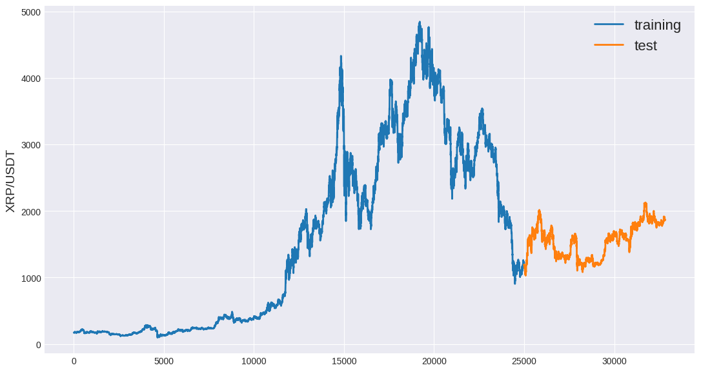

### 4 Trend, Seasonality, and Cyclical Analysis:

### 5 Modeling and Forecasting

```python
import numpy as np
import pandas as pd

def extract_window_data(data, window_len):
    """
    Extracts sliding windows from a time series data.

    Parameters:
    - data: The time series data.
    - window_len: The length of the sliding window.

    Returns:
    - An array of windowed data.
    """
    window_data = []
    for i in range(len(data) - window_len + 1):
        window_data.append(data[i:i+window_len])
    return np.array(window_data)


def normalize_data(data):
    """
    Performs min-max normalization on the given data.

    Parameters:
    - data: The data to be normalized.

    Returns:
    - The normalized data.
    """
    return (data - np.min(data)) / (np.max(data) - np.min(data))


def split_data(data, test_ratio):
    """
    Splits the data into training and testing sets based on the specified ratio.

    Parameters:
    - data: The data to be split.
    - test_ratio: The ratio of the test set size to the total data size.

    Returns:
    - The training and testing sets.
    """
    train_size = int(len(data) * (1 - test_ratio))
    train_data = data[:train_size]
    test_data = data[train_size:]
    return train_data, test_data
```

```python
# Example usage
window_len = 100
test_ratio = 0.2

windowed_data = extract_window_data(data, window_len)
normalized_data = normalize_data(data)
train_data, test_data = split_data(data, test_ratio)
```

```python
windowed_data.shape
```

```output
(32722, 100, 6)
```

```python
import numpy as np

def create_train_test_data(windowed_data, target_col_index, test_ratio):
    """
    Splits the windowed data into input features (X) and target variable (y) for training and testing.

    Parameters:
    - windowed_data: The windowed data.
    - target_col_index: The index of the column to be used as the target variable.
    - test_ratio: The ratio of the test set size to the total data size.

    Returns:
    - X_train: Input features for training.
    - y_train: Target variable for training.
    - X_test: Input features for testing.
    - y_test: Target variable for testing.
    """
    num_samples = windowed_data.shape[0]
    train_size = int(num_samples * (1 - test_ratio))

    X = windowed_data[:, :-1]  # Input features (all columns except the last one)
    y = windowed_data[:, target_col_index, :]   # Target variable (specified column)

    X_train = X[:train_size]
    y_train = y[:train_size]
    X_test = X[train_size:]
    y_test = y[train_size:]

    return X_train, y_train, X_test, y_test, X, y
```

```python
windowed_data[:,50:,5].shape
```

```output
(32722, 50)
```

```python
y = windowed_data[:, -1]
y_train = y[:100,-1, :]
y.shape
y_train.shape
```

```python
y_train
```

```output
array([[Timestamp('2019-09-05 03:00:00'), 10537.09, 10563.25, 10490.0,
        10550.37, 1067.493568],
       [Timestamp('2019-09-05 04:00:00'), 10550.0, 10608.69, 10539.32,
        10572.43, 1105.94671],
       [Timestamp('2019-09-05 05:00:00'), 10572.43, 10636.95, 10551.0,
        10602.85, 1102.853904],
       ...,
       [Timestamp('2022-09-01 03:00:00'), 20119.43, 20181.22, 19931.0,
        20022.97, 9197.00362],
       [Timestamp('2022-09-01 04:00:00'), 20023.82, 20095.0, 19991.45,
        20055.59, 6641.98427],
       [Timestamp('2022-09-01 05:00:00'), 20055.59, 20139.0, 20032.63,
        20038.97, 7495.19589]], dtype=object)
```

```python
y_train = y_train.reshape(-1, 1)
print(y_train.shape)
```

```output
(157062, 1)
```

```python
X_train, y_train, X_test, y_test,X,y=create_train_test_data(windowed_data,6, .2)
```

```python
print(train_data.shape)
print(test_data.shape)
print(X_train.shape)
print(X_test.shape)
print(y_train.shape)
print( y_test.shape)
print(X.shape)
print(y.shape)
```

```output
(26256, 6)
(6565, 6)
(26177, 99, 6)
(6545, 99, 6)
(26177, 6)
(6545, 6)
(32722, 99, 6)
(32722, 6)
```

#### 5.1 Preprocessing

1. normalise_zero_base(continuous):

     - This function performs zero-based normalization on a given continuous series of data.
     - It calculates the percentage change in each data point relative to the first data point in the series

     - By dividing each data point by the first data point and subtracting 1, the resulting values will be centered around zero. This normalization technique is useful for comparing the relative changes in the data over time.

2. normalise_min_max(continuous):

    - This function performs min-max normalization on a given continuous series of data.
    - It scales the data to a range between 0 and 1 based on the minimum and maximum values in the series.
    - By subtracting the minimum value from each data point and dividing it by the range between the maximum and minimum values, the resulting values will be in the range of 0 to 1.
    - This normalization technique is useful for comparing the relative positions of data points within the overall range of the data.

```python
def normalise_zero_base(continuous):
    return continuous / continuous.iloc[0] - 1

def normalise_min_max(continuous):
    return (continuous - continuous.min()) / (data.max() - continuous.min())
```

```python
import pandas as pd
import numpy as np
from sklearn.preprocessing import MinMaxScaler
from tensorflow.keras.models import Sequential
from tensorflow.keras.layers import LSTM, Dense


# Extract the 'close' column for prediction
target_col = "close"
target_data = data[target_col].values.reshape(-1, 1)

# Normalize the target data
scaler = MinMaxScaler()
target_data_normalized = scaler.fit_transform(target_data)

# Normalize the input features
input_features = ['open', 'high', 'low', 'Volume']
input_data = data[input_features].values
input_data_normalized = scaler.fit_transform(input_data)
```

```python
data[target_col].values.reshape(-1, 1).shape
```

```output
(32821, 1)
```

#### 5.2 Model Build

```python
def build_lstm_model(input_data, output_size, neurons, activ_func='linear',
                     dropout=0.2, loss='mse', optimizer='adam'):
    model = Sequential()
    model.add(LSTM(neurons, input_shape=(input_data.shape[1], input_data.shape[2])))
    model.add(Dropout(dropout))
    model.add(Dense(units=output_size))
    model.add(Activation(activ_func))

    model.compile(loss=loss, optimizer=optimizer)
    return model
np.random.seed(245)
window_len =10
split_ratio = 0.8  # Ratio of training set to total data
zero_base = True
lstm_neurons = 50
epochs = 100
batch_size = 128 #32
loss = 'mean_squared_error'
dropout = 0.24
optimizer = 'adam'
```

#### 5.3 Extract Windows

```python
def extract_window_data(input_data, target_data, window_len):
    X = []
    y = []
    for i in range(len(input_data) - window_len):
        X.append(input_data[i : i + window_len])
        y.append(target_data[i + window_len])
    return np.array(X), np.array(y)
```

```python
X, y = extract_window_data(input_data_normalized, target_data_normalized, window_len)
```

```python
# Split the data into training and testing sets
split_ratio = 0.8  # Ratio of training set to total data
split_index = int(split_ratio * len(X))

X_train, X_test = X[:split_index], X[split_index:]
y_train, y_test = y[:split_index], y[split_index:]
```

```python
print(X_train.shape)
print(X_test.shape)
print(y_train.shape)
print( y_test.shape)
```

```output
(26248, 10, 4)
(6563, 10, 4)
(26248, 1)
(6563, 1)
```

#### 5.4 Lr_Schedule & Earlystopping

```python
lr_schedule = LearningRateScheduler(lambda epoch: 1e-8 * 10**(epoch/20))
earlystopping = EarlyStopping(monitor='val_loss', patience=10, restore_best_weights=True)


checkpoint_path = 'LSTM_new.hdf5'
checkpoint = ModelCheckpoint(filepath=checkpoint_path,
                             monitor='val_loss',
                             verbose=1,
                             save_best_only=True,
                             mode='min')

callbacks = [checkpoint, earlystopping, lr_schedule]
```

#### 5.5 Training

```python
model = build_lstm_model(
    X_train, output_size=1, neurons=lstm_neurons, dropout=dropout, loss=loss,
    optimizer=optimizer)
modelfit = model.fit(
    X_train, y_train, validation_data=(X_test, y_test), epochs=epochs, batch_size=batch_size, verbose=1, shuffle=True,callbacks=callbacks)
```

```output
Epoch 1/100
205/206 [============================>.] - ETA: 0s - loss: 0.0877
Epoch 1: val_loss improved from inf to 0.04192, saving model to LSTM_new.hdf5
206/206 [==============================] - 12s 40ms/step - loss: 0.0877 - val_loss: 0.0419 - lr: 1.0000e-08
Epoch 2/100
205/206 [============================>.] - ETA: 0s - loss: 0.0875
Epoch 2: val_loss improved from 0.04192 to 0.04189, saving model to LSTM_new.hdf5
206/206 [==============================] - 3s 15ms/step - loss: 0.0876 - val_loss: 0.0419 - lr: 1.1220e-08
Epoch 3/100
203/206 [============================>.] - ETA: 0s - loss: 0.0883
Epoch 3: val_loss improved from 0.04189 to 0.04185, saving model to LSTM_new.hdf5
206/206 [==============================] - 3s 14ms/step - loss: 0.0884 - val_loss: 0.0419 - lr: 1.2589e-08
Epoch 4/100
205/206 [============================>.] - ETA: 0s - loss: 0.0871
Epoch 4: val_loss improved from 0.04185 to 0.04181, saving model to LSTM_new.hdf5
206/206 [==============================] - 3s 15ms/step - loss: 0.0871 - val_loss: 0.0418 - lr: 1.4125e-08
Epoch 5/100
205/206 [============================>.] - ETA: 0s - loss: 0.0877
Epoch 5: val_loss improved from 0.04181 to 0.04177, saving model to LSTM_new.hdf5
206/206 [==============================] - 4s 20ms/step - loss: 0.0877 - val_loss: 0.0418 - lr: 1.5849e-08
Epoch 6/100
205/206 [============================>.] - ETA: 0s - loss: 0.0874
Epoch 6: val_loss improved from 0.04177 to 0.04173, saving model to LSTM_new.hdf5
206/206 [==============================] - 3s 15ms/step - loss: 0.0874 - val_loss: 0.0417 - lr: 1.7783e-08
Epoch 7/100
204/206 [============================>.] - ETA: 0s - loss: 0.0876
Epoch 7: val_loss improved from 0.04173 to 0.04168, saving model to LSTM_new.hdf5
206/206 [==============================] - 4s 21ms/step - loss: 0.0876 - val_loss: 0.0417 - lr: 1.9953e-08
Epoch 8/100
205/206 [============================>.] - ETA: 0s - loss: 0.0875
Epoch 8: val_loss improved from 0.04168 to 0.04162, saving model to LSTM_new.hdf5
206/206 [==============================] - 6s 28ms/step - loss: 0.0875 - val_loss: 0.0416 - lr: 2.2387e-08
Epoch 9/100
202/206 [============================>.] - ETA: 0s - loss: 0.0875
Epoch 9: val_loss improved from 0.04162 to 0.04155, saving model to LSTM_new.hdf5
206/206 [==============================] - 4s 17ms/step - loss: 0.0873 - val_loss: 0.0416 - lr: 2.5119e-08
Epoch 10/100
204/206 [============================>.] - ETA: 0s - loss: 0.0867
Epoch 10: val_loss improved from 0.04155 to 0.04148, saving model to LSTM_new.hdf5
206/206 [==============================] - 3s 15ms/step - loss: 0.0868 - val_loss: 0.0415 - lr: 2.8184e-08
Epoch 11/100
204/206 [============================>.] - ETA: 0s - loss: 0.0870
Epoch 11: val_loss improved from 0.04148 to 0.04140, saving model to LSTM_new.hdf5
206/206 [==============================] - 4s 19ms/step - loss: 0.0870 - val_loss: 0.0414 - lr: 3.1623e-08
Epoch 12/100
205/206 [============================>.] - ETA: 0s - loss: 0.0869
Epoch 12: val_loss improved from 0.04140 to 0.04130, saving model to LSTM_new.hdf5
206/206 [==============================] - 6s 28ms/step - loss: 0.0868 - val_loss: 0.0413 - lr: 3.5481e-08
Epoch 13/100
205/206 [============================>.] - ETA: 0s - loss: 0.0867
Epoch 13: val_loss improved from 0.04130 to 0.04120, saving model to LSTM_new.hdf5
206/206 [==============================] - 5s 24ms/step - loss: 0.0867 - val_loss: 0.0412 - lr: 3.9811e-08
Epoch 14/100
205/206 [============================>.] - ETA: 0s - loss: 0.0869
Epoch 14: val_loss improved from 0.04120 to 0.04108, saving model to LSTM_new.hdf5
206/206 [==============================] - 5s 22ms/step - loss: 0.0869 - val_loss: 0.0411 - lr: 4.4668e-08
Epoch 15/100
206/206 [==============================] - ETA: 0s - loss: 0.0863
Epoch 15: val_loss improved from 0.04108 to 0.04095, saving model to LSTM_new.hdf5
206/206 [==============================] - 7s 32ms/step - loss: 0.0863 - val_loss: 0.0410 - lr: 5.0119e-08
... 308 more lines (the full output is in the notebook on GitHub)
```

```python
plt.plot(modelfit.history['loss'],'r',linewidth=2, label='Training loss')
plt.plot(modelfit.history['val_loss'], 'g',linewidth=2, label='Validation loss')
plt.title('LSTM Neural Networks - XRP Model')
plt.xlabel('Epochs numbers')
plt.ylabel('MSE numbers')
plt.show()
```

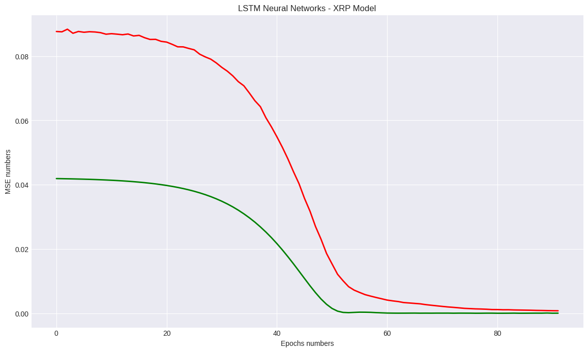

```python
# Save the model weights
file_path = "/content/drive/MyDrive/Colab Notebooks/AI Projects/4 Timeseries Analysis/Crypto_Currency_Omdena/LSTM_weights.h5"  # Specify the file path where you want to save the weights
model.save_weights(file_path)
```

```python
# Build and fit the ARIMA model
arima_model = ARIMA(train_data, order=(1, 1, 1))
arima_model_fit = arima_model.fit()

#  Build and fit the Exponential Smoothing model
exp_smoothing_model = ExponentialSmoothing(train_data, trend="add", seasonal="add", seasonal_periods=7)
exp_smoothing_model_fit = exp_smoothing_model.fit()
```

```python
# Step 4: Make predictions
predictions = model.predict(X_test)


# Step 6: Evaluate the model (optional)
mse = np.mean((predictions - y_test) ** 2)
print("Mean Squared Error:", mse)
```

### 6 Model Evaluation and Validation

```python
## Prediction
preds = model.predict(X_test)
y_test = y[split_index:]
```

```output
206/206 [==============================] - 1s 5ms/step
```

```python
# Normalize the target data
scaler = MinMaxScaler()
target_data_normalized = scaler.fit_transform(target_data)
```

```python
# Inverse normalize the predictions
preds = preds.reshape(-1, 1)
y_test = y_test.reshape(-1, 1)
preds = scaler.inverse_transform(preds)
y_test = scaler.inverse_transform(y_test)
```

```python
from sklearn.metrics import mean_squared_error
SCORE_MSE=mean_squared_error(preds, y_test)
SCORE_MSE
```

```output
1.9265585519632266e-05
```

$$r2-score$$


An R2 score of -3823.33% indicates that the model's performance is significantly worse than random chance. The R2 score, also known as the coefficient of determination, measures the proportion of the variance in the target variable that can be explained by the model. It ranges from negative infinity to 1, where 1 represents a perfect fit, 0 represents a model that performs no better than the mean, and negative values indicate that the model performs worse than the mean.

- A negative R2 score suggests that the model's predictions deviate substantially from the actual values and perform worse than a naive baseline model. This could be due to various reasons, such as inappropriate model selection, insufficient training data, or the lack of meaningful patterns in the data.


- Having a high positive R2 score suggests that the model captures the underlying patterns and relationships in the data accurately. It indicates that the model's predictions align closely with the actual values, and it performs significantly better than a baseline model or random chance.

  - A positive R2 score of 99 indicates that the model is performing exceptionally well and can explain 99% of the variance in the target variable. An R2 score of 1 represents a perfect fit, where the model can perfectly predict the target variable based on the features.

```python
from sklearn.metrics import r2_score
r2_score=r2_score(y_test, preds)
r2_score*100
```

```output
99.3033436589132
```

### 7 Residual Analysis and Model Refinement:

### 8 Forecast Visualization and Reporting

```python
fig, ax = plt.subplots(1, figsize=(13, 7))
ax.plot(y_test, label='actual', linewidth=3)
ax.plot(preds, label='prediction', linewidth=3)
ax.set_ylabel('ETH/USDT', fontsize=14)
ax.set_title('ETH', fontsize=16)
ax.legend(loc='best', fontsize=16);
```

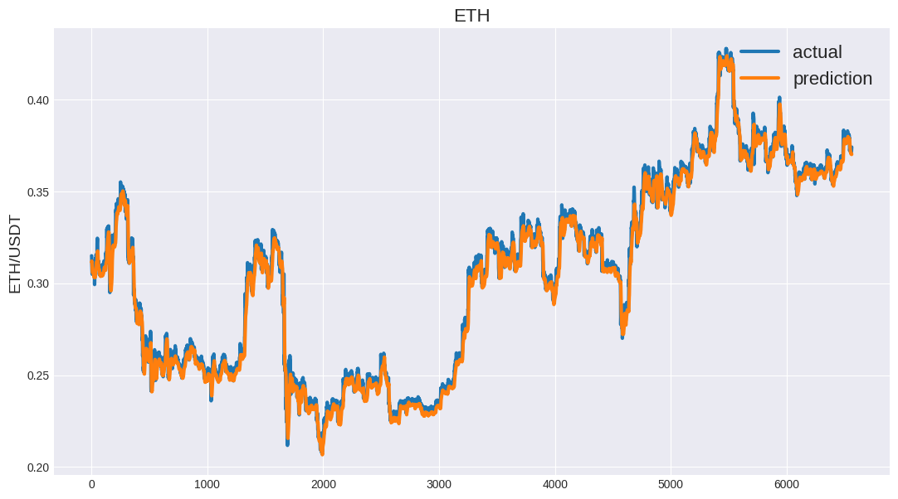

```python
scaler
```

<div class="nb-output">

<div id="sk-container-id-2" class="sk-top-container"><div class="sk-text-repr-fallback"><pre>MinMaxScaler()</pre><b>In a Jupyter environment, please rerun this cell to show the HTML representation or trust the notebook. <br />On GitHub, the HTML representation is unable to render, please try loading this page with nbviewer.org.</b></div><div class="sk-container" hidden><div class="sk-item"><div class="sk-estimator sk-toggleable"><input class="sk-toggleable__control sk-hidden--visually" id="sk-estimator-id-2" type="checkbox" checked><label for="sk-estimator-id-2" class="sk-toggleable__label sk-toggleable__label-arrow">MinMaxScaler</label><div class="sk-toggleable__content"><pre>MinMaxScaler()</pre></div></div></div></div></div>

</div>

```python
y_test_inverse = scaler.inverse_transform(y_test)
pred_inverse = scaler.inverse_transform(preds)
```

```python
# Inverse normalize the predictions
preds_reshape = preds.reshape(-1, 1)
y_test_reshape = y_test.reshape(-1, 1)
preds_inv = scaler.inverse_transform(preds_reshape)
y_test_inv = scaler.inverse_transform(y_test_reshape)
```

```python
from sklearn.metrics import r2_score
test_mae_LSTM= round(mean_absolute_error(y_test_inv, preds_inv), 2)
test_rmse_LSTM = round(np.sqrt(mean_squared_error(y_test_inv, preds_inv)), 2)
test_r2_LSTM = round(r2_score(y_test_inv, preds_inv)*100, 2)
```

```python
print(test_mae_LSTM)
print(test_rmse_LSTM)
print(test_r2_LSTM)
```

```output
15.84
20.85
99.3
```

```python
fig, ax = plt.subplots(1, figsize=(13, 7))
ax.plot(y_test_inv, label='actual', linewidth=3)
ax.plot(preds_inv, label='prediction', linewidth=3)
ax.set_ylabel('ETH/USDT', fontsize=14)
ax.set_title('ETH', fontsize=16)
ax.legend(loc='best', fontsize=16);
```

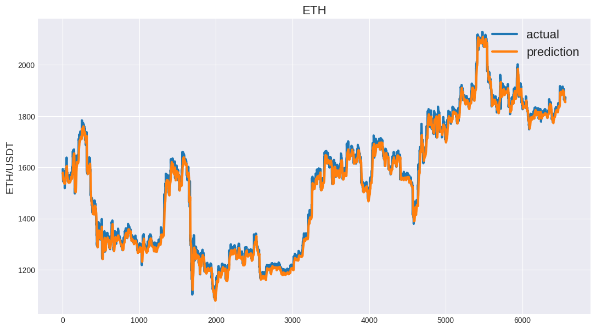

## 6 BTC

### 0 Dataset

Here's a breakdown of each feature:

- **open_time:** This represents the opening time of a specific period in Unix time format. Unix time is a way to represent time as the number of seconds that have elapsed since January 1, 1970.

- **open:** This refers to the opening price of the trading instrument at the given period.

- **high:** This represents the highest price reached by the trading instrument during the specified period.

- **low:** This denotes the lowest price reached by the trading instrument during the specified period.

- **close:** This indicates the closing price of the trading instrument at the given period.

- **volume:** This refers to the total volume, typically the quantity of the trading instrument, traded during the specified period.

- **close_time:** This represents the closing time of the specific period in Unix time format.

- **quote_volume:** This refers to the total volume in terms of the quote asset. The quote asset is the asset used to determine the value of the trading instrument.

- **count:** This represents the number of trades that occurred during the specified period.

- **taker_buy_volume:** This denotes the volume of the quote asset bought by takers (market takers) during the specified period.

- **taker_buy_quote_volume:** This represents the volume of the base asset bought by takers (market takers) during the specified period.

### 1 Packages

```python
from google.colab import drive
drive.mount('/content/drive')
```

```output
Drive already mounted at /content/drive; to attempt to forcibly remount, call drive.mount("/content/drive", force_remount=True).
```

```python
pip install prophet
```

```output
Requirement already satisfied: prophet in /usr/local/lib/python3.10/dist-packages (1.1.4)
Requirement already satisfied: cmdstanpy>=1.0.4 in /usr/local/lib/python3.10/dist-packages (from prophet) (1.1.0)
Requirement already satisfied: numpy>=1.15.4 in /usr/local/lib/python3.10/dist-packages (from prophet) (1.22.4)
Requirement already satisfied: matplotlib>=2.0.0 in /usr/local/lib/python3.10/dist-packages (from prophet) (3.7.1)
Requirement already satisfied: pandas>=1.0.4 in /usr/local/lib/python3.10/dist-packages (from prophet) (1.5.3)
Requirement already satisfied: LunarCalendar>=0.0.9 in /usr/local/lib/python3.10/dist-packages (from prophet) (0.0.9)
Requirement already satisfied: convertdate>=2.1.2 in /usr/local/lib/python3.10/dist-packages (from prophet) (2.4.0)
Requirement already satisfied: holidays>=0.25 in /usr/local/lib/python3.10/dist-packages (from prophet) (0.27.1)
Requirement already satisfied: python-dateutil>=2.8.0 in /usr/local/lib/python3.10/dist-packages (from prophet) (2.8.2)
Requirement already satisfied: tqdm>=4.36.1 in /usr/local/lib/python3.10/dist-packages (from prophet) (4.65.0)
Requirement already satisfied: importlib-resources in /usr/local/lib/python3.10/dist-packages (from prophet) (5.12.0)
Requirement already satisfied: pymeeus<=1,>=0.3.13 in /usr/local/lib/python3.10/dist-packages (from convertdate>=2.1.2->prophet) (0.5.12)
Requirement already satisfied: ephem>=3.7.5.3 in /usr/local/lib/python3.10/dist-packages (from LunarCalendar>=0.0.9->prophet) (4.1.4)
Requirement already satisfied: pytz in /usr/local/lib/python3.10/dist-packages (from LunarCalendar>=0.0.9->prophet) (2022.7.1)
Requirement already satisfied: contourpy>=1.0.1 in /usr/local/lib/python3.10/dist-packages (from matplotlib>=2.0.0->prophet) (1.1.0)
Requirement already satisfied: cycler>=0.10 in /usr/local/lib/python3.10/dist-packages (from matplotlib>=2.0.0->prophet) (0.11.0)
Requirement already satisfied: fonttools>=4.22.0 in /usr/local/lib/python3.10/dist-packages (from matplotlib>=2.0.0->prophet) (4.40.0)
Requirement already satisfied: kiwisolver>=1.0.1 in /usr/local/lib/python3.10/dist-packages (from matplotlib>=2.0.0->prophet) (1.4.4)
Requirement already satisfied: packaging>=20.0 in /usr/local/lib/python3.10/dist-packages (from matplotlib>=2.0.0->prophet) (23.1)
Requirement already satisfied: pillow>=6.2.0 in /usr/local/lib/python3.10/dist-packages (from matplotlib>=2.0.0->prophet) (8.4.0)
Requirement already satisfied: pyparsing>=2.3.1 in /usr/local/lib/python3.10/dist-packages (from matplotlib>=2.0.0->prophet) (3.1.0)
Requirement already satisfied: six>=1.5 in /usr/local/lib/python3.10/dist-packages (from python-dateutil>=2.8.0->prophet) (1.16.0)
```

```python
import prophet
from prophet import Prophet
from prophet.plot import plot_plotly, plot_components_plotly
from prophet.plot import add_changepoints_to_plot
```

```python
from statsmodels.tsa.arima.model import ARIMA
from statsmodels.tsa.holtwinters import ExponentialSmoothing
from statsmodels.tsa.seasonal import STL
```

```python
from statsmodels.tsa.seasonal import seasonal_decompose
from statsmodels.tsa.stattools import kpss
from statsmodels.tsa.stattools import adfuller
from statsmodels.graphics.tsaplots import plot_acf, plot_pacf
from sklearn.metrics import mean_absolute_error, mean_squared_error,r2_score
```

```python
import xgboost as xgb
from xgboost import plot_importance, plot_tree
```

```python
import pandas as pd
import matplotlib.pyplot as plt
import seaborn as sns
import plotly.express as px
import plotly.graph_objects as go
plt.style.use('seaborn-v0_8-darkgrid')
```

```python
!pip install dataprep
```

```python
from dataprep.eda import plot_correlation, plot_missing
from dataprep.eda import create_report
from dataprep.eda import plot
```

```python
from tensorflow.keras import layers
from tensorflow.keras.models import Sequential
from tensorflow.keras.layers import Activation, Dense, Dropout, LSTM
import matplotlib.pyplot as plt
import numpy as np
import pandas as pd
from sklearn.metrics import mean_absolute_error
from keras.callbacks import ModelCheckpoint, EarlyStopping, LearningRateScheduler
```

```python
from keras.callbacks import ModelCheckpoint, EarlyStopping, LearningRateScheduler
```

```python
import joblib
from pylab import rcParams
rcParams['figure.figsize'] = 14, 8
```

### 2 Data Loading and Preprocessing

```python
data=pd.read_csv("/content/drive/MyDrive/Datasets/Time_Series_Analysis/Crypto/BTCUSDT_merged.csv")
print(data.head())
```

```output
             open_time     open     high      low    close      volume  \
0  2019-09-01 00:00:00  9588.74  9630.00  9579.34  9617.06  546.960415   
1  2019-09-01 01:00:00  9617.06  9642.58  9612.08  9614.99  453.105152   
2  2019-09-01 02:00:00  9614.99  9616.00  9595.76  9605.78  458.004517   
3  2019-09-01 03:00:00  9606.12  9624.01  9605.78  9623.02  633.588749   
4  2019-09-01 04:00:00  9623.02  9630.21  9605.60  9614.46  542.260896   

                close_time  quote_volume  count  taker_buy_volume  \
0  2019-09-01 00:59:59.999  5.257943e+06   7428        261.131656   
1  2019-09-01 01:59:59.999  4.362498e+06   5789        258.764082   
2  2019-09-01 02:59:59.999  4.400751e+06   5485        321.355630   
3  2019-09-01 03:59:59.999  6.092024e+06   5500        446.853542   
4  2019-09-01 04:59:59.999  5.216076e+06   5536        368.470786   

   taker_buy_quote_volume  
0            2.510480e+06  
1            2.491295e+06  
2            3.088171e+06  
3            4.296649e+06  
4            3.544535e+06
```

```python
# Renaming the columns to match the name in the previous notebook with bitstamp data so that I do not have to change the whole code
data.rename(columns = {'open_time':'date', 'volume':'Volume'}, inplace = True)
```

```python
data.columns
```

```output
Index(['date', 'open', 'high', 'low', 'close', 'Volume', 'close_time',
       'quote_volume', 'count', 'taker_buy_volume', 'taker_buy_quote_volume'],
      dtype='object')
```

```python
data.info()
```

```output
<class 'pandas.core.frame.DataFrame'>
RangeIndex: 32821 entries, 0 to 32820
Data columns (total 11 columns):
 #   Column                  Non-Null Count  Dtype  
---  ------                  --------------  -----  
 0   date                    32821 non-null  object 
 1   open                    32821 non-null  float64
 2   high                    32821 non-null  float64
 3   low                     32821 non-null  float64
 4   close                   32821 non-null  float64
 5   Volume                  32821 non-null  float64
 6   close_time              32821 non-null  object 
 7   quote_volume            32821 non-null  float64
 8   count                   32821 non-null  int64  
 9   taker_buy_volume        32821 non-null  float64
 10  taker_buy_quote_volume  32821 non-null  float64
dtypes: float64(8), int64(1), object(2)
memory usage: 2.8+ MB
```

```python
# Removing close time column
data = data.drop(columns=['close_time'])
data=data.drop(columns=["count", "quote_volume", "taker_buy_volume", "taker_buy_quote_volume"])
```

$$Missing-Data-Check$$

```python
data.isnull().any()
```

```output
date      False
open      False
high      False
low       False
close     False
Volume    False
dtype: bool
```

```python
data.shape
```

```output
(32821, 6)
```

$$Target-Feature$$

```python
Target=data['close']
Feature=data.drop(['close'],axis=1)
```

```python
print(Target.shape)
print(Feature.shape)
```

```output
(32821,)
(32821, 5)
```

$$Convert-To-Datatime$$

```python
# Converting the Date column from object to datetime
data[["date"]] = data[["date"]].apply(pd.to_datetime)
```

```python
print(data)
```

```output
                     date      open      high       low     close       Volume
0     2019-09-01 00:00:00   9588.74   9630.00   9579.34   9617.06   546.960415
1     2019-09-01 01:00:00   9617.06   9642.58   9612.08   9614.99   453.105152
2     2019-09-01 02:00:00   9614.99   9616.00   9595.76   9605.78   458.004517
3     2019-09-01 03:00:00   9606.12   9624.01   9605.78   9623.02   633.588749
4     2019-09-01 04:00:00   9623.02   9630.21   9605.60   9614.46   542.260896
...                   ...       ...       ...       ...       ...          ...
32816 2023-05-31 19:00:00  27037.06  27123.43  27000.20  27010.57  1064.241890
32817 2023-05-31 20:00:00  27010.57  27116.13  27005.16  27114.20   835.439160
32818 2023-05-31 21:00:00  27114.19  27119.77  27045.61  27090.79   644.019020
32819 2023-05-31 22:00:00  27090.78  27193.24  27084.92  27183.98   999.118680
32820 2023-05-31 23:00:00  27183.97  27299.99  27159.63  27210.35  1483.723750

[32821 rows x 6 columns]
```

```python
data = data.set_index('date')
data.index = pd.to_datetime(data.index,unit='ns')
print(data.index)
```

```output
DatetimeIndex(['2019-09-01 00:00:00', '2019-09-01 01:00:00',
               '2019-09-01 02:00:00', '2019-09-01 03:00:00',
               '2019-09-01 04:00:00', '2019-09-01 05:00:00',
               '2019-09-01 06:00:00', '2019-09-01 07:00:00',
               '2019-09-01 08:00:00', '2019-09-01 09:00:00',
               ...
               '2023-05-31 14:00:00', '2023-05-31 15:00:00',
               '2023-05-31 16:00:00', '2023-05-31 17:00:00',
               '2023-05-31 18:00:00', '2023-05-31 19:00:00',
               '2023-05-31 20:00:00', '2023-05-31 21:00:00',
               '2023-05-31 22:00:00', '2023-05-31 23:00:00'],
              dtype='datetime64[ns]', name='date', length=32821, freq=None)
```

### 3 Exploratory Data Analysis (EDA):

```python
train_data = data.iloc[:25000]
test_data = data.iloc[25000:]
```

```python
def line_plot(line1, line2, label1=None, label2=None, title='', lw=2):
    fig, ax = plt.subplots(1, figsize=(13, 7))
    ax.plot(line1, label=label1, linewidth=lw)
    ax.plot(line2, label=label2, linewidth=lw)
    ax.set_ylabel('XRP/USDT', fontsize=14)
    ax.set_title(title, fontsize=16)
    ax.legend(loc='best', fontsize=16);
```

```python
aim = 'close'
line_plot(train_data[aim], test_data[aim], 'training', 'test', title='')
```


### 4 Trend, Seasonality, and Cyclical Analysis:

### 5 Modeling and Forecasting

#### 5.1 Preprocessing

1. normalise_zero_base(continuous):

     - This function performs zero-based normalization on a given continuous series of data.
     - It calculates the percentage change in each data point relative to the first data point in the series

     - By dividing each data point by the first data point and subtracting 1, the resulting values will be centered around zero. This normalization technique is useful for comparing the relative changes in the data over time.

2. normalise_min_max(continuous):

    - This function performs min-max normalization on a given continuous series of data.
    - It scales the data to a range between 0 and 1 based on the minimum and maximum values in the series.
    - By subtracting the minimum value from each data point and dividing it by the range between the maximum and minimum values, the resulting values will be in the range of 0 to 1.
    - This normalization technique is useful for comparing the relative positions of data points within the overall range of the data.

```python
def normalise_zero_base(continuous):
    return continuous / continuous.iloc[0] - 1

def normalise_min_max(continuous):
    return (continuous - continuous.min()) / (data.max() - continuous.min())
```

```python
import pandas as pd
import numpy as np
from sklearn.preprocessing import MinMaxScaler
from tensorflow.keras.models import Sequential
from tensorflow.keras.layers import LSTM, Dense


# Extract the 'close' column for prediction
target_col = "close"
target_data = data[target_col].values.reshape(-1, 1)

# Normalize the target data
scaler = MinMaxScaler()
target_data_normalized = scaler.fit_transform(target_data)

# Normalize the input features
input_features = ['open', 'high', 'low', 'Volume']
input_data = data[input_features].values
input_data_normalized = scaler.fit_transform(input_data)
```

```python
data[target_col].values.reshape(-1, 1).shape
```

```output
(32821, 1)
```

#### 5.2 Model Build

```python
def build_lstm_model(input_data, output_size, neurons, activ_func='linear',
                     dropout=0.2, loss='mse', optimizer='adam'):
    model = Sequential()
    model.add(LSTM(neurons, input_shape=(input_data.shape[1], input_data.shape[2])))
    model.add(Dropout(dropout))
    model.add(Dense(units=output_size))
    model.add(Activation(activ_func))

    model.compile(loss=loss, optimizer=optimizer)
    return model
np.random.seed(245)
window_len =10
split_ratio = 0.8  # Ratio of training set to total data
zero_base = True
lstm_neurons = 50
epochs = 100
batch_size = 128 #32
loss = 'mean_squared_error'
dropout = 0.24
optimizer = 'adam'
```

#### 5.3 Extract Windows

```python
def extract_window_data(input_data, target_data, window_len):
    X = []
    y = []
    for i in range(len(input_data) - window_len):
        X.append(input_data[i : i + window_len])
        y.append(target_data[i + window_len])
    return np.array(X), np.array(y)
```

```python
X, y = extract_window_data(input_data_normalized, target_data_normalized, window_len)
```

```python
# Split the data into training and testing sets
split_ratio = 0.8  # Ratio of training set to total data
split_index = int(split_ratio * len(X))

X_train, X_test = X[:split_index], X[split_index:]
y_train, y_test = y[:split_index], y[split_index:]
```

```python
print(X_train.shape)
print(X_test.shape)
print(y_train.shape)
print( y_test.shape)
```

```output
(26248, 10, 4)
(6563, 10, 4)
(26248, 1)
(6563, 1)
```

#### 5.4 Lr_Schedule & Earlystopping

```python
lr_schedule = LearningRateScheduler(lambda epoch: 1e-8 * 10**(epoch/20))
earlystopping = EarlyStopping(monitor='val_loss', patience=10, restore_best_weights=True)


checkpoint_path = 'LSTM_new.hdf5'
checkpoint = ModelCheckpoint(filepath=checkpoint_path,
                             monitor='val_loss',
                             verbose=1,
                             save_best_only=True,
                             mode='min')

callbacks = [checkpoint, earlystopping, lr_schedule]
```

#### 5.5 Training

```python
model = build_lstm_model(
    X_train, output_size=1, neurons=lstm_neurons, dropout=dropout, loss=loss,
    optimizer=optimizer)
modelfit = model.fit(
    X_train, y_train, validation_data=(X_test, y_test), epochs=epochs, batch_size=batch_size, verbose=1, shuffle=True,callbacks=callbacks)
```

```output
Epoch 1/100
204/206 [============================>.] - ETA: 0s - loss: 0.0966
Epoch 1: val_loss improved from inf to 0.03378, saving model to LSTM_new.hdf5
206/206 [==============================] - 6s 16ms/step - loss: 0.0967 - val_loss: 0.0338 - lr: 1.0000e-08
Epoch 2/100
204/206 [============================>.] - ETA: 0s - loss: 0.0973
Epoch 2: val_loss improved from 0.03378 to 0.03375, saving model to LSTM_new.hdf5
206/206 [==============================] - 4s 18ms/step - loss: 0.0974 - val_loss: 0.0337 - lr: 1.1220e-08
Epoch 3/100
206/206 [==============================] - ETA: 0s - loss: 0.0978
Epoch 3: val_loss improved from 0.03375 to 0.03372, saving model to LSTM_new.hdf5
206/206 [==============================] - 3s 17ms/step - loss: 0.0978 - val_loss: 0.0337 - lr: 1.2589e-08
Epoch 4/100
204/206 [============================>.] - ETA: 0s - loss: 0.0969
Epoch 4: val_loss improved from 0.03372 to 0.03368, saving model to LSTM_new.hdf5
206/206 [==============================] - 3s 13ms/step - loss: 0.0969 - val_loss: 0.0337 - lr: 1.4125e-08
Epoch 5/100
205/206 [============================>.] - ETA: 0s - loss: 0.0965
Epoch 5: val_loss improved from 0.03368 to 0.03364, saving model to LSTM_new.hdf5
206/206 [==============================] - 3s 13ms/step - loss: 0.0965 - val_loss: 0.0336 - lr: 1.5849e-08
Epoch 6/100
205/206 [============================>.] - ETA: 0s - loss: 0.0968
Epoch 6: val_loss improved from 0.03364 to 0.03360, saving model to LSTM_new.hdf5
206/206 [==============================] - 4s 19ms/step - loss: 0.0967 - val_loss: 0.0336 - lr: 1.7783e-08
Epoch 7/100
204/206 [============================>.] - ETA: 0s - loss: 0.0962
Epoch 7: val_loss improved from 0.03360 to 0.03355, saving model to LSTM_new.hdf5
206/206 [==============================] - 5s 26ms/step - loss: 0.0961 - val_loss: 0.0336 - lr: 1.9953e-08
Epoch 8/100
205/206 [============================>.] - ETA: 0s - loss: 0.0965
Epoch 8: val_loss improved from 0.03355 to 0.03350, saving model to LSTM_new.hdf5
206/206 [==============================] - 4s 20ms/step - loss: 0.0965 - val_loss: 0.0335 - lr: 2.2387e-08
Epoch 9/100
206/206 [==============================] - ETA: 0s - loss: 0.0964
Epoch 9: val_loss improved from 0.03350 to 0.03344, saving model to LSTM_new.hdf5
206/206 [==============================] - 5s 23ms/step - loss: 0.0964 - val_loss: 0.0334 - lr: 2.5119e-08
Epoch 10/100
205/206 [============================>.] - ETA: 0s - loss: 0.0966
Epoch 10: val_loss improved from 0.03344 to 0.03337, saving model to LSTM_new.hdf5
206/206 [==============================] - 6s 30ms/step - loss: 0.0966 - val_loss: 0.0334 - lr: 2.8184e-08
Epoch 11/100
205/206 [============================>.] - ETA: 0s - loss: 0.0961
Epoch 11: val_loss improved from 0.03337 to 0.03329, saving model to LSTM_new.hdf5
206/206 [==============================] - 5s 26ms/step - loss: 0.0961 - val_loss: 0.0333 - lr: 3.1623e-08
Epoch 12/100
205/206 [============================>.] - ETA: 0s - loss: 0.0961
Epoch 12: val_loss improved from 0.03329 to 0.03321, saving model to LSTM_new.hdf5
206/206 [==============================] - 4s 20ms/step - loss: 0.0961 - val_loss: 0.0332 - lr: 3.5481e-08
Epoch 13/100
205/206 [============================>.] - ETA: 0s - loss: 0.0957
Epoch 13: val_loss improved from 0.03321 to 0.03311, saving model to LSTM_new.hdf5
206/206 [==============================] - 6s 29ms/step - loss: 0.0957 - val_loss: 0.0331 - lr: 3.9811e-08
Epoch 14/100
206/206 [==============================] - ETA: 0s - loss: 0.0952
Epoch 14: val_loss improved from 0.03311 to 0.03300, saving model to LSTM_new.hdf5
206/206 [==============================] - 5s 23ms/step - loss: 0.0952 - val_loss: 0.0330 - lr: 4.4668e-08
Epoch 15/100
204/206 [============================>.] - ETA: 0s - loss: 0.0957
Epoch 15: val_loss improved from 0.03300 to 0.03288, saving model to LSTM_new.hdf5
206/206 [==============================] - 6s 28ms/step - loss: 0.0956 - val_loss: 0.0329 - lr: 5.0119e-08
... 336 more lines (the full output is in the notebook on GitHub)
```

```python
plt.plot(modelfit.history['loss'],'r',linewidth=2, label='Training loss')
plt.plot(modelfit.history['val_loss'], 'g',linewidth=2, label='Validation loss')
plt.title('LSTM Neural Networks - BTC')
plt.xlabel('Epochs numbers')
plt.ylabel('MSE numbers')
plt.show()
```

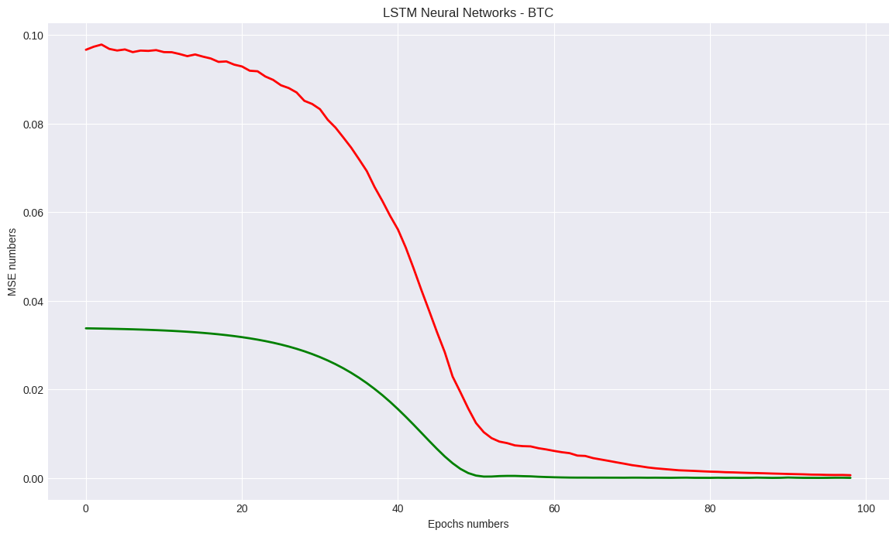

```python
# Save the model weights
file_path = "/content/drive/MyDrive/Colab Notebooks/AI Projects/4 Timeseries Analysis/Crypto_Currency_Omdena/LSTM_BTC_weights.h5"  # Specify the file path where you want to save the weights
model.save_weights(file_path)
```

### 6 Model Evaluation and Validation

```python
## Prediction
preds = model.predict(X_test)
y_test = y[split_index:]
```

```output
206/206 [==============================] - 3s 7ms/step
```

```python
# Inverse normalize the predictions
preds = preds.reshape(-1, 1)
y_test = y_test.reshape(-1, 1)
preds = scaler.inverse_transform(preds)
y_test = scaler.inverse_transform(y_test)
```

```python
from sklearn.metrics import mean_squared_error
SCORE_MSE=mean_squared_error(preds, y_test)
SCORE_MSE
```

```output
1.0272767770123935e-05
```

$$r2-score$$


An R2 score of -3823.33% indicates that the model's performance is significantly worse than random chance. The R2 score, also known as the coefficient of determination, measures the proportion of the variance in the target variable that can be explained by the model. It ranges from negative infinity to 1, where 1 represents a perfect fit, 0 represents a model that performs no better than the mean, and negative values indicate that the model performs worse than the mean.

- A negative R2 score suggests that the model's predictions deviate substantially from the actual values and perform worse than a naive baseline model. This could be due to various reasons, such as inappropriate model selection, insufficient training data, or the lack of meaningful patterns in the data.


- Having a high positive R2 score suggests that the model captures the underlying patterns and relationships in the data accurately. It indicates that the model's predictions align closely with the actual values, and it performs significantly better than a baseline model or random chance.

  - A positive R2 score of 99 indicates that the model is performing exceptionally well and can explain 99% of the variance in the target variable. An R2 score of 1 represents a perfect fit, where the model can perfectly predict the target variable based on the features.

```python
from sklearn.metrics import r2_score
r2_score=r2_score(y_test, preds)
r2_score*100
```

```output
99.77120510111023
```

### 7 Residual Analysis and Model Refinement:

### 8 Forecast Visualization and Reporting

```python
fig, ax = plt.subplots(1, figsize=(13, 7))
ax.plot(y_test, label='actual', linewidth=3)
ax.plot(preds, label='prediction', linewidth=3)
ax.set_ylabel('BTC/USDT', fontsize=14)
ax.set_title('BTC', fontsize=16)
ax.legend(loc='best', fontsize=16);
```

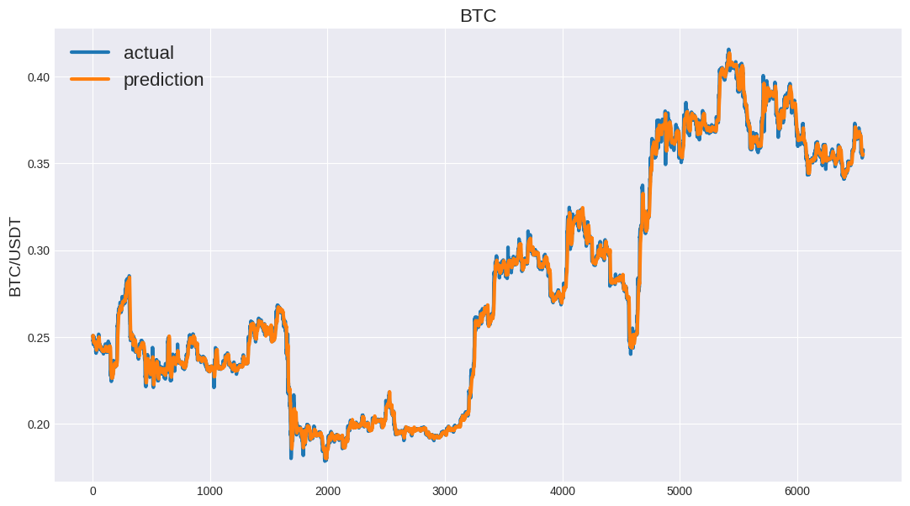

```python
scaler
```

<div class="nb-output">

<div id="sk-container-id-2" class="sk-top-container"><div class="sk-text-repr-fallback"><pre>MinMaxScaler()</pre><b>In a Jupyter environment, please rerun this cell to show the HTML representation or trust the notebook. <br />On GitHub, the HTML representation is unable to render, please try loading this page with nbviewer.org.</b></div><div class="sk-container" hidden><div class="sk-item"><div class="sk-estimator sk-toggleable"><input class="sk-toggleable__control sk-hidden--visually" id="sk-estimator-id-2" type="checkbox" checked><label for="sk-estimator-id-2" class="sk-toggleable__label sk-toggleable__label-arrow">MinMaxScaler</label><div class="sk-toggleable__content"><pre>MinMaxScaler()</pre></div></div></div></div></div>

</div>

```python
# Normalize the target data
scaler = MinMaxScaler()
target_data_normalized = scaler.fit_transform(target_data)
```

```python
y_test_inverse = scaler.inverse_transform(y_test)
pred_inverse = scaler.inverse_transform(preds)
```

```python
# Inverse normalize the predictions
preds_reshape = preds.reshape(-1, 1)
y_test_reshape = y_test.reshape(-1, 1)
preds_inv = scaler.inverse_transform(preds_reshape)
y_test_inv = scaler.inverse_transform(y_test_reshape)
```

```python
from sklearn.metrics import r2_score
test_mae_LSTM= round(mean_absolute_error(y_test_inv, preds_inv), 2)
test_rmse_LSTM = round(np.sqrt(mean_squared_error(y_test_inv, preds_inv)), 2)
test_r2_LSTM = round(r2_score(y_test_inv, preds_inv)*100, 2)
```

```python
from sklearn.metrics import r2_score
test_mae_LSTM= round(mean_absolute_error(y_test_inv, preds_inv), 2)
test_rmse_LSTM = round(np.sqrt(mean_squared_error(y_test_inv, preds_inv)), 2)
test_r2_LSTM = round(r2_score(y_test_inv, preds_inv)*100, 2)
```

```python
print(test_mae_LSTM)
print(test_rmse_LSTM)
print(test_r2_LSTM)
```

```output
123.66
206.74
99.77
```

```python
fig, ax = plt.subplots(1, figsize=(13, 7))
ax.plot(y_test_inv, label='actual', linewidth=3)
ax.plot(preds_inv, label='prediction', linewidth=3)
ax.set_ylabel('BTC', fontsize=14)
ax.set_title('BTC', fontsize=16)
ax.legend(loc='best', fontsize=16);
```

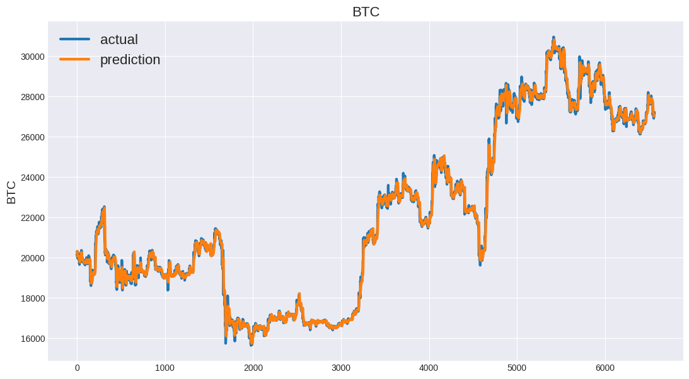
