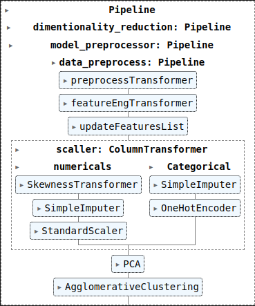

# Tabular Data - DATA MODELING - PIPELINE

> One diagram of a scikit-learn pipeline: preprocessing, scaling, PCA, then agglomerative clustering, chained into a single flow. By the end you'll see why people wire the steps together instead of running them by hand.

A pipeline is a recipe written down. Data goes in at one end, passes through each step in order, and comes out the other as clusters. Same steps, same order, every time.

# Table of Content
- [Tabular Data - DATA MODELING - PIPELINE](#tabular-data---data-modeling---pipeline)
- [Table of Content](#table-of-content)
- [PipeLine](#pipeline)

# PipeLine

